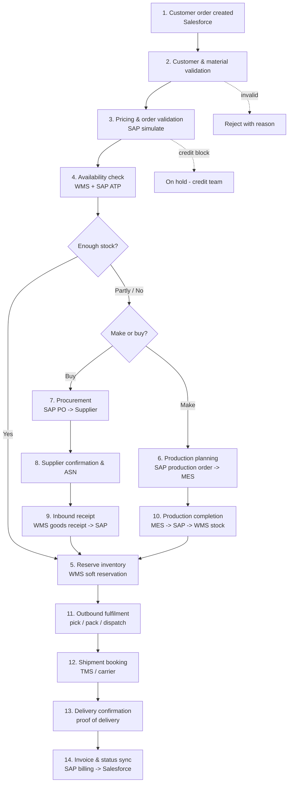
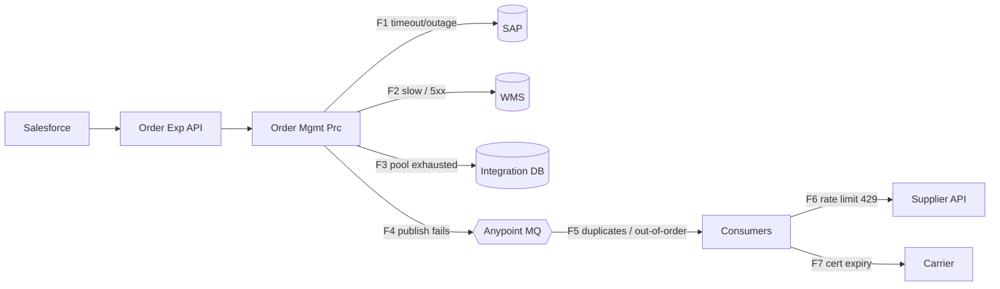

# 01.2 — End-to-End Business Process (Order-to-Cash + Procure-to-Pay + Plan-to-Produce)

`Essential`

The AIM platform links three classic supply chain processes:

- **Order-to-Cash (O2C):** customer order → delivery → invoice.
- **Procure-to-Pay (P2P):** shortage → purchase order → supplier → goods receipt.
- **Plan-to-Produce (P2P-M):** shortage of a manufactured item → production order → MES → finished goods.

## Step-by-step: what happens, who owns it, sync or async

| # | Step | Owner / SoR | Mule API involved | Sync or async | Why |
|---|------|-------------|-------------------|---------------|-----|
| 1 | Customer order created | Salesforce | Customer Order Exp API | **Sync** (request/response) | The rep needs immediate feedback |
| 2 | Customer and material validation | SAP (master data) | Order Mgmt Prc → SAP Sys / Salesforce Sys | **Sync** | Reject bad orders at the door |
| 3 | Pricing and order validation | SAP | SAP Sys API (simulate) | **Sync** | Price must be shown and confirmed |
| 4 | Availability check | WMS (physical), SAP (ATP) | Inventory Prc API → WMS Sys | **Sync** | A promise date is needed now |
| 5 | Inventory reservation | WMS | Inventory Prc → WMS Sys | **Sync** with TTL | Prevents overselling during order creation |
| 5b | Create SAP sales order | SAP | SAP Sys API | **Sync within budget**, async fallback | See the timeout design in [02.6](../02-architecture/06-order-to-fulfilment-sequence.md) |
| 6 | Production planning | SAP PP → MES | Production & Fulfilment Prc | **Async** (event) | Takes minutes to days, so nobody waits |
| 7 | Procurement | SAP MM → SupplierHub | Procurement Prc | **Async** (event) | Buyers and suppliers work on business-day timelines |
| 8 | Supplier confirmation | SupplierHub | Supplier Exp API (callback) | **Async** (webhook, queued) | The supplier decides when |
| 9 | Inbound receipt | WMS → SAP | Warehouse Ops Exp → Inventory Prc | **Async** (event) | Physical event |
| 10 | Production completion | MES → SAP → WMS | Production Prc | **Async** (MES events) | Shop-floor event |
| 11 | Outbound fulfilment | WMS | Production & Fulfilment Prc | **Async** | Waves are planned by the warehouse |
| 12 | Shipment booking | TMS | Shipment & Delivery Prc | **Sync** call inside an async flow | Needs a booking number and label |
| 13 | Delivery confirmation | Carrier → TMS | Logistics Tracking Exp (webhook) | **Async** | Carrier pushes events |
| 14 | Invoice and status sync | SAP billing | Shipment Prc → SAP Sys, Salesforce Sys | **Async** | Downstream bookkeeping |

**Rule of thumb you can say in an interview:**
> "I keep a call synchronous only when a human or a calling system cannot continue without the answer, and only when the dependency can answer within the caller's timeout budget. Everything else becomes an event. That is why steps 1–5 are synchronous and steps 6–14 are event-driven."

## Transaction boundaries

There is **no distributed transaction** across SAP, WMS, Salesforce and the DB. XA is not supported by these systems over HTTP/RFC, and it would lock resources across organisations. Instead each step is a **local transaction** inside one system, and the steps are linked by a **saga** that has compensations.

| Boundary | What commits atomically | Technology |
|----------|-------------------------|------------|
| T1 | Idempotency key claim | Integration DB, single insert |
| T2 | WMS soft reservation | WMS (its own DB) |
| T3 | SAP sales order + schedule lines | SAP LUW (`BAPI_TRANSACTION_COMMIT`) |
| T4 | Order integration state + outbox events | Integration DB, **one local transaction** (outbox pattern) |
| T5 | Event delivery | Anypoint MQ (at-least-once) |
| T6 | Each consumer's work + inbox record | Consumer's local transaction |

**Compensations (the saga's undo steps):**

| If this fails… | …after this succeeded | Compensate by |
|----------------|-----------------------|---------------|
| SAP sales order creation (definitive business error, e.g. credit block) | WMS reservation | Release the reservation (`DELETE /reservations/{id}`) |
| SAP outcome **unknown** (timeout) | WMS reservation | **Do not compensate.** Query SAP by external reference, then retry or confirm (see [14.1](../14-interview-scenarios/01-sap-timeout-after-commit.md)) |
| Customer cancels | SAP order + PO created | Cancel the SAP order and send a PO change/cancel to the supplier if it is not yet shipped |
| Shipment booking fails | Dispatch done in WMS | Retry booking, or escalate to the logistics desk. Dispatch is a physical act and cannot be "undone" |

> **Senior insight:** Some steps are **not compensatable**, because physical goods already moved. For those, the saga moves *forward*: retry, then escalate to a human work queue. Say this explicitly in interviews.

## Dependencies and failure points

| ID | Failure point | Business consequence if unhandled | Handling summary |
|----|---------------|-----------------------------------|------------------|
| F1 | SAP timeout or outage | Lost or duplicate sales orders | Lookup by reference, async retry, circuit breaker |
| F2 | WMS slow | Order intake latency breaches the SLA | Timeout budget, bulkhead, cached availability for display |
| F3 | DB pool exhausted | All flows stall | Pool sizing, short transactions, alerts |
| F4 | Event publication fails after the DB commit | Downstream never learns of the order | **Transactional outbox** |
| F5 | Duplicate or out-of-order events | Duplicate POs or shipments | Idempotent receiver, inbox, sequence/version checks |
| F6 | Supplier rate limiting | PO transmission backlog | Client-side throttling, queue-based load levelling |
| F7 | Certificate expiry | Carrier integration down | Certificate inventory with 30/14/7-day alerts |

## Business consistency requirements

| Requirement | Consistency model | Why it is acceptable |
|-------------|-------------------|----------------------|
| An order must never be lost once acknowledged to Salesforce | **Durable before ack** (persist, then respond) | Losing a customer order is unacceptable |
| An order must never be created twice in SAP | **Idempotent** creation (key + lookup by reference) | A duplicate order means a duplicate shipment and invoice |
| Salesforce status may lag SAP | **Eventual** (target < 1 minute, assumption) | Reps tolerate a short delay |
| WMS and SAP inventory may differ temporarily | **Eventual + reconciliation** every 4 h and nightly | They are different granularities and the timing of physical moves differs |
| Invoice exactly once per delivery | Idempotent on delivery number, SAP duplicate check | Financial and legal requirement |
| A PO exactly once per shortage line | Idempotency key `{orderId}:{material}:{plant}` | Prevents excess stock |

Next: [03 — Requirements](03-requirements.md)
