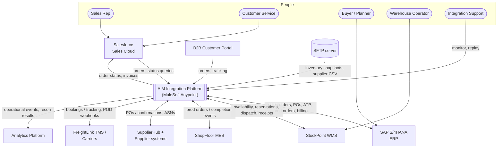

# 02.1 — Business System Context Diagram (Diagram 1)

`Essential`

A **system context diagram** answers one question: *who and what does the platform talk to, and what flows between them?* It contains no internals. Draw this first in any design discussion or whiteboard interview.

## Walkthrough

| Element | What it is | What flows | Direction and style |
|---------|-----------|------------|---------------------|
| **Sales Rep / Customer Service** | Humans who use Salesforce | Indirect: they never call MuleSoft | — |
| **Salesforce** | CRM where orders are captured | Order submission, status queries in; status and invoice updates out | Sync REST in, async updates out |
| **B2B Portal** | Self-service channel for large customers | Orders and tracking | Sync REST |
| **SAP S/4HANA** | ERP and the system of record for orders, POs, materials and invoices | Bidirectional | Sync RFC/BAPI or OData calls. IDocs for some outbound flows |
| **WMS** | Physical stock, reservations, pick/pack/ship | Bidirectional | Sync REST + async webhooks (dispatch, receipt) |
| **MES** | Shop-floor execution | Production orders in, progress and completion events out | Async events |
| **SupplierHub** | Supplier collaboration | POs out. Confirmations and ASNs in | REST + webhooks (large suppliers), SFTP CSV (small ones) |
| **TMS / Carriers** | Shipment booking and tracking | Booking requests out. Tracking and proof-of-delivery webhooks in | Sync REST out, async webhooks in |
| **SFTP** | File drop zone | Nightly WMS snapshots, supplier price lists | Scheduled polling |
| **Analytics** | Reporting / data warehouse | Business events, reconciliation results | Async (subscribe) |
| **Integration Support** | L2/L3 support team | Monitoring, DLQ replay | Anypoint Monitoring + replay API |

### Decision points shown by the diagram
- **External vs internal parties.** Suppliers, carriers and the B2B portal sit *outside* AIM's network, so they need stronger security (mTLS, IP allow-lists, separate ingress). See [10.1](../10-security-governance/01-security-architecture.md).
- **Humans work in their own systems.** Buyers use SAP and warehouse staff use the WMS. MuleSoft automates the hand-offs *between* systems. It does not replace user interfaces.

## Real-time scenario: using this diagram in an interview
> *Interviewer:* "Walk me through your integration landscape."
>
> *You:* "Start with the context. Salesforce and a B2B portal are the order channels. SAP S/4HANA is the system of record for orders, materials, POs and invoices. The WMS owns physical stock and the MES owns shop-floor execution. Externally we talk to suppliers through SupplierHub, both REST and SFTP, and to carriers through a TMS with webhooks. A PostgreSQL integration database holds our own integration state, and Anypoint MQ is the event backbone. MuleSoft sits in the middle with API-led layers…" *(then move to [02.3](03-api-led-architecture.md)).*

## Common mistakes
- Drawing the Mule apps inside the context diagram. Keep the context view *black-box*.
- Forgetting the humans and the support team. Operability is a senior concern.
- Not stating the **system of record** for each entity ([01.1 §4](../01-business-domain/01-business-scenario.md#4-key-business-entities-and-their-system-of-record-sor)).

Next: [02.2 High-level integration architecture](02-integration-architecture.md)
