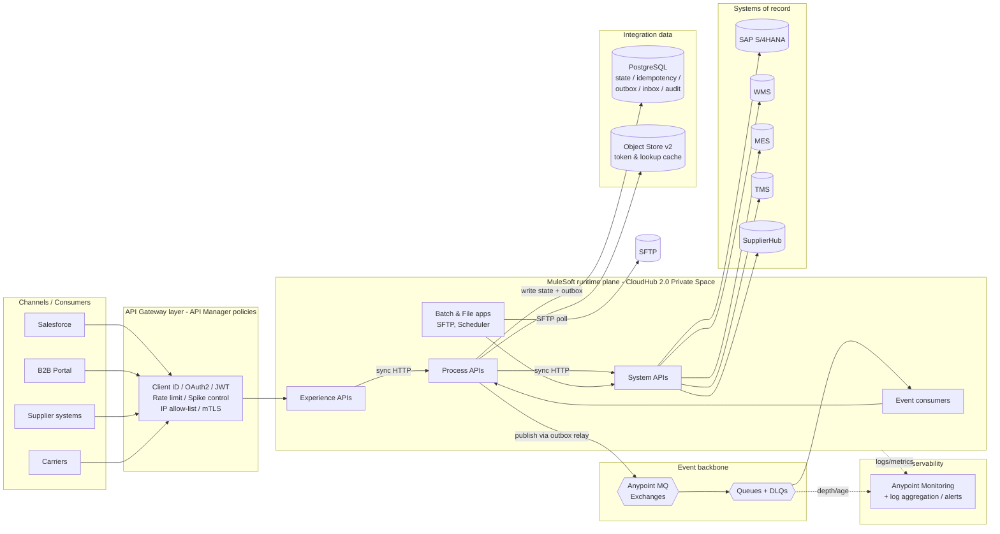

# 02.2 — High-Level Enterprise Integration Architecture (Diagram 2)

`Essential`

This view opens the black box. It shows **which integration styles** are used (synchronous APIs, events, batch/files) and **where the shared platform services** sit.

## Component-by-component explanation

| Zone | Purpose | Key decisions |
|------|---------|---------------------|
| **Gateway (API Manager policies)** | Cross-cutting security and traffic control *before* business logic | Policies run on the Mule runtime itself (or on Flex Gateway for non-Mule APIs). That keeps rate limits and auth out of the code |
| **Experience APIs** | Channel-shaped contracts (Salesforce, suppliers, warehouse, logistics) | Thin layer: security, request validation, mapping to canonical. **No business rules** |
| **Process APIs** | Business orchestration: order, inventory, procurement, production, shipment | Owns the saga, idempotency and the outbox. This is where the manufacturing logic lives |
| **System APIs** | One per backend. Hide SAP BAPIs, WMS REST quirks, auth and retries | Reusable by any Process API. A canonical-ish contract with no consumer-specific logic |
| **Batch & file apps** | Bulk inventory, supplier files, reconciliation | Scheduler + SFTP + Batch Job. Isolated from online traffic (bulkhead) |
| **Event consumers** | Subscribe to queues and perform async steps | Idempotent receivers with an inbox table, DLQ after N redeliveries |
| **Anypoint MQ** | Pub/sub (exchanges) + point-to-point (queues) + DLQs | Standard queues for most events. **FIFO** for supplier confirmations per PO (ordering) |
| **PostgreSQL** | Integration state owned by Mule apps | Not a business system of record. Each Process API owns its own schema |
| **Object Store v2** | Small key-value cache (tokens, lookup tables) | Not used for idempotency of critical financial operations. The DB is used, because it gives transactional guarantees |
| **Observability** | Logs, metrics, traces, alerts | Correlation ID across HTTP and MQ hops |

## Sync vs async vs batch — where each style appears

| Style | Used for | Examples |
|-------|----------|----------|
| **Synchronous API** | Interactive needs with a short answer | Order submission, availability, order status |
| **Event-driven (MQ)** | Long-running or multi-consumer steps | Shortage → procurement, dispatch → shipment booking, status → Salesforce + analytics |
| **Webhook in → queue** | Partner callbacks | Supplier confirmations, carrier tracking: ack fast, process async |
| **Batch / file** | High volume, not urgent | Nightly 2M-row inventory snapshot, supplier price files |
| **Polling / CDC** | Systems that cannot push | SAP change pointers / IDocs for material master changes, polling the WMS for adjustments |

## Architectural rationale and alternatives

| Decision | Chosen | Alternative | Why chosen / trade-off |
|----------|--------|-------------|------------------------|
| Event backbone | **Anypoint MQ** | Kafka (Confluent / MSK) | MQ is managed, built into Anypoint, has DLQs, FIFO and simple ops. **Kafka** wins for replayable logs, very high throughput (> 10k msg/s), stream processing and long retention. Choose Kafka if analytics needs a replayable event log |
| Integration state store | **PostgreSQL** | Object Store v2 only | We need transactions (state + outbox in one commit), queries for reconciliation and long retention. OSv2 has none of these |
| Deployment | **CloudHub 2.0 Private Space** | Runtime Fabric on-prem / hybrid | A managed platform with a private network to SAP via VPN / Transit Gateway. RTF is chosen when data residency or on-prem-only SAP access demands it |
| SAP access | **SAP Connector (BAPI/RFC + IDoc)** | SAP OData APIs via HTTP | BAPIs give rich create/simulate operations. OData is simpler (HTTP, no JCo libraries) and is preferred for S/4HANA Cloud. We keep both behind the SAP System API so consumers do not care |

## Limitations (say these before the interviewer does)
- The architecture is **eventually consistent** between SAP, the WMS and Salesforce. Reconciliation is therefore mandatory, not optional.
- Anypoint MQ is **at-least-once**, so every consumer must be idempotent.
- More layers mean more network hops and more latency. We cap the chain at Exp → Prc → Sys and use timeout budgets ([12.1](../12-performance/01-timeouts-retries-pools.md)).

Next: [02.3 API-led architecture](03-api-led-architecture.md)
