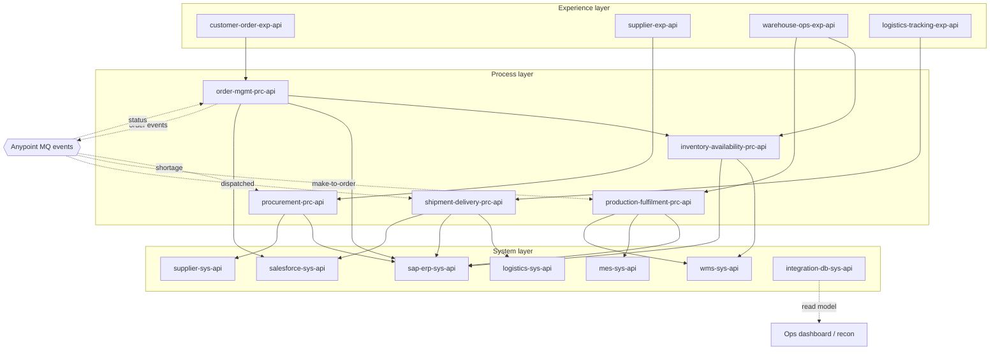

# 02.3 — API-Led Connectivity Architecture (Diagram 3)

`Essential`

**API-led connectivity** organises integrations into three layers. Each layer has one kind of responsibility:

| Layer | Answers the question | Changes when… | Owned by (typical) |
|-------|----------------------|---------------|--------------------|
| **Experience** | "What does *this consumer* need, in its shape?" | A channel changes (new Salesforce screen, new supplier format) | Channel / LoB teams |
| **Process** | "What is the *business process*?" | Business rules change (new shortage policy) | Integration / domain teams |
| **System** | "How do I talk to *this backend* safely?" | A backend changes (SAP upgrade, WMS v3 API) | Platform / backend-aligned teams |

## How to read it
- **Solid arrows** are synchronous HTTP calls. **Dotted arrows** are asynchronous events through Anypoint MQ.
- Calls only go **down** (Exp → Prc → Sys) or **sideways within the Process layer** (Order → Inventory) when one process reuses another's capability.
- Process APIs talk to each other **through events** for long-running hand-offs (Order → Procurement), never through deep synchronous chains.

## Responsibilities by API (summary — details in [04.1](../04-api-design/01-api-catalogue.md))

| API | Responsibility | Not its responsibility |
|-----|----------------|------------------------|
| customer-order-exp-api | Salesforce/portal contract, OAuth scopes, request validation, mapping to canonical order | Pricing rules, SAP mapping |
| supplier-exp-api | Supplier-facing contract (PO confirmations, ASNs), mTLS, accepts EDI-like JSON | Updating SAP directly |
| warehouse-ops-exp-api | WMS webhooks (receipt, dispatch), handheld queries | Inventory reconciliation logic |
| logistics-tracking-exp-api | Carrier webhooks, tracking query for the portal | Invoice triggering |
| order-mgmt-prc-api | Order saga: validate → reserve → SAP order → events. Idempotency. Status | Talking to SAP directly with RFC (it uses the SAP Sys API) |
| inventory-availability-prc-api | Aggregates WMS + SAP ATP, reservation lifecycle, inventory recon | Creating POs |
| procurement-prc-api | Shortage → PR/PO, supplier confirmation handling, **duplicate PO prevention** | Supplier-specific formats |
| production-fulfilment-prc-api | Make-to-order production orders, MES events, outbound fulfilment | Carrier booking |
| shipment-delivery-prc-api | Shipment booking, tracking, POD → billing, invoice sync | Order creation |
| sap-erp-sys-api | BAPI/OData/IDoc access, SAP error translation (RETURN table), connection pooling | Business decisions |
| salesforce-sys-api | Account lookup, order status upsert (external ID), Composite/Bulk API usage | Order orchestration |
| wms-sys-api | Availability, reservations, outbound orders, WMS auth | Choosing a DC |
| supplier-sys-api | Sends POs to SupplierHub, rate-limit-aware client | Deciding what to buy |
| logistics-sys-api | Carrier/TMS booking and tracking, label retrieval | Delivery business rules |
| mes-sys-api | Release production orders to MES, query progress | Production scheduling |
| integration-db-sys-api | Read-only access to audit / recon / order state for the ops UI and analytics | Writing business data |

> **Why does the Database System API exist when Process APIs write to the DB directly?**
> Each Process API **owns its own integration tables** and writes to them locally. That is the only way to get *state + outbox in one local transaction*. The Database System API is a **read model** for ops dashboards and analytics. It stops external teams from connecting to the database directly. This is a deliberate exception to "everything through System APIs", and you should be ready to defend it.

## Avoiding the classic API-led anti-patterns

| Anti-pattern | Symptom | How AIM avoids it |
|--------------|---------|-------------------|
| **Duplicated business logic** | Shortage rules coded in both the Exp and Prc layers | Rules live only in Process APIs. Exp does schema validation only |
| **Unnecessary layers** | A "pass-through" Process API that just forwards to one System API | Allowed to skip: e.g. `logistics-tracking-exp-api` GET tracking → `logistics-sys-api` directly when no orchestration exists (documented in an ADR) |
| **Circular dependencies** | Order Prc calls Inventory Prc, which calls Order Prc | Rule: Prc→Prc sync calls must follow a **DAG** (Order → Inventory only). Reverse direction is by event only |
| **Chatty deep chains** | 5+ sync hops, so latency and failure probability multiply | Max chain Exp → Prc → (Prc) → Sys. Timeout budget enforced |
| **Tightly coupled canonical model** | One giant "Order" model forced on every system | A **small canonical model** per domain + anti-corruption mapping in System APIs |
| **System API that leaks the backend** | Exposes `VBELN`, `POSNR`, BAPI names to consumers | The SAP Sys API returns `salesOrderNumber`, `lineNumber` |
| **Process API owning a channel format** | Process returns Salesforce field names | Exp maps canonical → channel |

## Trade-offs (be honest in interviews)
- **Pros:** reuse (the SAP Sys API serves 5 processes), change isolation (SAP upgrade = one app), parallel team delivery, clear security zones, discoverability via Exchange.
- **Cons:** more apps (more vCores and cost), extra latency per hop (~10–50 ms on the same network), more deployment/versioning overhead, and a risk of "layering for its own sake".
- **When not to use 3 layers:** one-off, low-value, single-consumer integrations; very-high-throughput streaming (use event streaming); file-to-file transfers (an MFT tool may be cheaper).

Next: [02.4 Component diagram](04-component-diagram.md)
