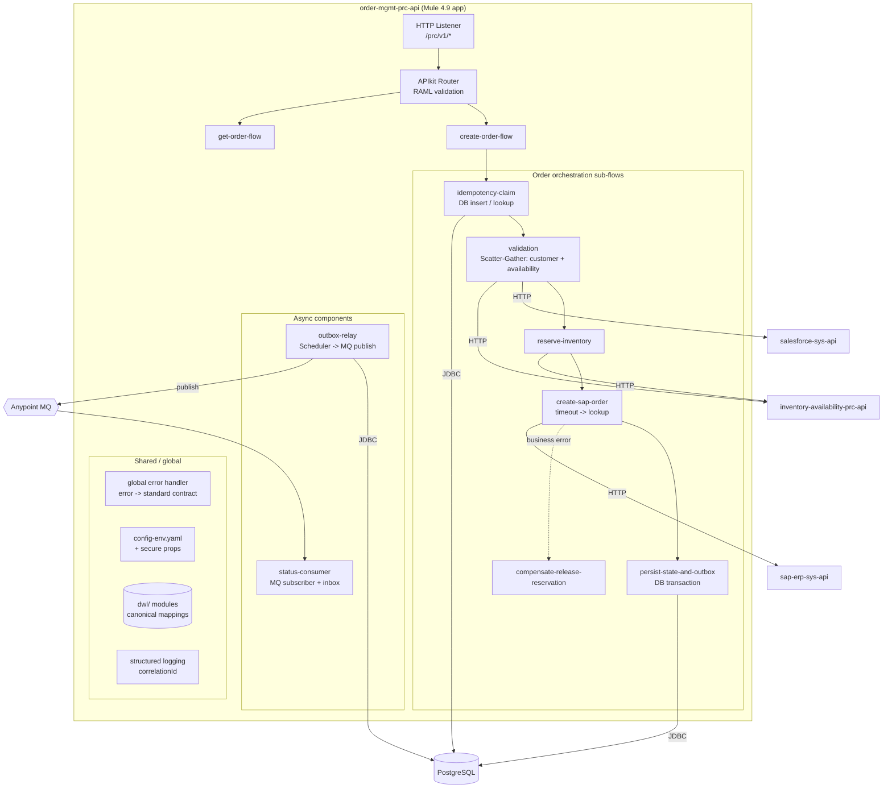

# 02.4 — Mule Application Component Diagram (Diagram 4)

`Essential`

This view zooms into **one Mule application**, `order-mgmt-prc-api`, and shows its internal building blocks. A senior developer is expected to know how a well-structured Mule app is organised, not just how to drag connectors.

## Component explanations

| Component | Mule building blocks | Why it is separate |
|-----------|---------------------|--------------------|
| **HTTP Listener + APIkit Router** | `http:listener`, `apikit:router` | Contract-first. Invalid requests are rejected *before* any flow logic runs |
| **create-order-flow** | `flow` calling `flow-ref`s | Keeps the main flow readable as a sequence of business steps |
| **idempotency-claim** | `db:insert` in `try` + `db:select` | A unique key is claimed atomically. It decides whether to process, replay or reject |
| **validation** | `scatter-gather` with 2 routes | Customer check and availability are independent, so they run in parallel and save latency |
| **reserve-inventory** | `http:request` to the Inventory Prc API | Soft reservation with TTL |
| **create-sap-order** | `http:request` with `responseTimeout`, `try` + `on-error-continue` for `HTTP:TIMEOUT` | Encapsulates the "unknown outcome" logic |
| **compensate-release-reservation** | `http:request DELETE` | A saga step. Called only on *definitive* failure |
| **persist-state-and-outbox** | `try transactionalAction="ALWAYS_BEGIN"` + 2× `db:insert` | State and event are committed atomically (outbox pattern) |
| **outbox-relay** | `scheduler` + `db:select` + `anypoint-mq:publish` + `db:update` | Decouples publication from the request and survives broker outages |
| **status-consumer** | `anypoint-mq:subscriber` + inbox insert | Idempotent receiver for downstream status events |
| **global error handler** | `error-handler` referenced by `configuration defaultErrorHandler-ref` | One error contract for all flows |
| **config + secure props** | `configuration-properties`, `secure-properties:config` | One artifact for every environment. Secrets encrypted |
| **DataWeave modules** | `src/main/resources/dwl/*.dwl` | Reusable, unit-testable mappings |

## Data flow inside the app (create order)
1. The listener receives JSON and APIkit validates it against RAML. A bad request gets **400** immediately.
2. `idempotency-claim` inserts `(Idempotency-Key, hash)`. A duplicate gets the **stored response replayed**, or **409** if the first request is still in progress.
3. The Scatter-Gather calls Salesforce Sys (customer) and Inventory Prc (availability) in parallel. Both results merge into `vars.validation`.
4. Choice: if the customer is blocked, the request fails with **422**. Otherwise the order goes on to reservation.
5. The SAP call runs with a 6 s timeout. On timeout, the app looks the order up by external reference. If it is still unknown, the order is marked `PENDING_ERP` and an `erp-retry` event is emitted.
6. The DB transaction commits the order state and the outbox rows. The app responds with **201** or **202**.
7. Separately, the outbox relay publishes the events and the status consumer updates Salesforce.

## Design alternatives
- **One flow with everything inline** is easy to write but hard to test and review. Use sub-flows and private flows so each step can be MUnit-tested and mocked.
- **`sub-flow` vs private `flow`**: a `sub-flow` inherits the caller's error handling and can't have its own handler. A private `flow` (no source) can have its own error handler. Use private flows when the step needs its own error strategy, e.g. `create-sap-order`.
- **Outbox relay inside the same app vs a separate app**: the same app is simpler. A separate app scales independently and isolates scheduler load. AIM keeps the relay in-app at first and splits it if volume grows.

> Implemented for real in the mini project: [`prc-order-management.xml`](../mule-project/aim-order-integration/src/main/mule/prc-order-management.xml).

Next: [02.5 Deployment architecture](05-deployment-architecture.md)
