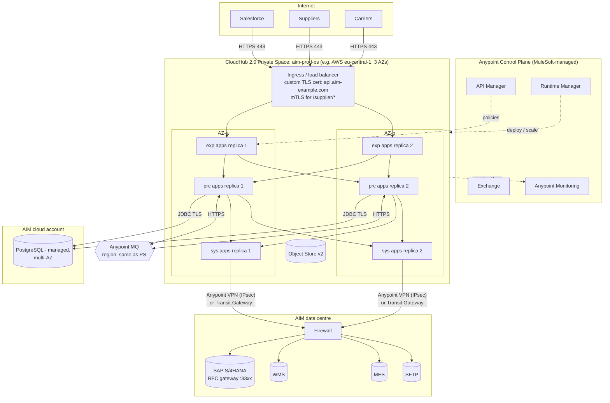

# 02.5 — Runtime Deployment Architecture (Diagram 5)

`Essential` (CloudHub 2.0) · `Advanced` (hybrid/RTF details)

*Platform capabilities can vary by release and contract. Check each one against the MuleSoft CloudHub 2.0 documentation for your control plane (US/EU/Gov).*

## Elements explained

| Element | Purpose | Key configuration |
|---------|---------|-------------------|
| **Control plane** | Runtime Manager (deploy, scale, properties), API Manager (policies, contracts), Exchange (assets), Monitoring | MuleSoft-hosted. Data plane traffic does not pass through it |
| **Private Space** | An isolated virtual network for AIM's apps | A dedicated CIDR (must not overlap on-prem ranges), firewall rules, custom domains/TLS |
| **Ingress** | Routes public and internal hostnames to apps | Custom certificate, **mTLS** for supplier endpoints, path-based routing. Internal-only apps (System APIs) get **no public endpoint** |
| **Replicas across AZs** | High availability | ≥ 2 replicas for Exp/Prc in prod. Spread across zones |
| **System APIs** | Only these reach on-prem | Private connectivity via **Anypoint VPN** (IPsec) or **Transit Gateway**. The firewall allow-lists only the Private Space CIDR → SAP RFC/HTTPS ports |
| **PostgreSQL** | Integration state | Managed multi-AZ DB, TLS, connection pools sized per replica |
| **Anypoint MQ** | Events | Same region as the Private Space for latency and data residency |
| **Object Store v2** | Caches | Per-app, region-bound |

## Sizing (assumption-based starting point)

| App | Replicas (prod) | Replica size (vCore) | Reasoning |
|-----|-----------------|----------------------|-----------|
| customer-order-exp-api | 2 | 0.5 | Thin, I/O-bound |
| order-mgmt-prc-api | 2–4 (autoscale if enabled) | 1 | Orchestration + DW + DB |
| sap-erp-sys-api | 2 | 1 | SAP JCo + XML mapping is memory-heavy |
| wms/salesforce/supplier/logistics/mes sys | 2 each | 0.5 | Simple I/O |
| inventory-batch-app | 1 | 2 | Batch memory/threads. Runs nightly |
| event consumers | 2 | 0.5 | Scale on queue depth |

> **Cost reality check:** API-led has a cost. 16 APIs × 2 replicas is a lot of capacity. Seniors propose **consolidating low-traffic System APIs** into fewer, larger apps where justified, and they record the trade-off in an ADR.

## Environments
`sandbox-dev` → `sandbox-qa` → `sandbox-uat` (prod-like, connected to SAP QA) → `production`. Each environment has its own Private Space or namespace, its own MQ queues (`dev-`, `qa-` prefixes), separate DB schemas, and separate client credentials. **Never share credentials across environments.**

## Alternatives

| Option | When to choose it | Trade-off |
|--------|-------------------|-----------|
| **CloudHub 1.0** (workers, VPC, DLB) | Existing estates, simple apps | Older model. Still supported, but new features target CH2.0. Plan migrations: persistent VM queues and DLB rules need rework |
| **Runtime Fabric (RTF)** on customer Kubernetes (EKS/AKS/GKE/OpenShift) | Data must stay in AIM's network, or SAP is reachable only on-prem | AIM operates the K8s cluster. More control, more ops burden |
| **Hybrid** (customer-hosted Mule runtimes managed by Runtime Manager) | Plant-floor integrations near the MES with low latency and WAN-outage tolerance | You patch servers, run clustering and handle scaling yourself |

**AIM decision (recorded in an ADR):** CloudHub 2.0 for all APIs, plus a **hybrid runtime inside each plant** for MES integration, so production events still buffer locally if the WAN link to the cloud fails. This is a strong talking point because it shows you think about factory networks.

Next: [02.6 Primary order-to-fulfilment sequence](06-order-to-fulfilment-sequence.md)
