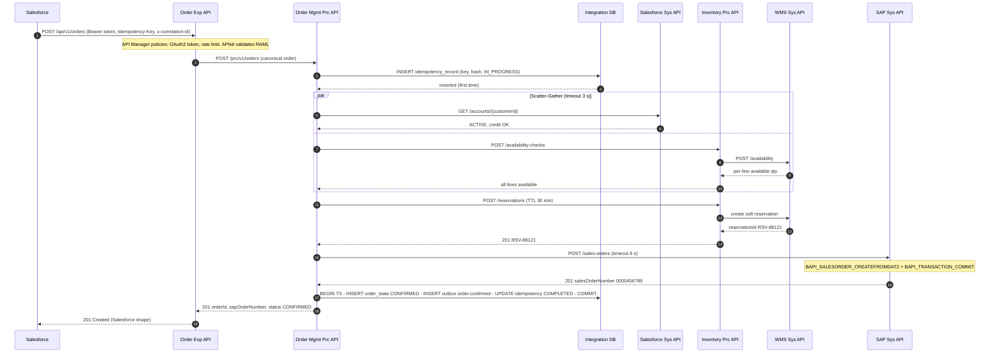
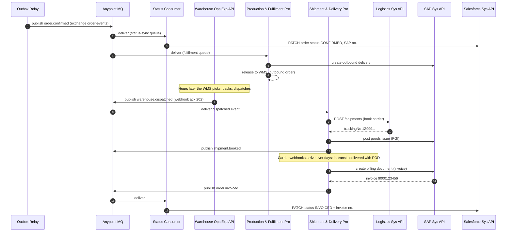

# 02.6 — Primary Order-to-Fulfilment Sequence (Diagram 6: Successful Order)

`Essential`

This is the most important diagram in the kit. **Practise drawing it from memory.**

## Part A — Synchronous order intake (happy path)

### Step-by-step explanation

| Step | What and why | Failure handling at this step |
|------|-------------|-------------------------------|
| 1 | Salesforce sends the order with a client-generated **Idempotency-Key** (e.g. the Salesforce Order Id) and a correlation ID | If Salesforce times out, it retries **with the same key**, which makes the retry safe |
| 2 | Policies reject unauthenticated or over-limit calls before they use app threads | 401/403/429 returned by the gateway |
| 3 | Exp maps the Salesforce shape to the canonical shape. It holds **no business rules** | Mapping errors return 400 with field details |
| 4–5 | Atomic key claim. A unique constraint guarantees that only one request "wins" | Duplicate → replay the stored response or 409 (see [Diagram 9](../03-uml-diagrams/02-failure-recovery-sequences.md)) |
| 6–12 | **Scatter-Gather**: customer and availability checks are independent, so they run in parallel. Latency = max(route), not the sum | Any route failing → `MULE:COMPOSITE_ROUTING`, then 502. Business failures (blocked customer) → 422 |
| 13–17 | Soft reservation prevents another order taking the same stock while SAP is called | WMS down → fail fast (503) *before* SAP. Nothing to compensate yet |
| 18–20 | SAP order creation. The **6 s timeout** fits inside the overall budget | Timeout → lookup by reference ([Diagram 8](../03-uml-diagrams/02-failure-recovery-sequences.md)). Business error → release the reservation (compensation) |
| 21 | **One local DB transaction**: state + outbox + idempotency completion | DB failure → the request fails. The SAP order exists, so the **reconciliation job** detects the SAP order without Mule state and repairs it |
| 22–23 | Respond only after the commit (**persist-then-respond**) | If the client times out *here*, its retry gets the stored response |

### Timeout budget (assumption)

| Hop | Timeout | Notes |
|-----|---------|-------|
| Salesforce → Exp | 15 s (client) | Salesforce callout limit is higher, but our UX target is lower |
| Exp → Prc | 12 s | Must be < the client timeout |
| Scatter-Gather | 3 s | Each route ≤ 2.5 s |
| Prc → Inventory (reserve) | 2 s | |
| Prc → SAP Sys | 6 s | SAP p95 is ~1.5 s (assumption) |
| **Sum of worst case** | ~11.5 s | < 12 s ✔. Each **inner timeout must be smaller than the outer one** |

## Part B — Asynchronous fulfilment (after confirmation)

### Explanation
- **Steps 1–3:** The outbox relay publishes **after** the DB commit. The status consumer updates Salesforce. If Salesforce is down, the message is retried and, after N attempts, sent to the DLQ. The order itself is unaffected.
- **Steps 4–6:** The fulfilment consumer creates the SAP outbound delivery and releases it to the WMS. It is idempotent on `deliveryNumber`.
- **Steps 7–8:** The WMS dispatch arrives as a **webhook**. The Warehouse Exp API acknowledges it fast (202) and puts it on a queue, because webhook senders often time out within seconds.
- **Steps 9–12:** Shipment booking is a synchronous call *inside* an asynchronous consumer. Post goods issue in SAP updates financial inventory.
- **Steps 13–17:** The delivery POD triggers billing. **Invoice creation is idempotent on the delivery number**, so a replayed POD cannot create a second invoice.

## Why this design (interview summary)
> "The synchronous part stops at SAP order confirmation, because that's what the sales rep needs. It's protected by an idempotency key, parallel validation and a strict timeout budget. Everything after that is event-driven through Anypoint MQ, published via a transactional outbox so we never lose an event after committing state. Every consumer is an idempotent receiver, because MQ guarantees at-least-once delivery, not exactly-once."

**Alternatives considered:**
1. **Fully synchronous**, where the rep waits for the SAP order, the delivery and so on. Rejected: the latency is too long and SAP outages would block intake.
2. **Fully asynchronous**: always return 202 and process later. This is more resilient, but the rep loses the immediate SAP number and pricing. AIM uses it **only as a fallback** (SAP down or peak load), as a hybrid.

Continue to the remaining diagrams: [03-uml-diagrams](../03-uml-diagrams/01-shortage-procurement-and-mes.md)
