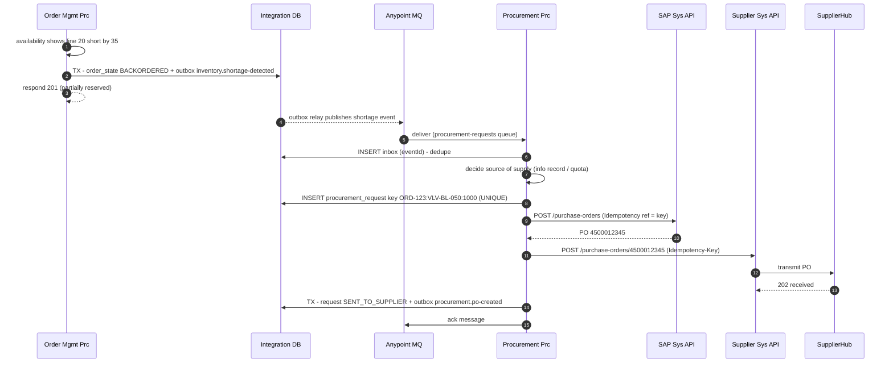
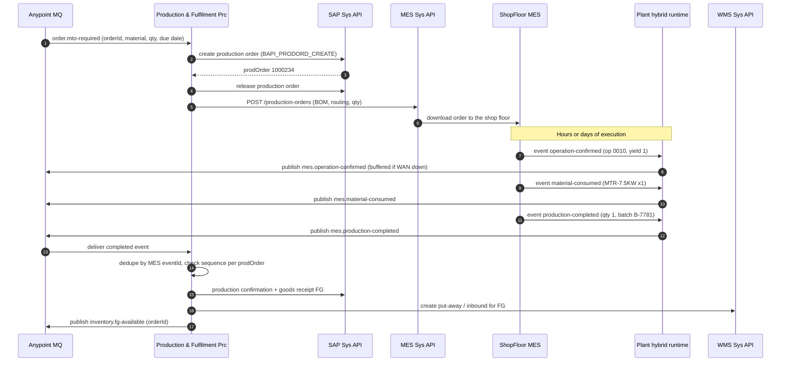

# 03.1 — Inventory Shortage, Procurement & MES Sequences (Diagrams 7 and 12)

`Essential`

## Diagram 7 — Inventory shortage and procurement

**Scenario:** An order needs 40 × `VLV-BL-050`, but only 5 are available. Valves are a **buy** item, so a PO goes to supplier `SUP-0042`.

**Explanation**
1–3. The order is **not blocked** by the shortage. It is confirmed with a partial reservation and a backorder flag, because the customer gets a promise date rather than an error.
4–6. The shortage event is delivered at least once, so an **inbox insert** (unique `eventId`) drops exact redeliveries.
7. **Source determination** (which supplier, price, lead time) comes from SAP info records and quota arrangements. It is not hard-coded in Mule.
8. **The business idempotency key** `{orderId}:{material}:{plant}` protects against *different* events about the same shortage. For example, an order is updated and two shortage events fire, so the inbox alone would not catch it.
9–10. The SAP PO is created with the key stored in a PO header text/reference field, so a timeout can be resolved by lookup.
11–13. The PO goes to the supplier with the same idempotency key, which SupplierHub honours.
14–15. State + next event are committed together, *then* the MQ message is acked. If Mule crashes before the ack, the message is redelivered, and steps 6 and 8 make the reprocessing harmless.

**Decision points:** Should shortages be aggregated per material across orders (MRP style) or raised per order? AIM raises per order for MTO/critical items and **lets SAP MRP aggregate** standard items. Mule only creates PRs and SAP converts them to POs. That's a good trade-off to discuss: *don't rebuild MRP in Mule.*

## Diagram 12 — Production planning and MES integration

**Scenario:** The order includes the make-to-order pump `PMP-CF-400-CUSTOM`. A production order must be created and executed on the shop floor.

**Explanation**
- **Hybrid runtime in the plant (steps 7–12):** MES events are produced locally. If the WAN to the cloud fails, the plant runtime buffers events in a persistent local queue, so production never stops for an IT outage. This is a deliberate decision in [02.5](../02-architecture/05-deployment-architecture.md).
- **Ordering:** The SAP confirmation for operation 0010 should be posted before goods receipt. Events carry `prodOrder` + `sequenceNo`. Consumers process per `prodOrder` in order, using a **FIFO queue with message group = prodOrder**. An event that arrives early is *parked* until the gap fills ([03.2 Diagram 10](02-failure-recovery-sequences.md)).
- **Duplicates (step 15):** MES devices often resend on reconnect, so the consumer dedupes by `eventId` *and* treats goods receipt as idempotent per `(prodOrder, batch)`.
- **Backflushing:** Material consumption can be posted per event or backflushed at completion. That's a business choice which changes the volume (many small events vs one). Ask about it in requirements.

**Failure handling:** If SAP is down, completion events stay in the queue with retry and backoff and the DLQ after N tries. Production continues. SAP catches up later, and inventory reconciliation verifies that no goods receipt was missed.

Next: [03.2 Failure & recovery sequences](02-failure-recovery-sequences.md)
