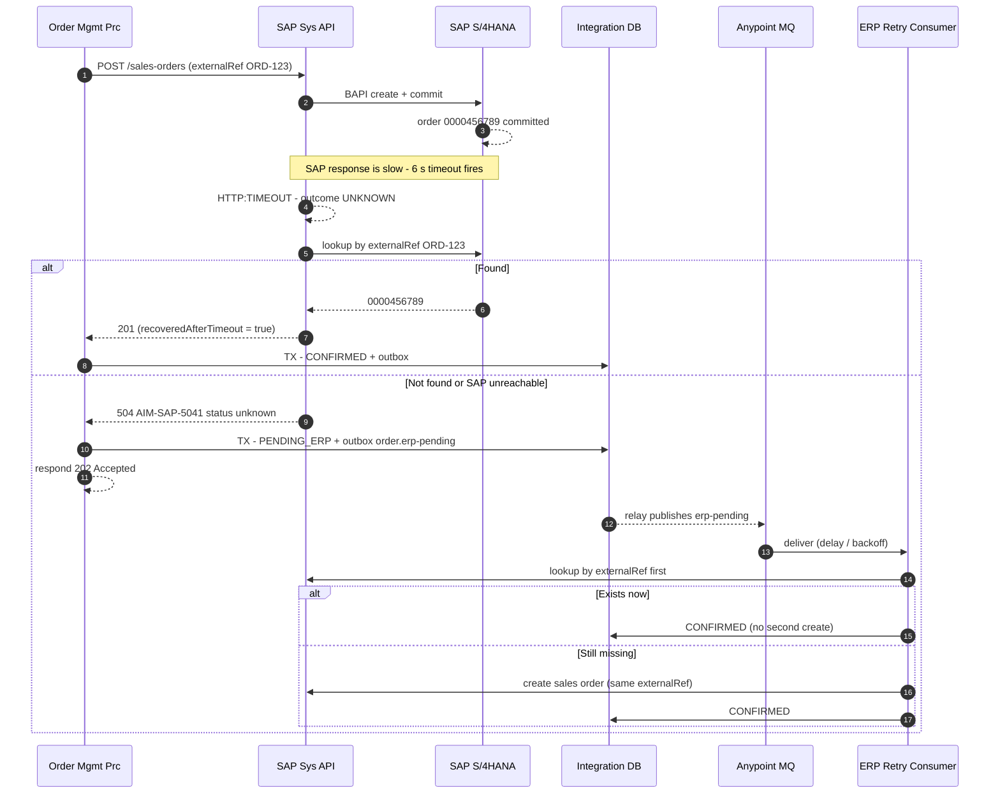
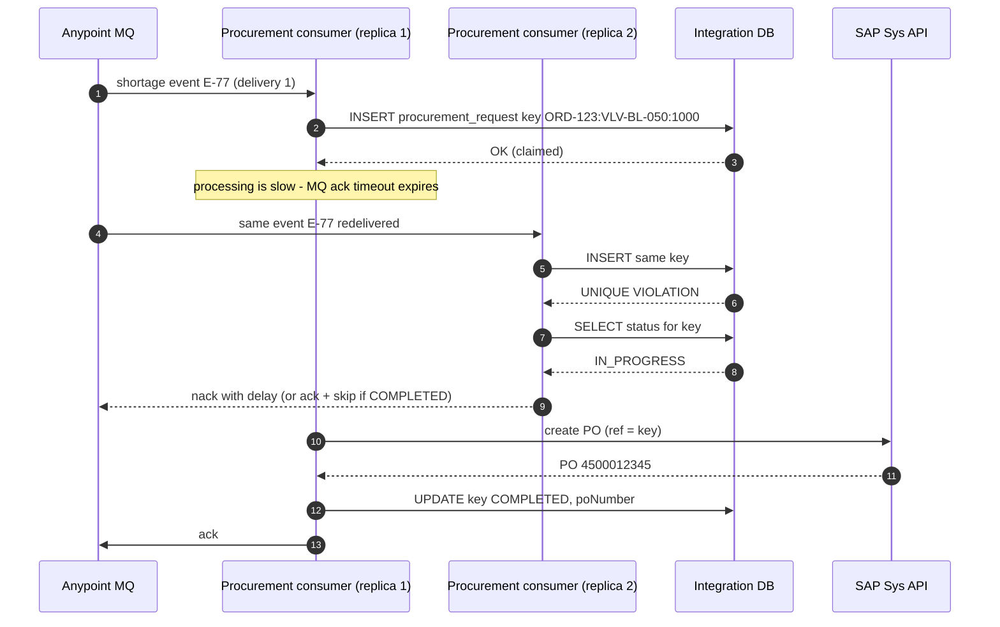
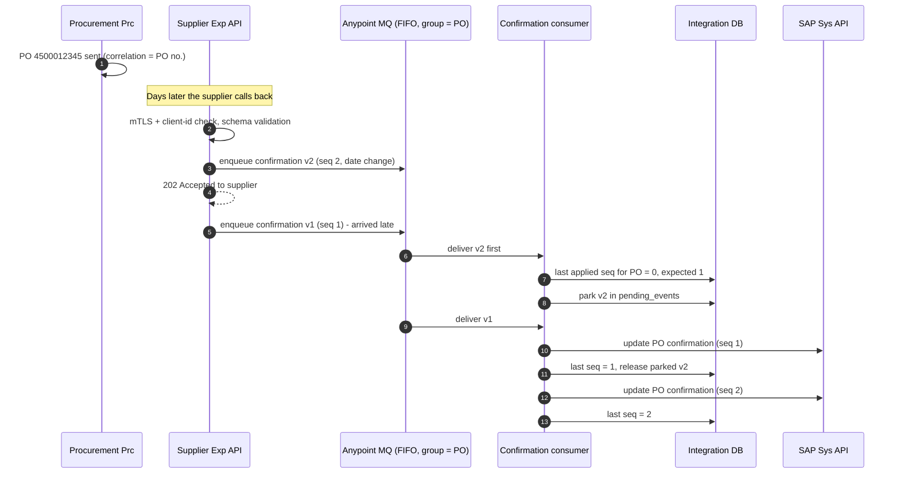

# 03.2 — Failure & Recovery Sequences (Diagrams 8, 9, 10)

`Essential` (8, 9) · `Advanced` (10)

These three diagrams are the backbone of senior interviews. Each one shows a **failure case** and how the design handles it *without* blind retries.

## Diagram 8 — SAP timeout and recovery ("committed but caller timed out")

**Key points**
- A timeout means **"I don't know"**, not "it failed". Retrying the create blindly can produce **two SAP orders**, which means two shipments and two invoices.
- The design needs a **unique, searchable business reference** in SAP, e.g. the customer PO field `BSTKD` or, better, a dedicated custom field. If SAP can't search by it, raise that dependency *early*. It's a design requirement for the SAP team.
- The lookup itself can fail (SAP fully down). The order then goes to `PENDING_ERP` and the retry consumer handles it, **always lookup-then-create**.
- **Race:** the lookup might run before SAP has finished committing (a long LUW). Mitigate with a small delay before the lookup, and keep lookup-first on every retry.

## Diagram 9 — Duplicate purchase-order prevention

**Why the database, not Object Store?** The unique constraint is enforced **atomically** by PostgreSQL, even across replicas and apps. It sits in the same transaction scope as other state, and it is queryable for reconciliation. Object Store v2 is fine for caching, but it is a poor fit for financially significant dedupe that needs auditability.

**Edge case:** C1 crashes after SAP created the PO but before `COMPLETED`. The key is stuck in `IN_PROGRESS`. A sweeper finds keys older than N minutes, **looks the PO up in SAP by reference**, and completes or retries. Dedupe always combines with lookup, never just "delete and retry".

## Diagram 10 — Asynchronous supplier confirmation (async request-reply, out-of-order)

**Explanation**
- **Async request-reply:** the PO is sent now and the reply (confirmation) arrives days later. **The PO number is the correlation ID.**
- **Ack fast, process later (steps 3–5):** the supplier only waits for durable enqueue, not for SAP.
- **Ordering strategies** (pick per business need):
  1. **Sequence number + parking** (shown): strict, more complex.
  2. **Last-write-wins by supplier timestamp/version:** simpler. Old events are ignored if `version <= stored`. Use it when only the latest state matters.
  3. **FIFO queue with message group = PO:** preserves order *within* the queue, but cannot fix events that the *supplier* sent in the wrong order.
- **Parking needs a timeout:** if seq 1 never arrives, alert after X hours and let a buyer decide. Don't wait forever.

Next: [03.3 Fulfilment & delivery](03-fulfilment-and-delivery.md)
