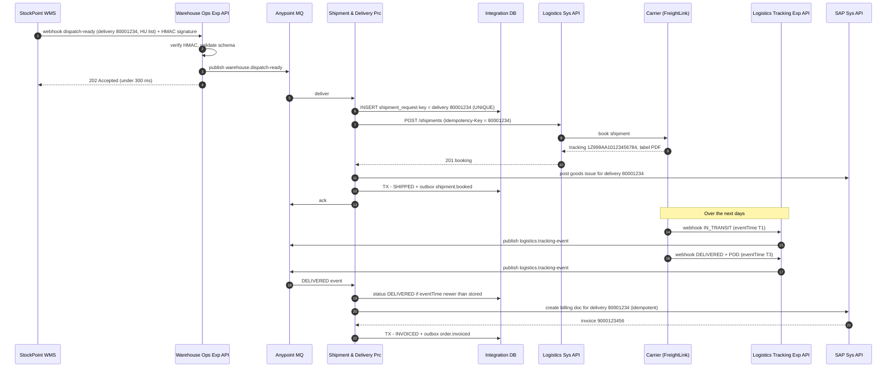

# 03.3 — Warehouse Dispatch & Delivery Confirmation (Diagram 11)

`Essential`

**Scenario:** The WMS has packed order `ORD-123` into 2 handling units. It must be booked with a carrier, goods issue must be posted in SAP, carrier tracking must be followed, and proof of delivery (POD) must trigger the invoice.

## Walkthrough

| Steps | What happens | Design reasoning |
|-------|-------------|------------------|
| 1–4 | WMS webhook → validate → enqueue → **202** | Webhook senders retry on timeout. Acking quickly after a *durable* enqueue prevents duplicate storms. **HMAC signature** proves the sender |
| 5–6 | The consumer claims the **delivery number** as its idempotency key | Replaying the dispatch event (e.g. from the DLQ) must not book a second truck (troubleshooting scenario #18) |
| 7–10 | Carrier booking with the idempotency key | If the carrier API doesn't support idempotency keys, do **lookup-by-reference** (shipper reference = delivery number) before re-booking |
| 11 | Post goods issue (PGI) in SAP | This reduces SAP stock and is a financial posting. It must happen *once* (SAP blocks a second PGI on the same delivery, but we don't rely only on that) |
| 15–19 | Tracking webhooks are ingested the same way | Carriers send events **out of order**: "delivered" can arrive before "out for delivery". Compare `eventTime` and ignore older status transitions. Keep all events in history |
| 20–23 | POD → invoice | Billing is idempotent on the delivery number. SAP also prevents double billing of the same delivery, which adds defence in depth |

## Failure scenarios on this sequence

| Failure | Handling |
|---------|----------|
| Carrier API down | Retry with exponential backoff (e.g. 1, 2, 4, 8 min). After 5 attempts → DLQ + alert the logistics desk, who can book manually and record the tracking number via the ops API |
| PGI fails in SAP (period closed, stock inconsistency) | Shipment is already booked and **cannot be compensated** (the truck is coming). Mark the order `SHIPPED_PGI_PENDING` and create an ops task. This is a forward-recovery saga |
| Webhook signature invalid | 401, no enqueue, security alert after a threshold |
| `DELIVERED` arrives before the dispatch event (timing) | Store the tracking event. When the shipment exists, apply the latest state. See pattern 34 in [07.7](../07-integration-patterns/07-resilience-and-data-patterns.md) |

## Alternatives
- **Polling carrier APIs** instead of webhooks: simpler security, but higher latency and API cost. Use it for carriers without webhooks (scheduler every 15 min + watermark).
- **Invoice on goods issue** instead of POD: common in B2B. Ask the business which is legally correct, because the integration impact differs.

Next: [03.4 Activity, state machine & domain model](04-activity-state-domain.md)
