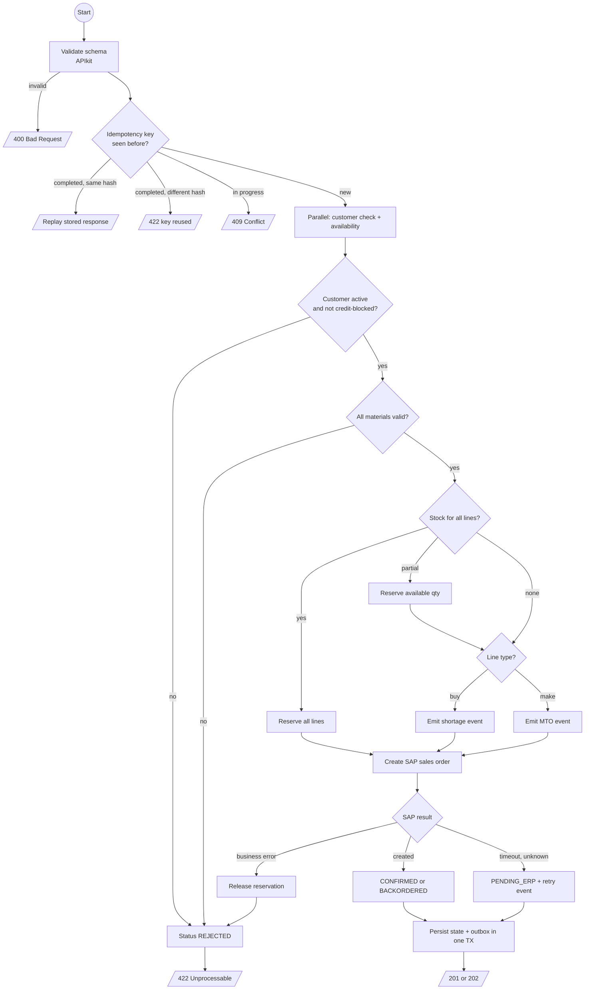
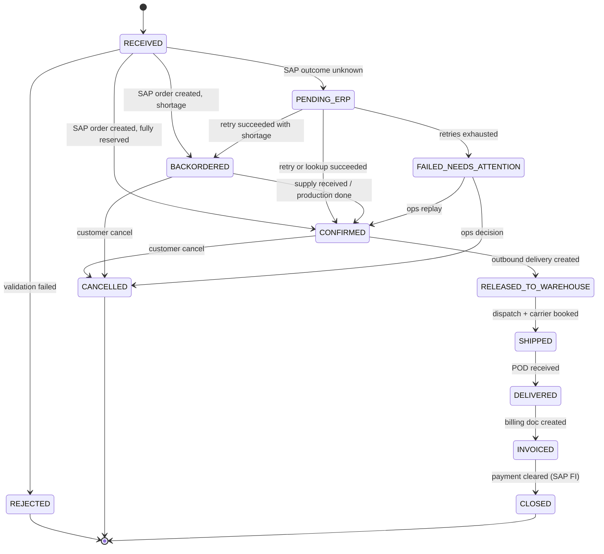
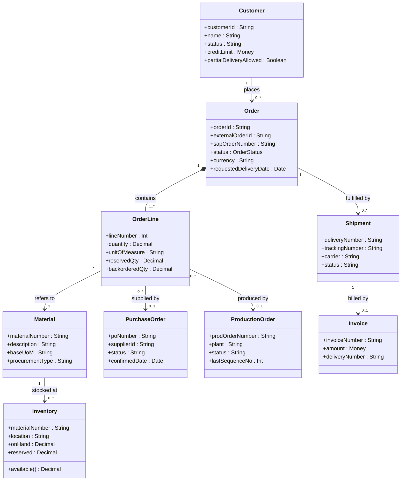

# 03.4 — Activity Diagram, Order State Machine, Domain Model (Diagrams 13, 14, 15)

`Essential`

## Diagram 13 — Activity: order validation and fulfilment decision

**Decision points explained**
- **Idempotency check comes first**, before any side effect. A repeated request must never reach SAP again.
- **Customer and material validity are hard stops** (422). These are *business* errors, so they are not retried.
- **Partial stock** doesn't reject the order. It splits into reserved and backordered quantities. Whether partial delivery is allowed is a customer master setting in SAP, so read it, don't assume it.
- **Make vs buy** comes from the material's procurement type in SAP (`E` = in-house, `F` = external). Cache it from the material master.
- **Three SAP outcomes**: success, definitive failure (compensate) and unknown (forward recovery). Interviewers love candidates who separate these.

## Diagram 14 — Order lifecycle state machine

**How the state machine is enforced in Mule**
- `order_state.status` holds the current state, plus a `version` column for **optimistic locking**:
  `UPDATE order_state SET status=:new, version=version+1 WHERE order_id=:id AND version=:v AND status IN (:allowedFrom)`.
  When 0 rows are updated, the transition is invalid or there was a concurrent update. Log it, re-read, and decide.
- **Out-of-order events can't move state backwards.** A late `SHIPPED` event after `DELIVERED` is ignored for state, but it is recorded in history.
- Every transition writes an **audit row** (who, when, from, to, correlationId).

## Diagram 15 — Domain model

**Explanation**
- **Order ↔ OrderLine is composition**: lines don't exist without their order.
- **Shortages are linked per line**, not per order. One order can have one line from stock, one from a PO and one from production.
- **Invoice links to Shipment (delivery)**, not to Order. That is how SAP bills (per delivery). It's also why delivery number is the invoice idempotency key.
- `Inventory.available() = onHand - reserved`. WMS and SAP compute this differently (bin vs storage location), and that is a root cause of inventory discrepancies ([13 scenario 11](../13-production-troubleshooting/03-scenarios-11-15.md)).

This model is the **canonical model**. Each System API maps SAP/WMS/Salesforce fields to and from it. See [05.3](../05-dataweave/03-supplier-canonical-lookups.md).

Next: [03.5 Batch & DLQ/replay](05-batch-dlq-replay.md)
