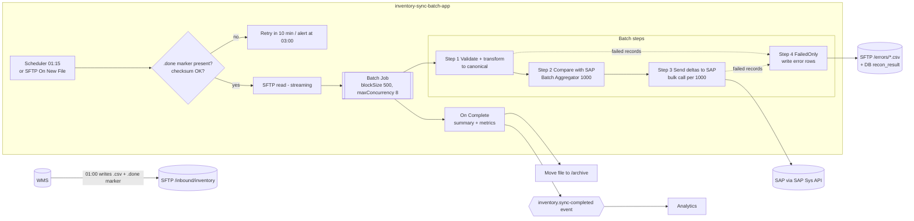
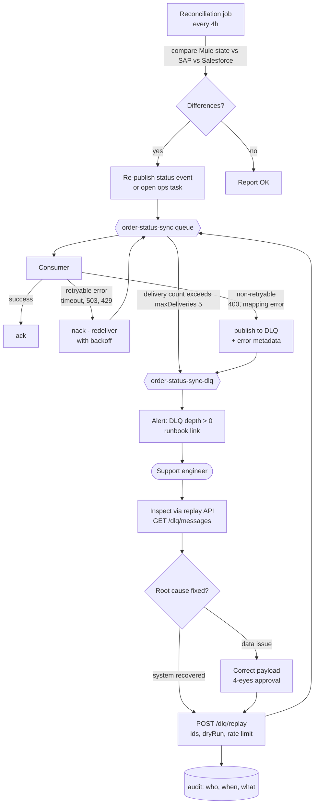

# 03.5 — Batch Inventory Sync & DLQ / Replay / Reconciliation (Diagrams 16, 17)

`Essential` (16) · `Advanced` (17)

## Diagram 16 — Batch inventory synchronisation architecture

**Scenario:** Every night at 01:00 the WMS drops `inventory_snapshot_YYYYMMDD.csv` (~2M rows, ~250 MB) on SFTP. It must update SAP's view of available stock and the analytics platform, and it must report row-level failures.

**Explanation**
- **Completion marker / checksum:** never start reading a file the producer is still writing. Use a `.done` file, a rename convention (`.tmp` → `.csv`), or a file-age check.
- **Streaming read:** the SFTP read is a *stream*. The Batch Job splits records without loading 250 MB into the heap. Batch persists records to its **internal on-disk queues**, so memory stays bounded.
- **Block size and concurrency:** the defaults are `blockSize=100` and concurrency based on available cores. Tune them with load tests. Bigger blocks mean fewer I/O round trips but more memory per thread.
- **Batch Aggregator:** sends 1000 records per SAP call instead of 2M single calls. This is the key performance lever.
- **Delta-only:** compare with SAP and send only changes. That usually cuts traffic by 90%+.
- **Failed-records step (`acceptPolicy="ONLY_FAILURES"`)** writes the failed rows to an error file and the DB, so the job continues past bad rows. The **`maxFailedRecords`** threshold (e.g. 1% of the total) stops the job if the file is clearly corrupt.
- **On Complete** emits a summary (total, successful, failed) as an event and moves the file to the archive. Idempotency: the file name + checksum is recorded, so the **same file isn't processed twice**.

**Alternatives:** an event-driven delta feed from the WMS (better freshness, more complex); SAP IDoc `WMMBXY` per movement; a direct DB-to-DB ETL tool for pure replication. Batch is chosen because the WMS only supports a nightly export.

## Diagram 17 — Dead-letter queue, controlled replay and reconciliation

**Explanation**
- **Retryable vs non-retryable classification** is the most important decision. Retrying a 400 is pointless. Not retrying a 503 loses data. Map Mule error types to these classes once, in shared error-handling config.
- **Anypoint MQ** has native DLQ support: configure a DLQ on the queue and set **max deliveries**. After N failed deliveries the broker moves the message. Non-retryable errors can be sent to the DLQ immediately by the app, which saves wasted attempts.
- **Controlled replay:** replay is a *write action* with business impact, so it needs an API with authentication, an audit trail, dry-run and rate limiting. Do not drag messages around in the console. Replay relies on **consumer idempotency**. Without it, replays create duplicates (scenario #18).
- **Reconciliation** is the safety net that catches what the DLQ never saw: silent failures, lost events, bugs. It compares the **source of truth** (SAP) with downstream copies and repairs them by re-publishing.

**Common mistakes:** having no alert on DLQ depth, so it becomes a graveyard; replaying everything at once and overloading the recovered system; editing payloads with no approval or audit.

Next: [03.6 Security & CI/CD diagrams](06-security-and-cicd.md)
