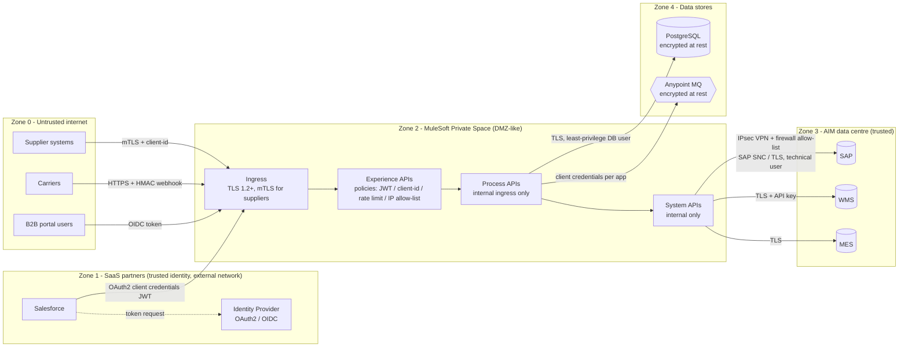
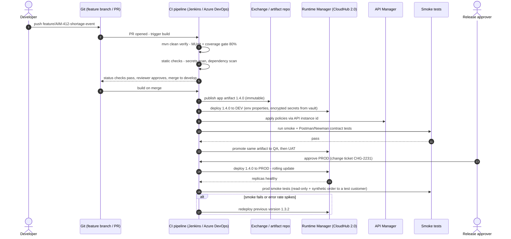

# 03.6 — Security Trust Boundaries & CI/CD Deployment Sequence (Diagrams 18, 19)

`Essential`

## Diagram 18 — Security and trust-boundary diagram

**Boundary-by-boundary**

| Boundary | Threats | Controls |
|----------|---------|----------|
| Internet → Ingress | Spoofing, DDoS, credential stuffing | TLS, **mTLS** for suppliers (certificate = identity), WAF/DDoS protection in front, rate limiting, IP allow-lists for carriers |
| Partner → Exp API | Over-privileged clients, replay | OAuth2 scopes per client (`orders:write`, `orders:read`), JWT validation (issuer, audience, expiry), **HMAC + timestamp** on webhooks to stop replay |
| Exp → Prc → Sys | Lateral movement, bypassing Exp policies | Prc/Sys have **no public endpoint**. Internal client-id enforcement, optionally internal mTLS |
| Mule → SAP | Stolen RFC credentials, excessive authorisation | Technical user restricted to required BAPIs (`S_RFC` authorisation object), SNC encryption, VPN, firewall limited to the Private Space CIDR |
| Mule → DB/MQ | Data exfiltration | Per-app credentials, least-privilege grants, encryption at rest and in transit |
| Logs | PII leakage | Mask names, email, phone and address. Never log tokens or full payloads at INFO |

Details: [10-security-governance](../10-security-governance/01-security-architecture.md).

## Diagram 19 — CI/CD deployment sequence

**Explanation**
- **Build once, deploy many:** the *same* artifact version moves from DEV to PROD. Only properties differ. Rebuilding per environment breaks traceability.
- **Quality gates:** MUnit coverage, failing tests, secret scanning and dependency vulnerabilities block the merge.
- **Secrets** come from a vault (Azure Key Vault, HashiCorp Vault) at deploy time, or are pre-set as *protected* properties in Runtime Manager. They are never stored in the repo.
- **Rolling update** on CloudHub 2.0 replaces replicas gradually, so there's no downtime for stateless apps.
- **Rollback = redeploy the previous artifact.** That only works if DB schema changes are **backward compatible** (expand → migrate → contract) and API changes are non-breaking.
- **Prod smoke tests must be safe:** read-only checks plus a synthetic order for a dedicated test customer that is excluded from billing. Agree this with the business.

Full pipeline YAML/Jenkinsfile: [11.3](../11-deployment-cicd/03-cicd-pipelines.md).
