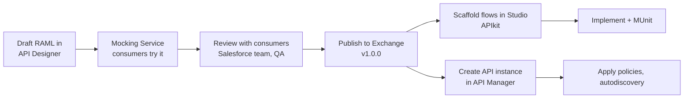

# 04.2 — RAML Specifications (Design-First with API Designer & Exchange)

`Essential`

## 1. The design-first workflow



- **Mocking Service** lets Salesforce developers build against the contract *while* you build the implementation. That's parallel delivery and a strong point to mention.
- **Exchange** versions follow semver: `1.0.0` → `1.1.0` (additive) → `2.0.0` (breaking).
- **Reusable fragments** (data types, traits, security schemes) are published *once* as Exchange fragments and imported by every API. This gives one error contract for the whole platform.

## 2. Reusable fragments

### `aim-common-types` (RAML Library, published as an Exchange fragment)
```yaml
#%RAML 1.0 Library
usage: Common AIM data types shared by all APIs
types:
  Money:
    type: object
    properties:
      amount:
        type: string
        pattern: ^-?[0-9]+(\.[0-9]{1,4})?$
      currency:
        type: string
        pattern: ^[A-Z]{3}$
  Address:
    type: object
    properties:
      name: { type: string, maxLength: 80 }
      line1: { type: string, maxLength: 60 }
      line2?: { type: string, maxLength: 60 }
      city: { type: string, maxLength: 40 }
      postalCode: { type: string, maxLength: 10 }
      country: { type: string, pattern: "^[A-Z]{2}$" }
  ErrorDetail:
    type: object
    properties:
      field?: string
      issue: string
  ErrorResponse:
    type: object
    properties:
      error:
        type: object
        properties:
          code: { type: string, example: AIM-ORD-4001 }
          message: string
          correlationId: string
          timestamp: datetime
          details?: ErrorDetail[]
```

### `aim-common-traits` (traits used across APIs)
```yaml
#%RAML 1.0 Library
uses:
  common: aim-common-types.raml
traits:
  correlated:
    headers:
      x-correlation-id?:
        type: string
        description: Propagated end to end. Generated if absent.
  idempotent:
    headers:
      Idempotency-Key:
        type: string
        minLength: 8
        maxLength: 64
        description: Client-generated unique key. Retries MUST reuse it.
    responses:
      409:
        description: A request with this key is still in progress.
        body:
          application/json:
            type: common.ErrorResponse
  standardErrors:
    responses:
      400: { body: { application/json: { type: common.ErrorResponse } } }
      401: { body: { application/json: { type: common.ErrorResponse } } }
      429: { body: { application/json: { type: common.ErrorResponse } } }
      500: { body: { application/json: { type: common.ErrorResponse } } }
      503: { body: { application/json: { type: common.ErrorResponse } } }
  pageable:
    queryParameters:
      offset?: { type: integer, minimum: 0, default: 0 }
      limit?:  { type: integer, minimum: 1, maximum: 200, default: 50 }
```

### Security schemes
```yaml
#%RAML 1.0 SecurityScheme
type: OAuth 2.0
description: AIM IdP client-credentials. Token validated by the API Manager JWT policy.
describedBy:
  headers:
    Authorization:
      type: string
      pattern: ^Bearer .+$
  responses:
    401: { description: Missing or invalid token }
    403: { description: Token lacks required scope }
settings:
  accessTokenUri: https://idp.aim-example.com/oauth2/token
  authorizationGrants: [ client_credentials ]
  scopes: [ "orders:read", "orders:write" ]
```
A second scheme, `client-id-required` (`type: x-client-id`), describes `client_id`/`client_secret` headers for internal Process/System APIs.

## 3. Experience API RAML — `customer-order-exp-api`

```yaml
#%RAML 1.0
title: AIM Customer Order Experience API
version: v1
baseUri: https://api.aim-example.com/api/{version}
mediaType: application/json
protocols: [ HTTPS ]
uses:
  common: exchange_modules/aim/aim-common-types/1.0.0/aim-common-types.raml
  traits: exchange_modules/aim/aim-common-traits/1.0.0/aim-common-traits.raml
securitySchemes:
  oauth2: !include exchange_modules/aim/aim-security/1.0.0/oauth2.raml
securedBy: [ oauth2: { scopes: [ "orders:write" ] } ]

types:
  OrderLine:
    type: object
    properties:
      lineNumber: { type: integer, minimum: 1 }
      materialNumber: { type: string, minLength: 3, maxLength: 40 }
      quantity: { type: number, minimum: 0.001 }
      unitOfMeasure: { type: string, enum: [ EA, PC, KG, M, BOX ] }
  OrderRequest:
    type: object
    properties:
      externalOrderId: { type: string, minLength: 3, maxLength: 35 }
      sourceSystem: { type: string, enum: [ SALESFORCE, B2B_PORTAL, EDI ] }
      customerId: { type: string, minLength: 3, maxLength: 20 }
      customerPoNumber: { type: string, maxLength: 35 }
      currency: { type: string, pattern: "^[A-Z]{3}$" }
      requestedDeliveryDate: date-only
      shipTo: common.Address
      lines: { type: OrderLine[], minItems: 1, maxItems: 200 }
  OrderLineResult:
    type: object
    properties:
      lineNumber: integer
      materialNumber: string
      reservedQty: number
      backorderedQty: number
  OrderResponse:
    type: object
    properties:
      orderId: string
      externalOrderId: string
      status: { type: string, enum: [ RECEIVED, CONFIRMED, BACKORDERED, PENDING_ERP, REJECTED, SHIPPED, DELIVERED, INVOICED ] }
      sapOrderNumber?: string
      lines?: OrderLineResult[]

/orders:
  post:
    displayName: Submit customer order
    is: [ traits.correlated, traits.idempotent, traits.standardErrors ]
    body:
      application/json:
        type: OrderRequest
        examples:
          inStock: !include examples/order-request-instock.json
          shortage: !include examples/order-request-shortage.json
    responses:
      201:
        description: Order created in SAP.
        body: { application/json: { type: OrderResponse, example: !include examples/order-response-201.json } }
      202:
        description: Accepted. ERP confirmation pending (SAP unavailable or slow).
        body: { application/json: { type: OrderResponse } }
      422:
        description: Business validation failed (customer blocked, invalid material, SAP rejection).
        body: { application/json: { type: common.ErrorResponse } }
  get:
    securedBy: [ oauth2: { scopes: [ "orders:read" ] } ]
    is: [ traits.correlated, traits.pageable ]
    queryParameters:
      externalOrderId?: string
    responses:
      200: { body: { application/json: { type: OrderResponse[] } } }
  /{orderId}:
    uriParameters:
      orderId: { type: string, pattern: "^AIM-[0-9]{8}-[A-Z0-9]{8}$" }
    get:
      securedBy: [ oauth2: { scopes: [ "orders:read" ] } ]
      is: [ traits.correlated, traits.standardErrors ]
      responses:
        200: { body: { application/json: { type: OrderResponse } } }
        404: { body: { application/json: { type: common.ErrorResponse } } }
```

**Why these choices**
- **`date-only` for the delivery date:** a business date has no timezone. Using `datetime` here causes "delivered a day early" bugs across timezones.
- **`maxItems: 200`:** protects the backend (and SAP) from huge orders arriving synchronously. Larger orders use a bulk API or EDI.
- **Enums for UoM:** they reject garbage early. The downside is that adding a UoM requires a minor version, which is acceptable.
- **Examples per scenario** feed the Mocking Service *and* contract tests.

## 4. System API RAML excerpt — `sap-erp-sys-api`

```yaml
#%RAML 1.0
title: AIM SAP ERP System API
version: v1
baseUri: https://sap-erp-sys-api.internal.aim-example.com/sys/sap/{version}
uses:
  common: exchange_modules/aim/aim-common-types/1.0.0/aim-common-types.raml
  traits: exchange_modules/aim/aim-common-traits/1.0.0/aim-common-traits.raml
securitySchemes:
  clientId: !include exchange_modules/aim/aim-security/1.0.0/client-id.raml
securedBy: [ clientId ]
/sales-orders:
  post:
    is: [ traits.correlated, traits.standardErrors ]
    body:
      application/json:
        type: !include types/sap-sales-order-create.raml
    responses:
      201: { body: { application/json: { properties: { salesOrderNumber: string, recoveredAfterTimeout: boolean } } } }
      422: { description: "SAP business error (BAPI RETURN type E/A)" }
      504: { description: "Timeout - outcome unknown after lookup. Caller must not blindly retry." }
  get:
    queryParameters:
      externalRef: { type: string, required: true }
    responses:
      200: { body: { application/json: { properties: { found: boolean, salesOrderNumber?: string } } } }
```

Notice that **504 is documented with its semantics**. The contract tells callers *how* to behave, not just what the shapes are.

## 5. Contract validation in the pipeline
1. **Linting / governance:** Anypoint API Governance rulesets (e.g. "all APIs must declare an error type", "no plain HTTP"). Run them in CI with the Anypoint CLI.
2. **Implementation conforms to the spec:** APIkit validates requests at runtime. Postman/Newman tests validate responses against the RAML examples and types.
3. **Consumer-driven checks:** Salesforce's integration tests run against the mock or QA endpoint before each release.

> The **runnable** RAML (with valid examples) is in the mini project: [`order-exp-api.raml`](../mule-project/aim-order-integration/src/main/resources/api/order-exp-api.raml).

Next: [04.3 Error contract & versioning](03-error-contract-and-versioning.md)
