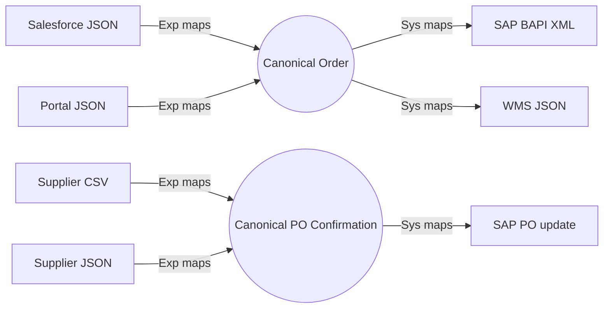

# 05.3 — Supplier Payloads, Canonical Data Model, Lookup Tables & Reusable Functions

`Essential`

## 1. The canonical model and the anti-corruption layer

A **canonical model** is AIM's own neutral representation of a business entity (Order, PurchaseOrder, Shipment). Each System or Experience API translates between its external format and the canonical one. That translation layer is an **anti-corruption layer**: SAP's `VBELN` or a supplier's `ordNo` never leaks into process logic.



**Keep it small:** the canonical model contains only the fields that *processes* need, not the union of every system's fields. A bloated "enterprise canonical model" becomes a bottleneck that every team must negotiate.

## 2. Salesforce order → canonical order (Experience layer)

**Input (Salesforce shape, simplified)**
```json
{
  "Id": "8015g00000AbCdE",
  "OrderNumber": "00012345",
  "Account": { "SAP_Customer_Id__c": "100234", "Name": "Riverside Water Utility" },
  "PoNumber": "WU-PO-77812",
  "CurrencyIsoCode": "USD",
  "EffectiveDate": "2026-10-13",
  "Requested_Delivery__c": "2026-11-20",
  "ShippingAddress": { "street": "100 River Rd", "city": "Austin", "postalCode": "73301", "countryCode": "US" },
  "OrderItems": { "records": [
    { "Line_No__c": 10, "Product2": { "ProductCode": "PMP-CF-200" }, "Quantity": 5.0, "UoM__c": "EA" },
    { "Line_No__c": 20, "Product2": { "ProductCode": "VLV-BL-050" }, "Quantity": 40.0, "UoM__c": null }
  ] }
}
```

**Script**
```dataweave
%dw 2.0
output application/json
import * from dwl::modules::aim::common
---
{
  externalOrderId: "SF-" ++ payload.OrderNumber,
  sourceSystem: "SALESFORCE",
  customerId: "CUST-" ++ payload.Account.SAP_Customer_Id__c,
  customerPoNumber: payload.PoNumber default payload.OrderNumber,
  currency: payload.CurrencyIsoCode,
  requestedDeliveryDate: payload.Requested_Delivery__c default payload.EffectiveDate,
  shipTo: {
    name: payload.Account.Name,
    line1: payload.ShippingAddress.street,
    city: payload.ShippingAddress.city,
    postalCode: payload.ShippingAddress.postalCode,
    country: payload.ShippingAddress.countryCode
  },
  lines: payload.OrderItems.records map (r) -> {
    lineNumber: r.Line_No__c as Number,
    materialNumber: trimUpper(r.Product2.ProductCode),
    quantity: r.Quantity,
    unitOfMeasure: r.UoM__c default "EA"
  }
}
```

**Output**
```json
{
  "externalOrderId": "SF-00012345",
  "sourceSystem": "SALESFORCE",
  "customerId": "CUST-100234",
  "customerPoNumber": "WU-PO-77812",
  "currency": "USD",
  "requestedDeliveryDate": "2026-11-20",
  "shipTo": { "name": "Riverside Water Utility", "line1": "100 River Rd", "city": "Austin", "postalCode": "73301", "country": "US" },
  "lines": [
    { "lineNumber": 10, "materialNumber": "PMP-CF-200", "quantity": 5.0, "unitOfMeasure": "EA" },
    { "lineNumber": 20, "materialNumber": "VLV-BL-050", "quantity": 40.0, "unitOfMeasure": "EA" }
  ]
}
```

The `default "EA"` for a null UoM is a **business decision** written down in the mapping spec, not a developer's guess. Document every default ([16.2 mapping spec](../16-project-documents/02-api-and-data-specs.md)).

## 3. Supplier CSV confirmation → canonical (file-based supplier)

Small suppliers drop `CONF_SUP0042_20261015.csv` on SFTP:
```csv
po_number;po_item;material;confirmed_qty;uom;ship_date;comment
4500012345;10;VLV-BL-050;35;PCE;15.10.2026;
4500012345;20;SEAL-MECH-40;0;PCE;;Discontinued - use SEAL-MECH-41
4500012399;10;MTR-7.5KW;12;PCE;28.10.2026;Partial
```

Tell Mule how to parse the file. Either set the MIME type `application/csv` with reader properties `separator=;` and `header=true` on the SFTP read operation (`outputMimeType`), or declare them in the script with an `input` directive:

```dataweave
%dw 2.0
input payload application/csv separator=";", header=true
output application/json
var uomMap = { "PCE": "EA", "PCS": "EA", "KGM": "KG", "MTR": "M" }
---
(payload groupBy $.po_number) pluck (rows, po) -> {
  poNumber: po as String,
  supplierId: "SUP-0042",
  lines: rows map (r) -> {
    poItem: r.po_item as Number,
    materialNumber: r.material,
    confirmedQty: r.confirmed_qty as Number,
    unitOfMeasure: uomMap[r.uom] default r.uom,
    confirmedShipDate: if (isEmpty(r.ship_date)) null
                       else (r.ship_date as Date { format: "dd.MM.yyyy" }) as String { format: "yyyy-MM-dd" },
    status: if ((r.confirmed_qty as Number) == 0) "REJECTED" else "CONFIRMED",
    supplierComment: if (isEmpty(r.comment)) null else r.comment
  }
}
```

**Output**
```json
[
  { "poNumber": "4500012345", "supplierId": "SUP-0042", "lines": [
      { "poItem": 10, "materialNumber": "VLV-BL-050", "confirmedQty": 35, "unitOfMeasure": "EA", "confirmedShipDate": "2026-10-15", "status": "CONFIRMED", "supplierComment": null },
      { "poItem": 20, "materialNumber": "SEAL-MECH-40", "confirmedQty": 0, "unitOfMeasure": "EA", "confirmedShipDate": null, "status": "REJECTED", "supplierComment": "Discontinued - use SEAL-MECH-41" } ] },
  { "poNumber": "4500012399", "supplierId": "SUP-0042", "lines": [
      { "poItem": 10, "materialNumber": "MTR-7.5KW", "confirmedQty": 12, "unitOfMeasure": "EA", "confirmedShipDate": "2026-10-28", "status": "CONFIRMED", "supplierComment": "Partial" } ] }
]
```

**Explanation**
- **`groupBy` then `pluck`** turns flat CSV rows into one document per PO, so one message is published per PO (FIFO group = PO).
- CSV values are **strings**, so coerce them explicitly (`as Number`). Empty fields are `""`, not `null`, which is why `isEmpty` is used.
- The supplier ID comes from the **file name / SFTP folder**, not from the content. In the flow it is taken from `attributes.fileName`.
- `supplierId` is hard-coded here for readability. In the flow it would be `vars.supplierId`.

## 4. Lookup tables: three options and when to use each

| Option | How | Good for | Watch out |
|--------|-----|----------|-----------|
| **Inline `var` map** | `var plantByDc = {...}` | Tiny, stable code lists | Changing it needs a redeploy |
| **Classpath JSON/CSV** | `readUrl("classpath://lookups/uom.json")` | Medium, versioned with the app | Still needs a deploy. Load it once (`var` at the top) |
| **External / cached** | Flow loads from DB or SAP into Object Store at startup, plus TTL; DW receives it via `vars.lookup` | Large or frequently changing lists (material → plant) | Cache invalidation, cold starts |

```dataweave
%dw 2.0
output application/json
var uom = readUrl("classpath://lookups/uom-conversion.json", "application/json")
// uom = { "EA": {"sap": "ST", "iso": "PCE"}, "BOX": {"sap": "KAR", "iso": "CT"} }
---
payload.lines map {
  materialNumber: $.materialNumber,
  sapUom: uom[$.unitOfMeasure].sap default $.unitOfMeasure,
  isoUom: uom[$.unitOfMeasure].iso default $.unitOfMeasure
}
```

## 5. Reusable functions module — `dwl/modules/aim/common.dwl`

```dataweave
%dw 2.0
import leftPad from dw::core::Strings

fun trimUpper(s: String | Null): String | Null = if (s == null) null else upper(trim(s))

/** SAP ALPHA conversion: pad numeric IDs with leading zeros */
fun sapAlpha(id: String, len: Number = 10): String =
  if (id matches /^[0-9]+$/) leftPad(id, len, "0") else id

/** Remove SAP leading zeros for display */
fun stripZeros(id: String): String = id replace /^0+(?!$)/ with ""

fun toSapDate(d: Date): String = d as String { format: "yyyyMMdd" }
fun fromSapDate(s: String): Date | Null =
  if (isEmpty(s) or s == "00000000") null else s as Date { format: "yyyyMMdd" }

/** Standard AIM error body */
fun errorBody(code: String, message: String, correlationId: String, details: Array = []) = {
  error: {
    code: code,
    message: message,
    correlationId: correlationId,
    timestamp: now() as String { format: "yyyy-MM-dd'T'HH:mm:ss.SSSXXX" },
    (details: details) if (!isEmpty(details))
  }
}
```

**Why this matters in interviews:** it shows you avoid copy-pasting the same date and zero-padding logic into 40 transforms. Point out `"00000000"` too: SAP's *initial* date value must map to `null`, not crash the parser.

Note `(details: details) if (...)`: this is **conditional key inclusion**, a DW idiom you will use constantly.

Next: [05.4 Arrays, grouping, aggregation](04-arrays-grouping-aggregation.md)
