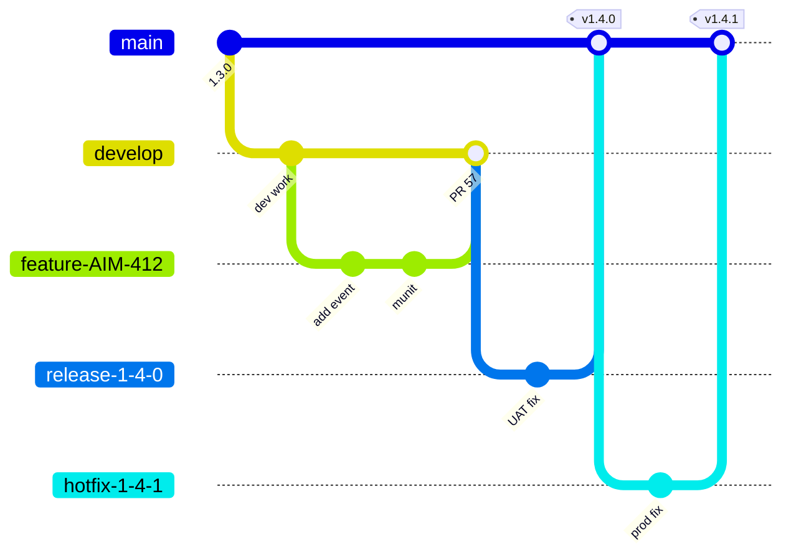

# 06.1 — Phase A: Development Setup, Repository Structure, Configuration Strategy

`Essential`

## 1. Tooling prerequisites

| Tool | Version (assumption, Oct 2026) | Notes |
|------|-------------------------------|-------|
| Anypoint Studio | 7.2x (bundles a Mule 4.x runtime) | Or Anypoint Code Builder (VS Code-based), MuleSoft's newer IDE |
| Mule runtime | **4.9 LTS** for prod apps | Edge releases (4.10–4.13) only if you need a new feature and can upgrade quickly |
| JDK | **17** | Required for Mule 4.9+. Check that all connectors are Java 17 compatible |
| Maven | 3.9.x | `~/.m2/settings.xml` with Exchange credentials |
| Git | 2.4x | + PR platform (GitHub / GitLab / Azure Repos / Bitbucket) |
| Postman / Newman | latest | Collections versioned in the repo |
| Anypoint Platform account | Trial or company org | Needed for Exchange, API Manager, Runtime Manager, MQ |
| Connector prerequisites | SAP JCo libs (`sapjco3.jar` + native lib), DB JDBC drivers | **SAP JCo cannot be redistributed.** Download it from SAP Support Portal with your company S-user |

### Maven `settings.xml` (Exchange access)
```xml
<settings>
  <servers>
    <server>
      <id>anypoint-exchange-v3</id>
      <username>~~~Client~~~</username>               <!-- connected app auth -->
      <password>${env.ANYPOINT_CLIENT_ID}~?~${env.ANYPOINT_CLIENT_SECRET}</password>
    </server>
    <server>
      <id>mulesoft-ee-releases</id>                    <!-- EE artifacts, e.g. for MUnit in CI -->
      <username>${env.MULE_NEXUS_USER}</username>
      <password>${env.MULE_NEXUS_PASSWORD}</password>
    </server>
  </servers>
</settings>
```
*Connected-app Maven authentication uses the `~~~Client~~~` username convention. Check the current format in the MuleSoft "Exchange Maven Facade" documentation.*

## 2. Repository strategy

**One Git repository per Mule application** (an industry default) plus shared repos for:
- `aim-api-fragments`: RAML types, traits, security schemes (published to Exchange)
- `aim-dw-library`: shared DataWeave modules
- `aim-parent-pom`: shared Maven parent (plugin versions, repositories, MUnit config)
- `aim-pipeline-templates`: CI/CD templates

### Standard app layout
```
order-mgmt-prc-api/
├── pom.xml                         # parent = aim-parent-pom
├── mule-artifact.json
├── src/main/mule/
│   ├── global.xml                  # all global configs (listeners, requesters, DB, MQ, properties)
│   ├── order-mgmt-prc-api.xml      # APIkit router + generated flow stubs only
│   ├── impl-create-order.xml       # implementation flows per use case
│   ├── impl-get-order.xml
│   ├── outbox-relay.xml
│   └── common-error-handler.xml
├── src/main/resources/
│   ├── api/                        # RAML (or Exchange dependency)
│   ├── config/config-{env}.yaml    # non-secret properties
│   ├── config/secure-{env}.yaml    # encrypted values only
│   ├── dwl/                        # reusable DW scripts and modules
│   ├── log4j2.xml
│   └── sql/                        # migration scripts (Flyway/Liquibase owned by DBA pipeline)
├── src/test/munit/                 # one suite per impl file
├── src/test/resources/test-data/
└── postman/
```

## 3. Naming conventions

| Item | Convention | Example |
|------|-----------|---------|
| App name | `{domain}-{layer}-api` | `order-mgmt-prc-api`, `sap-erp-sys-api` |
| Flow | `{verb}-{noun}-flow` (kebab) | `create-order-flow` |
| Sub-flow | `{verb}-{noun}-subflow` | `claim-idempotency-subflow` |
| Global config | `{Type}_{Target}_Config` | `HTTP_Request_SAP_Sys_Config`, `DB_Integration_Config` |
| Property keys | dot.case, grouped | `sap.sys.host`, `sap.sys.timeoutMs` |
| Variables | camelCase, meaningful | `vars.idempotencyKey` (never `vars.temp1`) |
| Error types | `AIM:UPPER_SNAKE` | `AIM:SAP_BUSINESS_ERROR` |
| MQ destinations | `{env}-{domain}-{event}-{q|x|dlq}` | `prod-order-confirmed-x`, `prod-procurement-requests-q` |
| `doc:name` | Business-readable and unique | "Create SAP sales order" (MUnit mocks target it) |

## 4. Branching workflow



- **GitFlow-lite** (shown) suits a scheduled release train with SAP-dependent UAT windows, which is common in manufacturing.
- **Trunk-based** (short-lived branches + feature flags) suits teams that deploy continuously. Recommend it when the organisation has strong automated tests.
- **Every PR:** passing MUnit, coverage ≥ 80% on changed flows, one senior reviewer, and a linked Jira story.

## 5. Configuration strategy (one artifact, many environments)

```xml
<!-- global.xml -->
<global-property name="env" value="local" doc:name="Default env (overridden by -Denv)"/>
<configuration-properties file="config/config-${env}.yaml" doc:name="Env properties"/>
<secure-properties:config name="Secure_Props" file="config/secure-${env}.yaml"
                          key="${secure.key}" doc:name="Secure properties">
    <secure-properties:encrypt algorithm="AES" mode="CBC"/>
</secure-properties:config>
```

```yaml
# config/config-qa.yaml
http:
  port: "8081"
sap:
  sys:
    host: "sap-erp-sys-api.qa.internal.aim-example.com"
    timeoutMs: "6000"
db:
  url: "jdbc:postgresql://pg-qa.internal:5432/integration?sslmode=require"
  maxPool: "20"
```

```yaml
# config/secure-qa.yaml — values encrypted with the Secure Properties Tool
db:
  password: "![nHk3c2VjcmV0LWJ5dGVzLWV4YW1wbGU=]"
sap:
  sys:
    clientSecret: "![q8Jb...]"
```
Reference it with `${secure::db.password}`.

**Rules**
- `env` and `secure.key` are passed at deploy time (Runtime Manager properties, with `secure.key` marked **protected/hidden**). They are never committed.
- Property files contain **no secrets in plain text**, even for DEV.
- **Feature flags** as properties (`order.asyncFallback.enabled=true`) let ops change behaviour without a redeploy (property update → app restart).
- For enterprise-grade secret management, use a vault (Azure Key Vault, HashiCorp Vault, AWS Secrets Manager) injected by the pipeline, or a vault properties provider. Rotation then doesn't require re-encrypting files.

## Common mistakes
- Different artifacts per environment ("rebuild for prod"). This kills traceability.
- `localhost` or QA hostnames hard-coded in XML instead of properties.
- Global configs scattered across many files, which makes them hard to find and causes duplicate listener port conflicts.
- Committing `secure.key` to the pipeline YAML in plain text.

Next: [06.2 HTTP and flow control](02-http-and-flow-control.md)
