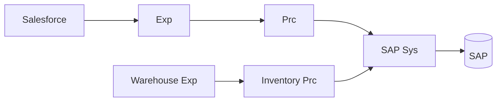
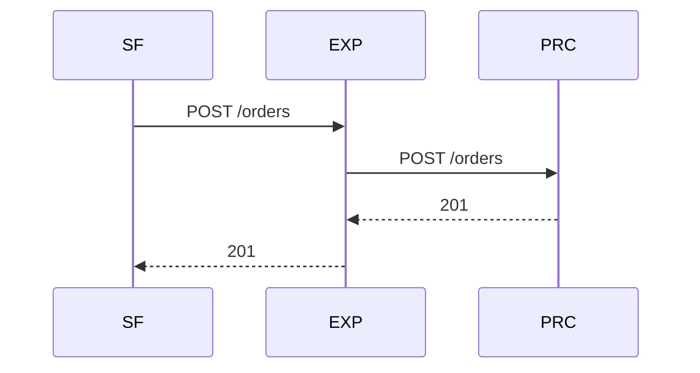
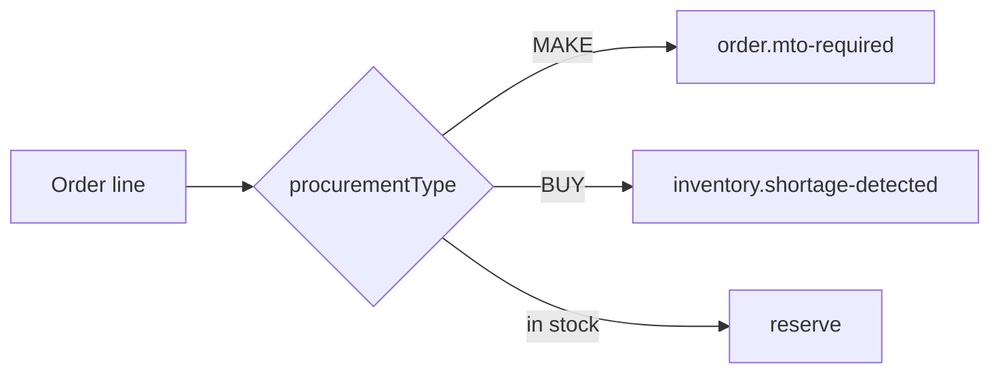
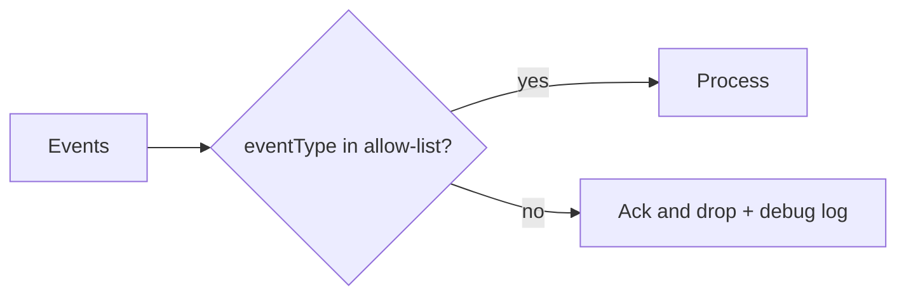
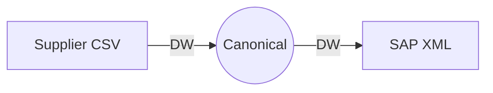
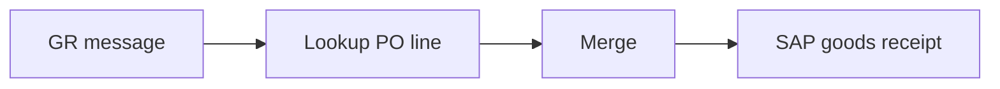
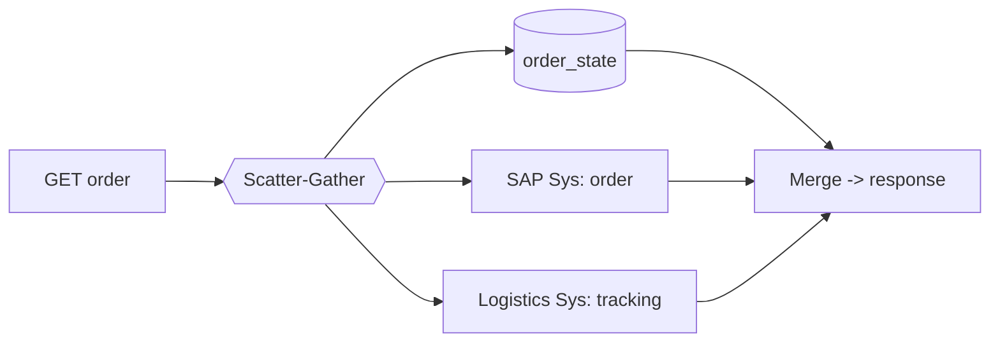

# 07.1 — API & Routing Patterns (Patterns 1–6, 25)

Each pattern is tagged as one of:
- **`Native`**: a Mule component does it out of the box.
- **`Custom`**: you implement the logic yourself in flows, DataWeave or the DB.
- **`Infra`**: it depends on platform or infrastructure features such as API Manager, MQ or the network.

---

## Pattern 1 — API-led connectivity · `Native (architecture style)` · `Essential`

**Problem:** Point-to-point integrations multiply. Ten systems wired together point-to-point can need up to 45 connections, each with its own copy of the SAP mapping.
**AIM use case:** Five process APIs reuse one `sap-erp-sys-api`, so an SAP upgrade changes one app.
**Components:** separate Mule apps per layer, Exchange for discovery, API Manager for contracts.



**Failure handling:** each layer has its own timeout (budget) and error translation. A System API maps backend errors into the standard contract.
**Performance:** each hop adds roughly 10–50 ms. Keep the chain to three or four hops at most.
**Alternatives:** an ESB-style single app (fewer moving parts, a monolith), or direct point-to-point (fast to build, slow to change).
**Don't use when:** the integration is a one-off, single-consumer file transfer, or a high-volume stream.

**Interview Q:** *"Isn't three layers over-engineering for a simple integration?"*
**A:** "Sometimes, yes. Layers are a means, not a goal. I'd collapse them when there's one consumer, no orchestration and no foreseeable reuse, and record that in an ADR. For SAP, though, the System API pays for itself immediately: it encapsulates JCo sessions, BAPI commits, ALPHA conversion and error translation, which five processes would otherwise copy."

---

## Pattern 2 — Request-response · `Native` · `Essential`

**Problem:** The caller needs an answer *now* (price, availability, order number).
**AIM use case:** Salesforce submits an order and waits for `201` with the SAP order number.
**Components:** `http:listener` → processing → response. `http:request` for outbound calls.



**Failure handling:** explicit `responseTimeout` at each hop, idempotency keys for safe client retries, and 504 semantics ("unknown outcome").
**Reliability/perf:** threads wait on I/O. Mule 4's non-blocking HTTP and reactive engine handle this well, but the **slowest dependency sets your latency**.
**Alternatives:** async request-reply (Pattern 13), fire-and-forget events.
**Don't use when:** processing takes longer than a typical client timeout (> 10–30 s), or the backend is frequently down.

**Interview Q:** *"How do you decide on the timeout value for a sync API?"*
**A:** "I work backwards from the consumer's timeout and subtract a margin. Each inner hop must time out before its caller, so the caller gets a meaningful error rather than its own generic timeout. Then I check the values against measured p99 latencies of the dependencies. If the budget can't fit the p99, the call shouldn't be synchronous."

---

## Pattern 3 — Content-based routing · `Native` · `Essential`

**Problem:** Messages need different handling depending on their content.
**AIM use case:** Route an order line by **procurement type**: `MAKE` → production event, `BUY` → procurement event, stock → reservation. Also route outbox events by `event_type` to different queues.
**Components:** `choice` router (DataWeave conditions). MQ **exchanges** for pub/sub-based routing.



```xml
<choice doc:name="Route outbox event">
  <when expression="#[vars.event.event_type startsWith 'inventory.']">
    <anypoint-mq:publish config-ref="MQ_Config" destination="${mq.q.procurementRequests}"/>
  </when>
  <otherwise>
    <anypoint-mq:publish config-ref="MQ_Config" destination="${mq.x.orderEvents}"/>
  </otherwise>
</choice>
```

**Failure handling:** always include an `otherwise` branch. An unknown type should go to the DLQ with an alert, never be silently dropped.
**Alternatives:** routing rules in a lookup table (data-driven; add routes without a redeploy), or broker-side routing (exchanges with multiple bound queues).
**Don't use when:** the routing rules are complex, change often and belong to the business. Externalise them as a rules table or a decision service.

**Interview Q:** *"Where should routing logic live: in Mule or in the broker?"*
**A:** "Routing that depends on *who is interested* belongs in the broker via exchanges and subscriptions, so adding a consumer needs no producer change. Routing that depends on *business decisions*, like make versus buy, belongs in the Process API, because it's business logic that must be tested and versioned."

---

## Pattern 4 — Message filtering · `Native` · `Essential`

**Problem:** Consumers receive messages they don't care about, which wastes processing or causes errors.
**AIM use case:** The analytics consumer ignores `order.erp-pending` (an internal technical event). The WMS feed drops rows with status `BLOCKED`.
**Components:** a `choice` that does nothing for filtered messages, a `validation:*` module (raises an error), or DataWeave `filter`. On a subscriber: separate queues per interest.



**Failure handling:** a filtered message must still be **acked**, otherwise it's redelivered forever. Log filtered counts as a metric. A sudden spike in filtered messages often signals an upstream schema change.
**Alternatives:** filter at the source (publish only relevant events), or use dedicated queues per event type.
**Don't use when:** you'd be filtering *most* messages. Change the subscription design instead.

**Interview Q:** *"What's the risk of filtering?"* **A:** "Silent data loss. A producer renames a field and suddenly every message is filtered out. That's why I filter on explicit allow-lists, emit metrics for dropped counts, and alert on anomalies."

---

## Pattern 5 — Message transformation · `Native (DataWeave)` · `Essential`

**Problem:** Systems speak different formats (SAP BAPI XML, Salesforce JSON, supplier CSV, IDocs).
**AIM use case:** canonical order → `BAPI_SALESORDER_CREATEFROMDAT2` XML, and supplier CSV → canonical confirmation ([05.2](../05-dataweave/02-json-xml-and-sap-mapping.md), [05.3](../05-dataweave/03-supplier-canonical-lookups.md)).
**Components:** `ee:transform`, DataWeave modules, reader and writer properties.



**Failure handling:** fail loudly on missing mandatory fields (`fail()`), route to the DLQ, and never invent defaults that weren't agreed.
**Performance:** see [05.6](../05-dataweave/06-large-payloads-streaming.md): streaming, indexing, one pass.
**Alternatives:** none really. You could map at the source system, which just moves the problem elsewhere.
**Don't use when:** you're tempted to put *business decisions* inside mappings. Keep transforms about shape, and keep rules in flows or modules that are tested separately.

**Interview Q:** *"How do you keep 50 mappings consistent?"* **A:** "Shared DW modules for common conversions (dates, ALPHA, UoM), a canonical model, a mapping specification as the source of truth, and MUnit tests with golden input/output files for every mapping."

---

## Pattern 6 — Message enrichment · `Native` · `Essential`

**Problem:** The incoming message lacks data that downstream systems need.
**AIM use case:** A WMS goods-receipt webhook carries only `material` + `qty`. SAP needs the plant, storage location and PO item, so enrich from the PO data.
**Components:** `http:request` / `db:select` with **`target`** (store the result in a variable without overwriting the payload), then merge with DataWeave.

```xml
<db:select config-ref="DB_Config" target="poLine" doc:name="Enrich: PO line">
  <db:sql><![CDATA[SELECT po_number, po_item, plant, sloc FROM po_line_cache WHERE asn_id = :asn AND material = :m]]></db:sql>
  <db:input-parameters><![CDATA[#[{ asn: payload.asnId, m: payload.material }]]]></db:input-parameters>
</db:select>
<ee:transform doc:name="Merge enrichment">
  <ee:message><ee:set-payload><![CDATA[%dw 2.0
output application/json
---
payload ++ { poNumber: vars.poLine[0].po_number, poItem: vars.poLine[0].po_item,
             plant: vars.poLine[0].plant, storageLocation: vars.poLine[0].sloc }]]></ee:set-payload></ee:message>
</ee:transform>
```



**Failure handling:** decide whether an enrichment miss is fatal (no PO, so no GR, so DLQ) or optional (a description that defaults to N/A).
**Performance:** cache stable reference data. Don't enrich per record inside a 2M-row batch with HTTP calls; preload it instead.
**Alternatives:** have the producer send the full data (fat events), or let the consumer look it up only when needed.
**Don't use when:** enrichment needs many calls per message. Redesign the event to carry the data.

**Interview Q:** *"Why use `target` instead of setting the payload?"* **A:** "So the original payload stays intact. Enrichment adds context. Overwriting the payload forces me to save and restore it, which is error-prone."

---

## Pattern 25 — API composition · `Native` · `Essential`

**Problem:** A consumer needs one view assembled from several systems.
**AIM use case:** `GET /api/v1/orders/{id}` returns order status (integration DB), SAP order data, and tracking (TMS) in one response for the portal.
**Components:** `scatter-gather` (parallel) or sequential calls, then DataWeave merge. Partial-failure fallbacks.



**Failure handling:** tracking is optional. If the TMS times out, return the order with `"tracking": {"status": "UNAVAILABLE"}` (try + on-error-continue per route). The order status itself is mandatory.
**Performance:** parallel routes, short timeouts, and caching of slow-changing parts.
**Alternatives:** a **materialised read model**: precompute the view from events into the integration DB. Reads are faster and more resilient, but the view is eventually consistent and there's more to build.
**Don't use when:** the composition is used heavily (thousands of req/s) or needs many backends. Use a read model.

**Interview Q:** *"Composition vs read model for the order tracking page?"*
**A:** "At AIM's volume, a few requests per second, composition is simpler and always fresh. If the portal grew to thousands of users refreshing tracking pages, I'd switch to a read model fed by shipment events, because composition would multiply load on SAP and the TMS for every page view."

Next: [07.2 Parallel processing & aggregation](02-parallel-and-aggregation.md)
