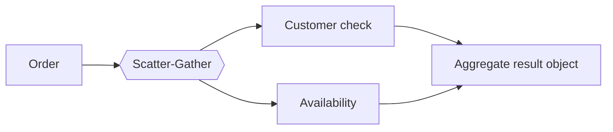
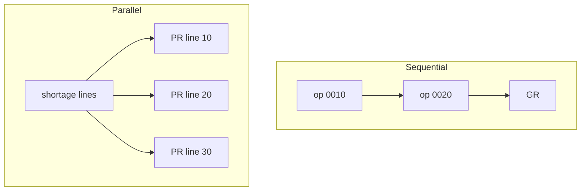
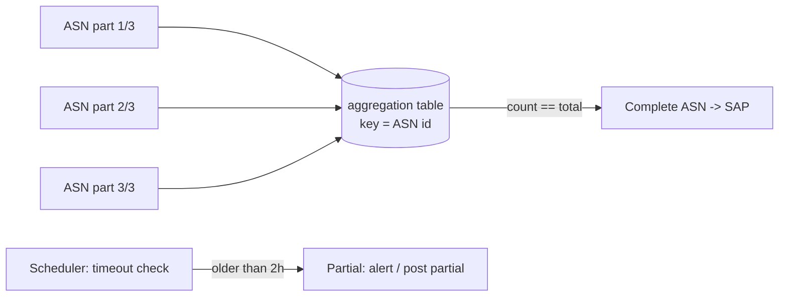
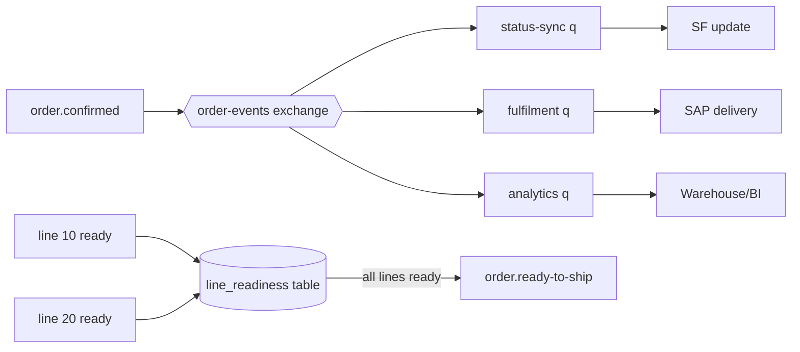

# 07.2 — Parallel Processing & Aggregation (Patterns 7, 8, 9, 32)

## Pattern 7 — Scatter-gather · `Native` · `Essential`

**Problem:** Several independent calls made one after another add up their latencies.
**AIM use case:** Order validation calls the customer check (Salesforce Sys) and availability (Inventory Prc) in parallel. Latency drops from ~1.6 s to ~0.9 s (assumption).
**Components:** `scatter-gather` with `timeout` and `maxConcurrency`. Each route returns a Mule message, and the results are keyed `"0"`, `"1"`, ….

**Failure handling:** if any route fails, the scatter-gather raises `MULE:COMPOSITE_ROUTING`. Two options:
1. **Fail-all** (AIM default for validation, since both answers are mandatory).
2. **Partial results:** wrap each route in `try` + `on-error-continue` that returns `{ "status": "FAILED" }`, then decide in DataWeave.

**Performance:** latency is the slowest route. The memory needed is all route results held together, which is fine for small payloads.
**Alternatives:** sequential calls (simpler, slower), or async fan-out via MQ (Pattern 32) when the results aren't needed immediately.
**Don't use when:** route B needs route A's output (that's sequential), or there are dozens of dynamic routes (use `parallel-foreach`).

**Interview Q:** *"One route is usually 200 ms but sometimes takes 8 s. What happens to your API?"*
**A:** "The API's latency follows the slowest route, so the tail latency of that backend becomes my p99. I'd set a route-level timeout that fits the budget, decide whether that route's data is optional enough to degrade, and look at caching it. If it's mandatory and slow, a bulkhead (a separate connection pool) keeps it from starving other calls."

---

## Pattern 8 — Sequential vs parallel processing · `Native` · `Essential`

**Problem:** Choosing the wrong mode gives either slow processing or broken ordering and overloaded backends.

| Dimension | Sequential (`foreach`, plain flow) | Parallel (`scatter-gather`, `parallel-foreach`, batch, MQ concurrency) |
|-----------|-----------------------------------|----------------------------------------------------------------------|
| Ordering | Preserved | Not guaranteed |
| Latency | Sum of steps | Max of steps |
| Backend load | Gentle | Bursty. Must be bounded |
| Error semantics | Stops at the first error | Composite errors, partial success |
| Use when | Dependencies between steps, ordering matters (SAP confirmations per production order) | Independent I/O (shortage lines → separate PRs) |

**AIM example:** shortage lines → procurement requests use `parallel-foreach maxConcurrency="4"` because the lines are independent. MES operation confirmations are processed **sequentially per production order** (FIFO message group) because SAP needs operation 0010 before 0020.

**Failure handling (parallel):** design for partial success. Lines 10 and 30 succeed and line 20 fails, so retry only line 20. That requires per-line idempotency keys.
**Don't parallelise when:** the backend has a strict concurrency limit (SAP dialog work processes, supplier API rate limits) and you haven't bounded the concurrency.

**Interview Q:** *"How do you get parallelism but keep ordering per order?"*
**A:** "Partition by key. Use a FIFO queue with message group = order or production order, or Kafka with partition key = orderId. Messages for different keys run in parallel, and messages for the same key stay sequential."

---

## Pattern 9 — Aggregator and batch aggregation · `Native` (Batch Aggregator) / `Custom` (cross-message aggregation) · `Essential`

**Problem:** Many small messages should be combined. Either the backend prefers bulk calls, or a business document needs all its parts.
**AIM use cases:**
1. **Batch Aggregator:** 1,000 inventory records per SAP bulk call ([06.7](../06-mule-implementation/07-scheduler-batch-sftp.md)).
2. **Cross-message aggregation:** an ASN arrives as 3 separate messages (one per truck). Post the goods receipt only when all 3 have arrived, or after a 2-hour timeout.

**Implementation (custom, cross-message):** store each part in a DB table keyed by `asnId`. On each arrival, `SELECT count(*)` in the same transaction. When it equals `totalParts`, assemble and publish. A scheduler handles timeouts. *Mule 4 also has an Aggregators module (size- and time-based group aggregation) that is useful for simple cases. For durable, multi-replica, auditable aggregation, AIM uses the DB.*

**Failure handling:** duplicates of a part (use a unique `(asnId, partNo)`), missing parts (timeout + alert), late parts after the timeout (ignore them, or post a correction).
**Alternatives:** ask the producer to send one complete document, or accept partial goods receipts (often fine in SAP).
**Don't use when:** aggregation state would live only in memory on a multi-replica deployment. A replica restart loses it.

**Interview Q:** *"Where do you store aggregation state on CloudHub 2.0 with 2 replicas?"*
**A:** "Not in memory, and not in a non-persistent object store, because each replica would see only half the parts. I use the database with a unique constraint per part and a transactional completeness check. That works across replicas and survives restarts."

---

## Pattern 32 — Fan-out and fan-in · `Infra (MQ exchanges)` + `Custom (fan-in)` · `Advanced`

**Problem:** One event must trigger several independent actions (fan-out), and sometimes the process must wait until all of them finish (fan-in).
**AIM use case:**
- **Fan-out:** `order.confirmed` goes to the exchange, then to status-sync (Salesforce), fulfilment (SAP delivery) and analytics, each with its own queue. They're independent, and one slow consumer doesn't block the others.
- **Fan-in:** "order ready to ship" requires all backordered lines to be fulfilled, where each line may come from a different PO or production order. A tracker table counts the completed lines per order.

**Failure handling:** each fan-out branch has its own retry and DLQ, so failures are isolated. Fan-in has a timeout and escalation when one branch never completes (e.g. a PO is cancelled).
**Reliability:** fan-out via the broker is far better than a Mule flow calling three HTTP endpoints in sequence. In that design one failure forces you to choose between retrying everything (and duplicating) and losing a branch.
**Alternatives:** a scatter-gather for synchronous fan-out/fan-in when all branches are fast and mandatory. A saga orchestrator for complex completion logic.
**Don't use when:** consumers must all succeed *atomically*. That needs a saga with compensation, not fire-and-forget fan-out.

**Interview Q:** *"Why not just call Salesforce, SAP and analytics from the order flow directly?"*
**A:** "Because it couples the order API's latency and availability to all three systems, and partial failures become ambiguous. With an exchange, the order flow publishes once through the outbox, each consumer retries independently, and adding a fourth consumer needs no change to the order flow."

Next: [07.3 Messaging patterns](03-messaging-patterns.md)
