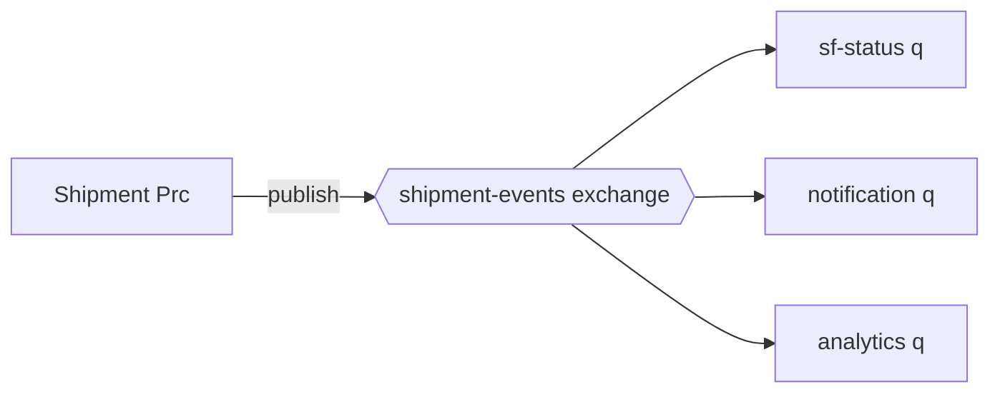
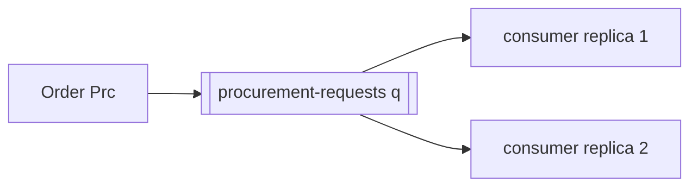
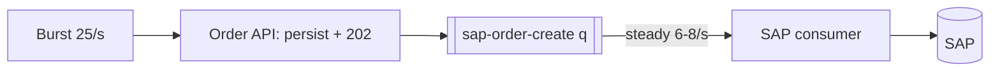
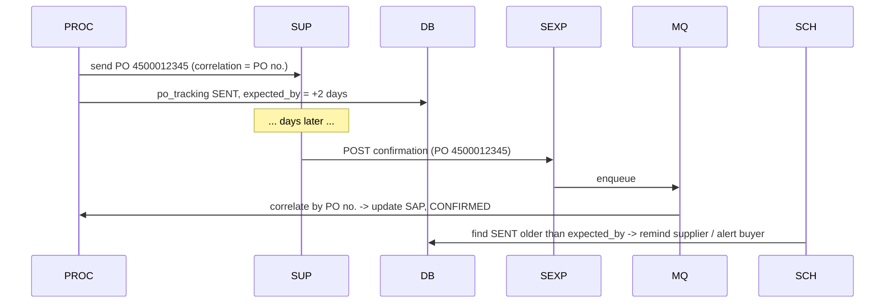
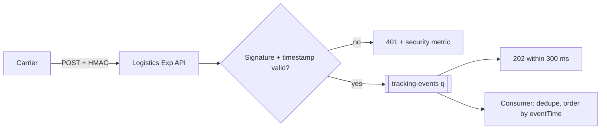
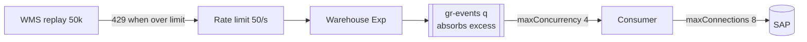

# 07.3 — Messaging Patterns (Patterns 10, 11, 12, 13, 33, 35)

## Pattern 10 — Publish-subscribe · `Infra (Anypoint MQ exchanges)` · `Essential`

**Problem:** The producer shouldn't need to know who consumes its events.
**AIM use case:** `shipment.booked` is consumed by status-sync (Salesforce), customer notifications (email/SMS) and analytics.
**Components:** `anypoint-mq:publish` to an **exchange**, queues bound to the exchange, and one `anypoint-mq:subscriber` per consuming app.



**Failure handling:** each subscriber queue has its own DLQ. A failing notification consumer doesn't affect Salesforce updates.
**Reliability/perf:** the exchange copies the message to each bound queue, so each subscriber gets at-least-once delivery independently.
**Alternatives:** Kafka topics with consumer groups (replayable). Salesforce Platform Events for Salesforce-centric fan-out.
**Don't use when:** you need a *reply* or a guarantee that a specific consumer acted (use request-reply or a saga).

**Interview Q:** *"How do you add a new subscriber without risking existing ones?"* **A:** "Create a new queue bound to the exchange. It only receives new messages from that point. If it needs history, backfill from the source of truth or the analytics store. Producers and other subscribers are untouched."

---

## Pattern 11 — Point-to-point messaging · `Infra (MQ queue)` · `Essential`

**Problem:** Work must be done exactly once by *one* of possibly many competing workers.
**AIM use case:** `procurement-requests-q`. Each shortage must be handled by exactly one procurement consumer instance, while 2 replicas compete for messages.



**Failure handling:** competing consumers plus the ack timeout. If replica 1 dies mid-processing, the message becomes visible again and replica 2 processes it. **That's why the consumer must be idempotent** (Diagram 9).
**Perf:** scale by adding replicas or increasing `maxConcurrency`. Throughput is bounded by the downstream system (SAP).
**Alternatives:** direct HTTP call (synchronous coupling), or a scheduler polling a DB table (works, but it's polling).
**Don't use when:** several *different* systems need the same message (use pub-sub).

**Interview Q:** *"Can two consumers process the same queue message at the same time?"* **A:** "Normally no, because the message is locked while in flight. But if processing outlasts the ack timeout, the lock expires and a second consumer gets it while the first is still working. So I set the ack timeout above the p99 processing time and still make the consumer idempotent."

---

## Pattern 12 — Queue-based load levelling · `Infra + Native` · `Essential`

**Problem:** Order bursts at quarter-end (25 orders/s for 5 minutes) exceed what SAP can absorb (assumption: ~8 order creations/s).
**AIM use case:** In **peak mode** (feature flag or automatic when the SAP circuit is half-open), the order API persists and returns `202 Accepted`. The orders are queued, and a consumer with `maxConcurrency=6` creates SAP orders at a steady rate.



**Failure handling:** queue depth and **message age** are the key metrics. Alert when the oldest message is more than 10 minutes old (the business SLA for confirmation).
**Reliability:** messages are durable, so a burst never overloads SAP and nothing is lost.
**Trade-off:** clients get an eventual answer (status via callback or polling) rather than an immediate one.
**Alternatives:** scale SAP (rarely possible), rate-limit clients (pushes the problem to Salesforce users).
**Don't use when:** the caller truly needs the answer synchronously and the volume is within capacity.

**Interview Q:** *"Isn't returning 202 just hiding the problem?"* **A:** "No, it converts a capacity problem into a latency problem the business has agreed to accept. The order is durably captured, SAP is protected, and we expose status and an SLA on queue age. Without levelling, the burst would cause SAP timeouts, which are much worse because they create unknown outcomes."

---

## Pattern 13 — Asynchronous request-reply · `Custom` · `Essential`

**Problem:** The reply comes much later (hours or days) or from another channel.
**AIM use case:** A PO goes to the supplier now, and the confirmation arrives days later via a callback or SFTP file. The **PO number is the correlation ID**.
**Components:** request: `supplier-sys-api` POST + DB record `po_status=SENT`. Reply: Supplier Exp API → queue → consumer correlates by PO number and updates SAP. A scheduler checks for overdue replies.



**Failure handling:** a reply with an unknown correlation ID goes to a business error queue (maybe a PO from another system). No reply arrives: the timeout scheduler escalates. Duplicate replies are handled with idempotency per `(PO, confirmation version)`.
**Alternatives:** polling the supplier's API for status (simple, wasteful), or a synchronous API (impossible, since humans confirm).
**Don't use when:** the reply is fast (< a few seconds). Plain request-response is simpler.

**Interview Q:** *"How do you correlate replies when the partner can't echo your ID?"* **A:** "Use a natural business key they *do* keep, such as our PO number and line. Otherwise maintain a mapping table from their reference to ours, populated from their acknowledgement. Correlation always needs a key both sides know. If none exists, that's a requirement to negotiate with the partner."

---

## Pattern 33 — Webhooks and callback processing · `Native (listener)` + `Custom (security, queueing)` · `Essential`

**Problem:** Partners push events to us. They expect fast acks, and they retry on failure, which causes duplicates.
**AIM use case:** Carrier tracking webhooks (`IN_TRANSIT`, `DELIVERED` + POD), WMS dispatch webhooks.



**HMAC verification sketch (DataWeave):**
```dataweave
%dw 2.0
import HMACWith from dw::Crypto
import toBase64 from dw::core::Binaries
output application/java
var expected = toBase64(HMACWith(p('secure::carrier.webhookSecret') as Binary,
                                 (attributes.headers.'x-timestamp' ++ "." ++ vars.rawBody) as Binary, "HmacSHA256"))
---
(expected == attributes.headers.'x-signature')
  and (abs(now() as Number - (attributes.headers.'x-timestamp' as Number)) < 300)
```
*(`vars.rawBody` must be the **exact raw bytes** received. Re-serialised JSON changes whitespace and breaks the signature. Use a constant-time comparison where available.)*

**Failure handling:** ack only **after a durable enqueue**. If MQ is down, return 503 so the partner retries later. Never ack and then drop.
**Alternatives:** polling partner APIs, or a managed event gateway.
**Don't use when:** the partner can't secure callbacks (no HMAC, no mTLS, no static IPs). Prefer polling over an unauthenticated public endpoint.

**Interview Q:** *"The carrier retries webhooks 5 times if you don't answer within 5 s. Your consumer takes 8 s. What happens?"* **A:** "Done synchronously, we'd get 5 duplicates of every event and possibly timeouts. That's why the webhook endpoint only validates, enqueues and returns 202 in milliseconds, and the slow processing happens asynchronously with dedupe on the carrier's event ID."

---

## Pattern 35 — Backpressure and asynchronous workload management · `Native (runtime) + design` · `Advanced`

**Problem:** Producers send work faster than consumers or backends can process it. Without backpressure you get memory exhaustion, thread starvation, timeouts and cascading failure.
**AIM use case:** A WMS replays 50,000 historical goods-receipt webhooks after an outage.

**Mechanisms in a Mule/Anypoint design**

| Layer | Mechanism |
|-------|-----------|
| Gateway | Rate limiting / spike control return 429 with `Retry-After`, which pushes back to the producer |
| HTTP listener | Mule's reactive engine applies backpressure when thread pools are saturated (the source stops accepting, or rejects, work) |
| Flow | `maxConcurrency` on flows limits in-flight events |
| Outbound | `maxConnections` on requesters (a bulkhead). DB `maxPoolSize` + `maxWait` |
| Messaging | The queue absorbs the excess. Consumer concurrency is fixed. Prefetch limits local buffering |
| Batch | `maxConcurrency`, block size |



**Failure handling:** watch queue depth/age and consumer error rates. If SAP slows down, *reduce* consumer concurrency (feature flag), don't increase it.
**Trade-off:** backpressure moves the waiting to where it's cheapest and safest (the queue or the producer's retry loop).
**Don't:** use unbounded `async` scopes, unbounded parallel-foreach, or in-memory buffers that grow with load.

**Interview Q:** *"What's the difference between rate limiting and backpressure?"* **A:** "Rate limiting is a fixed policy at the edge, so many requests per client per window, regardless of system health. Backpressure is dynamic: the system signals 'slow down' based on actual capacity, through bounded concurrency, queue depth and 429/503 responses. I use both: rate limits for fairness and protection, backpressure for actual capacity."

Next: [07.4 Reliability patterns](04-reliability-patterns.md)
