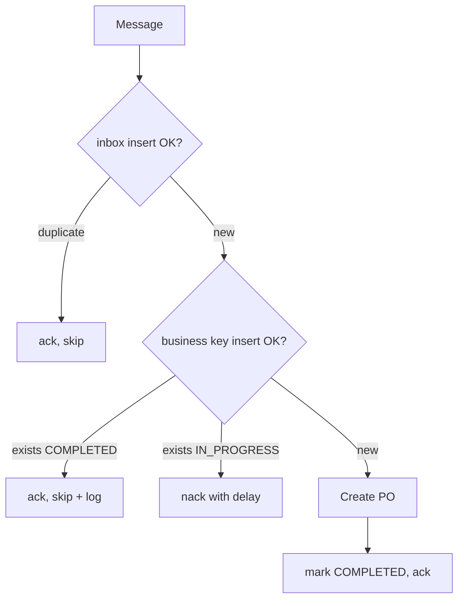
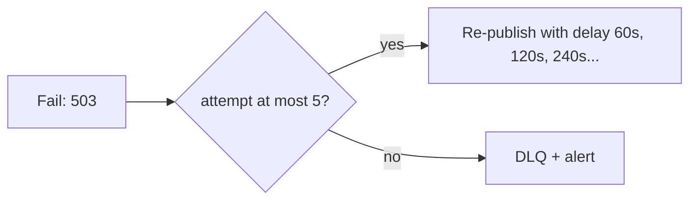
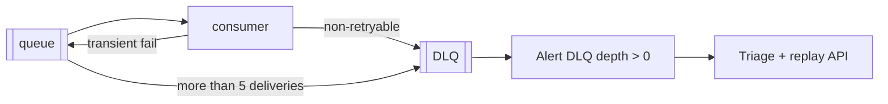
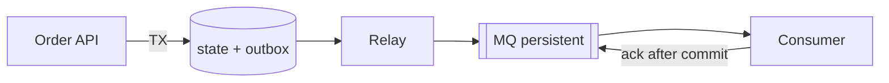
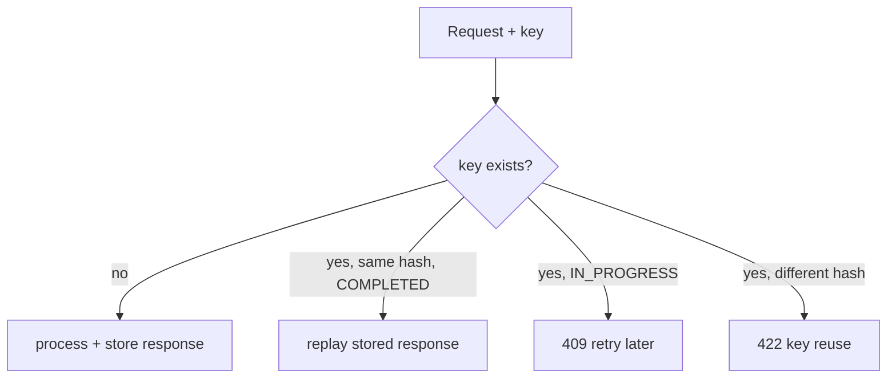
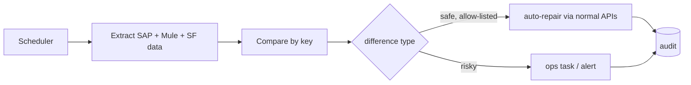

# 07.4 — Reliability Patterns (Patterns 14, 15, 16, 17, 29, 30)

These are the patterns that separate senior developers from mid-level ones. Learn them deeply.

## Pattern 14 — Idempotent receiver · `Custom` (+ `Native` validator for simple cases) · `Essential`

**Definition:** a receiver that produces the **same outcome** whether a message arrives once or many times.
**Problem:** at-least-once delivery (MQ, webhooks, client retries) **guarantees** duplicates eventually.
**AIM use case:** The procurement consumer receives `inventory.shortage-detected` twice and must create only one PO.

**Two layers of protection**
1. **Technical dedupe (inbox):** `INSERT INTO inbox_event (event_id, consumer)`. A PK violation means the event was already processed, so ack and skip.
2. **Business idempotency:** a unique key on the **business intent**, `{orderId}:{material}:{plant}`. This catches *different* events with the same intent (e.g. a republished event with a new eventId after reconciliation).



**Crucial nuance:** the inbox insert and the side effect (SAP PO) are **not** atomic, because SAP isn't in our DB transaction. If we crash after the SAP call but before `COMPLETED`, the retry must **look up** SAP by reference before creating. *Idempotency = dedupe + lookup-before-create.*

**Native option:** `idempotent-message-validator` (Object Store based). It's fine for tracking events, but not sufficient for financial documents.
**Don't use when:** never skip idempotency for anything that creates business documents.

**Interview Q:** *"Your consumer is idempotent using an Object Store. Is that enough?"* **A:** "Not for POs. The OS check and the SAP call aren't atomic, so OS entries can expire before a late redelivery, and they're not auditable. I use a DB unique constraint for the business key, lookup-by-reference in SAP for crash recovery, and keep the OS validator for low-stakes streams."

---

## Pattern 15 — Retry with backoff and bounded attempts · `Native` (`until-successful`, reconnection, MQ redelivery) · `Essential`

**Problem:** Transient failures (network blips, 503, 429) often succeed on retry. Unbounded or immediate retries cause **retry storms**.
**AIM rules**
- Retry **only transient** errors (see [06.3](../06-mule-implementation/03-error-handling.md)), and **only idempotent** operations (or after a lookup).
- **Bounded attempts**, with **exponential backoff + jitter**: 1 s, 2 s, 4 s ± random.
- Retry at **one layer only**. If Exp, Prc and Sys each retry 3 times, a single failure becomes 27 calls.
- Honour `Retry-After` on 429/503.

| Where | Mechanism | Use |
|-------|-----------|-----|
| In-flow, short | `until-successful maxRetries="2" millisBetweenRetries="500"` | GET availability |
| Connection level | `<reconnection><reconnect frequency="2000" count="3"/></reconnection>` on connector configs | Establishing connections (DB, SFTP, SAP) |
| Async, long | MQ nack → redelivery. A **delayed re-publish** with an attempt counter implements real exponential backoff | Supplier PO transmission over minutes or hours |

```xml
<!-- Exponential backoff via re-publish with delay (async) -->
<set-variable variableName="attempt" value="#[(attributes.properties.attempt default '0') as Number + 1]"/>
<choice>
  <when expression="#[vars.attempt &lt;= 5]">
    <anypoint-mq:publish config-ref="MQ_Config" destination="${mq.q.supplierPo}"
                         deliveryDelay="#[(2 pow vars.attempt) * 30]" deliveryDelayUnit="SECONDS">
      <anypoint-mq:properties>#[attributes.properties ++ { attempt: vars.attempt as String }]</anypoint-mq:properties>
    </anypoint-mq:publish>
  </when>
  <otherwise><flow-ref name="publish-to-dlq-with-metadata-subflow"/></otherwise>
</choice>
```
*(Parameter names for delivery delay vary by connector version. Check the publish operation's options.)*



**Interview Q:** *"What's a retry storm and how do you prevent one?"* **A:** "When a dependency degrades, every client retries immediately, which multiplies its load and keeps it down. I prevent it with bounded retries at a single layer, exponential backoff with jitter, circuit breakers that stop calls entirely while the dependency is unhealthy, and by honouring Retry-After."

---

## Pattern 16 — Dead-letter queues and poison-message handling · `Infra (Anypoint MQ DLQ)` + `Custom` · `Essential`

**Problem:** A message that can never succeed (malformed, references a deleted material, triggers a bug) is retried forever, blocking or consuming capacity. That's a **poison message**.
**AIM design:** every business queue has a DLQ with **max deliveries = 5**. Non-retryable errors are sent to the DLQ **immediately** with metadata (error type, description, correlationId, original queue, attempt count).



**Operational rules:** alert on **any** DLQ message for critical flows. Use a replay API, never manual console moves. Set a retention policy so messages don't expire before triage.
**Trade-off:** DLQ isolation keeps the main flow moving, but each DLQ message is a business transaction stuck in limbo. Measure **time-to-resolution**.
**Don't:** use the DLQ as a substitute for reconciliation. Some failures never produce a message at all.

**Interview Q:** *"How do you handle a poison message on a FIFO queue?"* **A:** "That's harder, because it blocks its message group: later messages for the same PO can't be processed. I limit deliveries so it moves to the DLQ quickly, alert immediately, and decide with the business whether the following messages can proceed without it. Sometimes we park the whole group until it's fixed, to preserve ordering."

---

## Pattern 17 — Guaranteed delivery and redelivery · `Infra` + `Custom (outbox)` · `Essential`

**Definition:** once a message is accepted, it is eventually delivered, surviving crashes and restarts.
**What's guaranteed where**

| Hop | Mechanism | Guarantee |
|-----|-----------|-----------|
| Client → Exp API | Persist before 2xx, client retry with key | At-least-once intake, idempotent processing |
| Mule → MQ | **Transactional outbox** + relay | At-least-once publish (duplicates possible, never lost) |
| MQ storage | Persistent, replicated by the platform | Durable within its retention/TTL |
| MQ → consumer | Ack after processing (MANUAL/AUTO) | At-least-once delivery |
| Consumer side effects | Inbox + business idempotency | Effectively-once *effect* |



**Common mistakes:** `IMMEDIATE` ack mode, publishing to MQ *outside* the DB transaction without an outbox, and VM transient queues for business data.

**Interview Q:** *"Can you guarantee exactly-once delivery end to end?"* **A:** "No, not across HTTP, SAP and Anypoint MQ. None of them participate in a shared transaction. What I can guarantee is at-least-once delivery plus idempotent processing, which gives an exactly-once *effect* on business state. I'm careful to describe it that way."

---

## Pattern 29 — Duplicate request and duplicate-event prevention · `Custom` · `Essential`

**Sources of duplicates on AIM:** a Salesforce user double-clicks, a client retries after a timeout, MQ redelivers, a webhook is retried, a DLQ message is replayed, the same SFTP file is uploaded twice, MES devices resend on reconnect.

| Source | Prevention |
|--------|-----------|
| API client retry / double-click | `Idempotency-Key` + stored response replay (409 while in progress) |
| MQ redelivery | Inbox table (eventId) |
| Different events, same intent | Business key (`orderId:material:plant`, deliveryNumber for invoices) |
| File re-upload | File name + checksum registry |
| SAP side | Lookup by external reference. SAP's own duplicate checks (e.g. billing per delivery) |
| Partner side | Forward the `Idempotency-Key` to partners that support it |

**Request hash:** store `SHA-256(canonical request)` with the key. The same key with a different body means **422**, a client bug. Don't silently return the old response.



**Retention:** keep keys longer than the maximum client retry window (AIM: 7 days for orders). Purge them with a scheduled job.

**Interview Q:** *"Where would you put the idempotency check: Experience or Process layer?"* **A:** "In the Process layer, which owns the business transaction and the database. If it lived only in the Experience API, another Experience API calling the same process would bypass it."

---

## Pattern 30 — Reconciliation and controlled replay · `Custom` · `Essential`

**Problem:** Even with perfect retry logic, systems drift: events are lost due to bugs, manual changes in SAP, partial failures, or a misconfigured filter.
**AIM reconciliations**

| Recon | Frequency | Compares | Auto-repair |
|-------|-----------|----------|-------------|
| Order status | Every 4 h | `order_state` vs SAP order status vs Salesforce | Re-publish the status event to Salesforce |
| Orders without SAP numbers | Every 15 min | `PENDING_ERP` older than 15 min | Trigger lookup-then-create |
| SAP orders without Mule state | Nightly | SAP orders with an `REF_1` prefix but no `order_state` row | Create the missing state and notify ops |
| Inventory | Nightly + every 4 h for A-items | WMS vs SAP per material/plant/sloc | Allow-listed differences only. Others go to an ops task |
| Invoices | Daily | Delivered orders vs SAP billing docs | Alert finance. **No auto-billing** |



**Controlled replay:** a replay API with auth (ops role), dry-run, rate limits, an audit trail, and **reliance on idempotent consumers**.
**Trade-off:** reconciliation costs compute and backend load, so schedule heavy jobs off-peak and use deltas where possible.

**Interview Q:** *"If your integrations are idempotent and reliable, why reconcile?"* **A:** "Because reliability covers the failures we anticipated. Reconciliation catches the ones we didn't: bugs, manual changes, mis-mapped filters, data fixed directly in a system. In manufacturing and finance it's also an audit expectation. It's the safety net that proves the system is consistent."

Next: [07.5 Transaction patterns](05-transaction-patterns.md)
