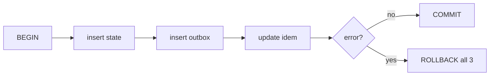
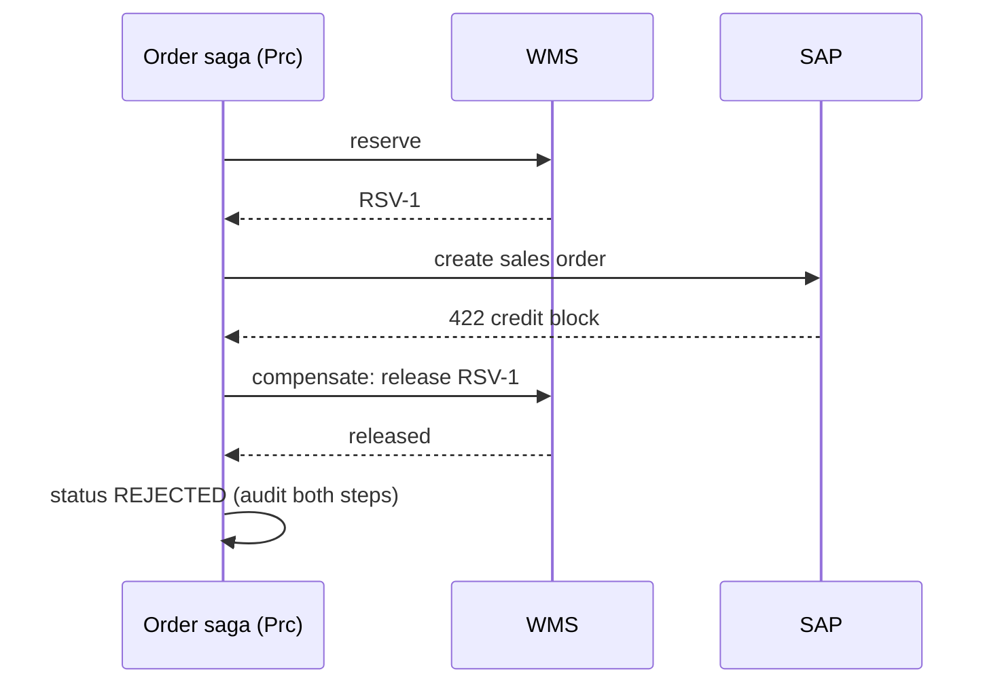
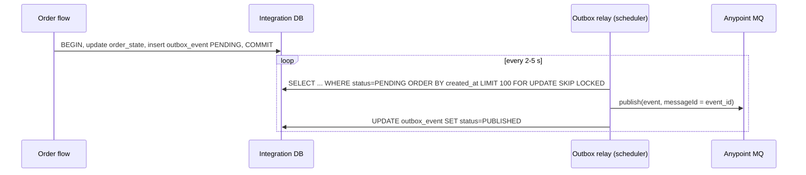

# 07.5 — Transaction Patterns (Patterns 18, 19, 31)

## Pattern 18 — Database transactions and transaction boundaries · `Native` · `Essential`

**Definition:** a set of operations that commit or roll back together (ACID) within **one resource**, or several XA-capable resources.
**AIM use case:** order state + outbox event + idempotency completion must commit together, or not at all.

```xml
<try transactionalAction="ALWAYS_BEGIN" doc:name="TX: state + outbox + idempotency">
    <db:insert config-ref="DB_Config" doc:name="Insert order_state">...</db:insert>
    <db:insert config-ref="DB_Config" doc:name="Insert outbox_event">...</db:insert>
    <db:update config-ref="DB_Config" doc:name="Complete idempotency_record">...</db:update>
</try>
```



**Transaction types in Mule 4**

| Type | Scope | Resources | Use on AIM |
|------|-------|-----------|------------|
| **Local** | One connector config | DB, JMS, VM | ✔ outbox writes |
| **XA** | Multiple XA resources (2-phase commit) | DB + JMS/VM with XA drivers | ✘ Slow, complex recovery, not applicable to HTTP/SAP/Anypoint MQ |
| **None** | — | HTTP, SAP RFC, Salesforce, Anypoint MQ | Use sagas / outbox / idempotency |

**Boundary rules**
- Keep transactions **short**: no HTTP calls or long DataWeave inside them, because that holds DB locks and pool connections.
- Know which operations **join**: operations on the same config with `transactionalAction="JOIN_IF_POSSIBLE"` (the default) join. HTTP never joins.
- `on-error-continue` inside a transactional scope **commits**. Make sure that's what you want.

**Don't use XA when:** any participant is non-XA (most of them), or throughput matters.

**Interview Q:** *"Why not wrap the SAP call and the DB insert in one transaction?"* **A:** "SAP RFC over the connector and HTTP don't take part in Mule transactions, so a rollback can't undo an SAP order. Wrapping them gives a false sense of safety. Instead I call SAP first and then commit state and outbox atomically. Inconsistent windows are covered by lookup-by-reference and reconciliation."

---

## Pattern 19 — Saga orchestration and compensating actions · `Custom` · `Essential`

**Definition:** a long-running business transaction split into local transactions. Each step has a **compensating action** that semantically undoes it if a later step fails.
**AIM order saga (orchestrated by `order-mgmt-prc-api`)**

| # | Step | Compensation | Compensatable? |
|---|------|--------------|----------------|
| 1 | Claim idempotency key | Delete the claim | Yes |
| 2 | Soft-reserve stock (WMS) | Release the reservation | Yes (and the TTL auto-expires) |
| 3 | Create the SAP sales order | Cancel / reject the SAP order (set a rejection reason) | Yes, before delivery |
| 4 | Create a PO for the shortage | PO change: cancel line (supplier must accept) | **Partially**. The supplier may have shipped |
| 5 | Dispatch from the warehouse | — | **No**: physical. Forward recovery only |



**Orchestration vs choreography**

| | Orchestration (AIM order saga) | Choreography (events only) |
|-|-------------------------------|----------------------------|
| Control | A central process knows the steps and state | Each service reacts to events |
| Visibility | One place to see the saga state (`order_state`) | Distributed, harder to trace |
| Coupling | Orchestrator knows the participants | Looser |
| Use when | Clear business process with compensation | Simple, independent reactions (status sync, analytics) |

AIM uses **orchestration** for the order and cancellation sagas and **choreography** for downstream notifications.

**Failure handling in the saga itself:**
- Compensations must be **idempotent and retryable**. "Release reservation" may be called twice.
- A failing compensation → retry queue → human task. Never ignore it.
- Persist the saga state *before* each step, so a crash resumes or compensates correctly (the state machine in [03.4](../03-uml-diagrams/04-activity-state-domain.md)).

**Don't use when:** a simple local transaction suffices, or the steps can't be compensated and the business needs strict atomicity. Then redesign the process, e.g. reserve in SAP only.

**Interview Q:** *"Inventory is reserved, but SAP creation fails. What does your saga do?"* **A:** "It depends on *how* it failed. A definitive business error, like a credit block, triggers the compensation: release the reservation and mark the order REJECTED with the SAP reason. A timeout is an unknown outcome, so we **don't** compensate. We look up the order in SAP by reference. If it exists, we continue. If not, we keep the reservation, mark PENDING_ERP, and the retry consumer finishes it. If retries are exhausted, the order goes to FAILED_NEEDS_ATTENTION and the reservation TTL plus an ops task handle cleanup. Compensating on a timeout risks releasing stock for an order SAP actually created."

---

## Pattern 31 — Transactional outbox and inbox · `Custom` · `Essential`

**The dual-write problem:** a flow commits to the DB and then publishes to MQ. If it crashes between the two, the DB says CONFIRMED but no event exists, so Salesforce never updates and fulfilment never starts. If you publish first, a DB rollback leaves an event about an order that doesn't exist.

**Outbox solution:** write the event **into the same DB transaction** as the state change. A separate **relay** publishes pending outbox rows to MQ and marks them published.



**Relay implementation notes**
- `FOR UPDATE SKIP LOCKED` (PostgreSQL) lets several replicas relay concurrently without double-publishing the same row in the same moment.
- A crash after publish but before the update means the event is published again: **at-least-once**. Consumers dedupe with the **inbox**, keyed by `event_id`.
- Ordering: publish in `created_at` order per aggregate. With concurrent relays, use one relay per partition or accept order-tolerant consumers.
- **Cleanup:** purge PUBLISHED rows after N days.
- **Alternative relay:** **change data capture** (e.g. Debezium on the PostgreSQL WAL), which streams outbox inserts to a broker. It has lower latency and no polling, but it's more infrastructure.

**Inbox (consumer side):**
```sql
INSERT INTO inbox_event (event_id, consumer) VALUES (:eventId, 'procurement');
-- PK violation  -> already processed -> ack and skip
-- then do work + mark business state in the same local TX where possible
```

**Trade-offs:** extra table, a polling relay (latency 2–5 s), cleanup jobs. You gain no lost events and a consistent state + event.
**Don't use when:** losing the occasional event is acceptable (pure telemetry), or the message broker *is* the system of record (event-sourced designs).

**Interview Q:** *"Your DB write succeeded but publishing to Anypoint MQ failed. What happens?"* **A:** "With an outbox nothing is lost. The event row was committed with the state, the relay keeps retrying until MQ is back, and the queue catches up. Without an outbox I'd have an inconsistent system and need reconciliation to find the orphans. That's exactly why the outbox exists. I'd add an alert on the age of the oldest PENDING outbox row."

Next: [07.6 Batch, file & synchronisation patterns](06-batch-file-sync-patterns.md)
