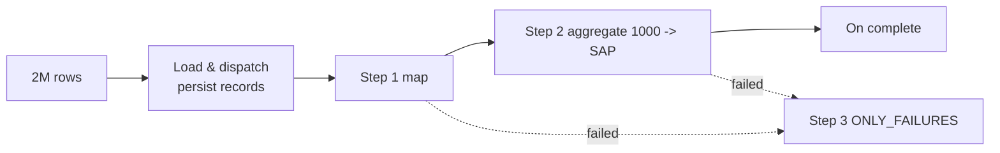
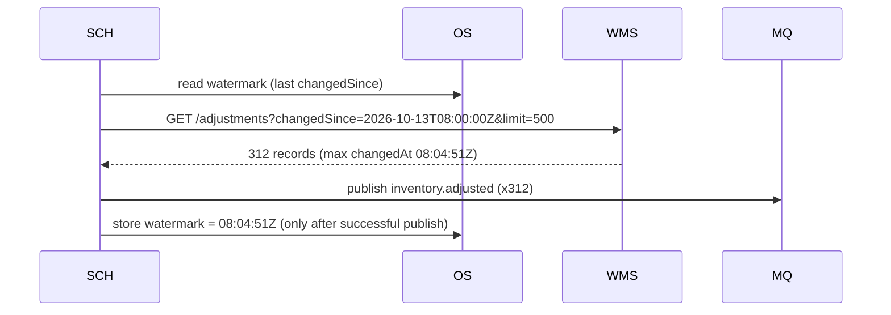
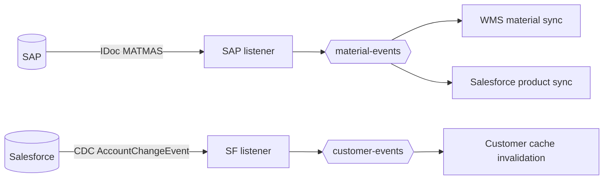
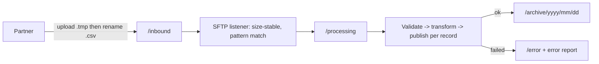

# 07.6 — Batch, File & Synchronisation Patterns (Patterns 20, 21, 22, 24)

## Pattern 20 — Batch processing and bulk ingestion · `Native (Batch Job)` · `Essential`

**Problem:** millions of records must be processed reliably, with bounded memory and per-record error handling.
**AIM use case:** the nightly WMS inventory snapshot (2M rows) is compared with SAP, and the deltas are posted.
**Components:** `batch:job`, `batch:step`, `batch:aggregator`, `batch:on-complete`. See the full XML in [06.7](../06-mule-implementation/07-scheduler-batch-sftp.md) and the architecture in [03.5](../03-uml-diagrams/05-batch-dlq-replay.md).

**Failure handling:** per-record failure tracking, `maxFailedRecords` as a corruption threshold, an error report file, and re-runnable delta posting.
**Performance levers:** delta-only, aggregator size, blockSize, maxConcurrency, streaming input, and avoiding per-record HTTP calls.
**Alternatives:** For Each (small sets), Parallel For Each (moderate), event streaming (continuous), ETL tools (pure bulk replication).
**Don't use when:** record ordering matters, the volume is small (the batch overhead isn't worth it), or you need a synchronous response.

**Interview Q:** *"Batch Job vs For Each for 50,000 records?"* **A:** "For 50k records with an API call each, Batch: it gives me per-record failure handling, persistence across restarts, parallel blocks and aggregation for bulk calls. For Each would hold the collection in memory, stop at the first error unless I wrap every iteration, and offers no restart semantics."

---

## Pattern 21 — Scheduled polling and incremental synchronisation · `Native (Scheduler, watermark)` · `Essential`

**Problem:** the source can't push changes. You need only the *changes* since the last run, not a full reload.
**AIM use case:** poll the WMS `GET /adjustments?changedSince=` every 5 minutes for manual stock adjustments (cycle counts, damage write-offs).

**Key details**
- **Update the watermark only after success.** If you update it first, a crash loses records.
- **Overlap window:** query from `watermark - 1 min` to catch clock skew and records committed late. The overlap creates duplicates, so consumers must be idempotent.
- **Pagination:** loop until there are no more pages within the run.
- The DB connector's **`db:listener`** supports watermark columns natively for table polling. For HTTP sources, store the watermark yourself in Object Store or the DB.
- **Multi-replica:** run the scheduler on one node (cluster primary) or guard it with a DB lock.

**Alternatives:** webhooks or CDC (push, lower latency), full snapshots (simple, heavy).
**Don't use when:** near-real-time latency is required and the source can push.

**Interview Q:** *"Why use the record's changedAt rather than the poll start time as the watermark?"* **A:** "Using poll time can skip records committed with an earlier timestamp after my query ran, because of long transactions or clock skew. The max changedAt of processed records, plus a small overlap and idempotent consumers, is safer."

---

## Pattern 22 — Event-driven integration and change data capture (CDC) · `Infra` + `Native listeners` · `Advanced`

**Problem:** polling is slow and wasteful. Systems should react to changes as they happen.
**AIM use cases**
- **SAP → Mule:** material master changes via **IDoc MATMAS** (change pointers, BD52/BD21), or **SAP Event Mesh** / business events in S/4HANA.
- **Salesforce → Mule:** **Change Data Capture** on Account (credit-block changes), consumed via the Salesforce connector's streaming / Pub/Sub listener with replay IDs.
- **Integration DB → MQ:** outbox via Debezium (log-based CDC) as an alternative relay.

**Failure handling:** store the **replay position** (Salesforce replay ID, IDoc TID) durably. Handle gaps when the listener was down longer than the source's retention: fall back to a **full reconciliation**.
**Trade-offs:** low latency and less load, but more moving parts, source-specific configuration and retention limits.
**Don't use when:** the source can't emit events reliably, or a nightly snapshot is good enough for the business.

**Interview Q:** *"Your Salesforce CDC listener was down for 4 days. What now?"* **A:** "If the downtime exceeds Salesforce's event retention window, replay can't recover everything. I'd resume from the earliest available replay and run a full or delta reconciliation for the gap, using a query on LastModifiedDate. I'd also add monitoring on listener health and last-event age, so it's caught in minutes next time."

---

## Pattern 24 — SFTP and file-based integration · `Native (SFTP/File connectors)` · `Essential`

**Problem:** many partners (small suppliers, 3PLs, legacy WMS) only exchange files.
**AIM use cases:** supplier confirmations as CSV (in), the inventory snapshot (in), POs as CSV for small suppliers (out), and error reports back to partners (out).

**Senior checklist for file integrations**

| Concern | Practice |
|---------|----------|
| Partial files | Write-then-rename convention, `.done` markers, size-stability check |
| Duplicates | Registry of `fileName + checksum`. Reject the same content uploaded twice |
| Large files | Streaming + Batch. Never read 500 MB into memory |
| Encoding | Agree on UTF-8. Declare the encoding in the MIME type. Watch for BOMs |
| Security | Key-based auth, host key verification, PGP encryption for sensitive files, least-privilege folders |
| Traceability | File name → correlation ID. Every record carries `sourceFile` and `lineNo` |
| Outbound | Write as `.tmp`, then rename. Idempotent file names (`PO_4500012345_v1.csv`) |
| Monitoring | "No file received by 02:00" is an alert too. Missing files are silent failures |

**Alternatives:** APIs (real time), EDI via B2B/partner manager tools (X12/EDIFACT with acknowledgements), managed file transfer (MFT) platforms.
**Don't use when:** the partner can integrate via API and the business needs real-time status.

**Interview Q:** *"How do you detect that a supplier stopped sending files?"* **A:** "Absence monitoring. A scheduled check verifies that the expected file arrived within its window, e.g. a supplier's daily confirmation by 18:00, and alerts otherwise. Most file integrations only monitor errors, so a partner silently stopping goes unnoticed for days."

Next: [07.7 Resilience & data patterns](07-resilience-and-data-patterns.md)
