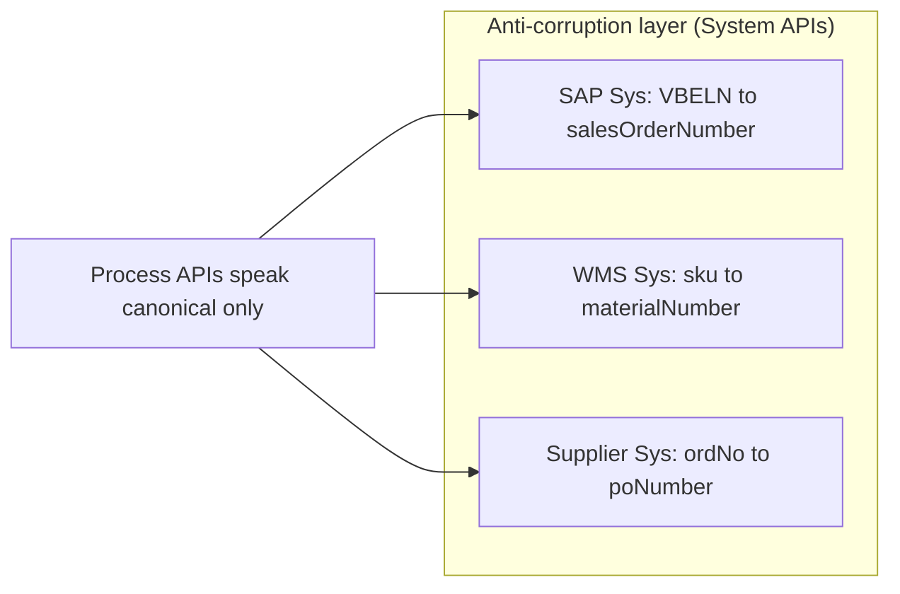
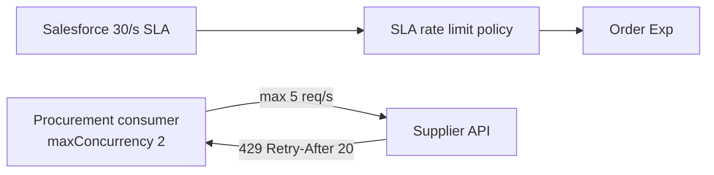
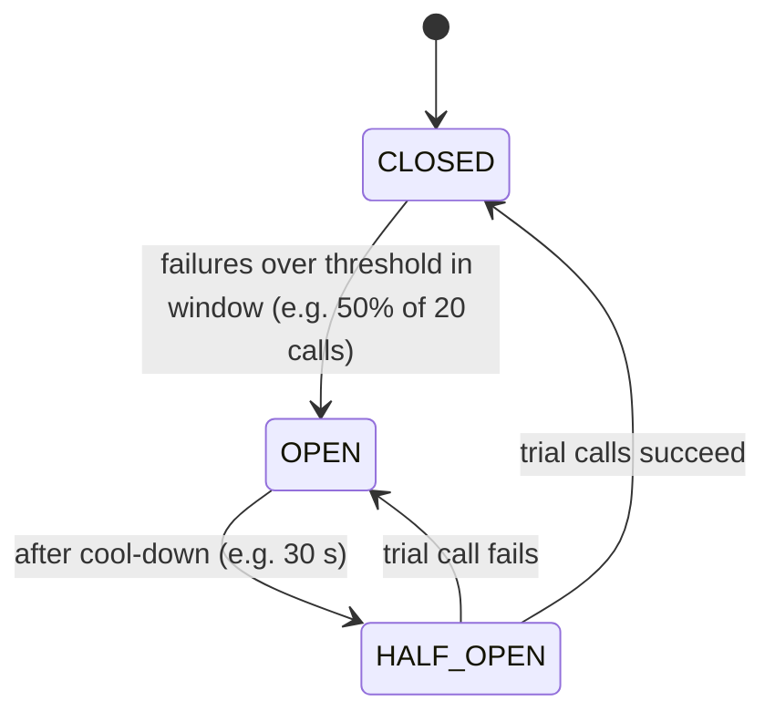
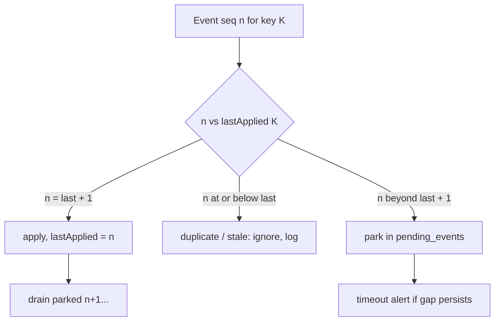

# 07.7 — Resilience & Data Patterns (Patterns 23, 26, 27, 28, 34)

## Pattern 23 — Canonical data model and anti-corruption layer · `Custom (DataWeave + API contracts)` · `Essential`

**Problem:** without a shared model, every process learns SAP's, the WMS's and each supplier's vocabulary, so one backend change ripples everywhere.
**AIM approach:** a **small, domain-scoped canonical model** (Order, OrderLine, Material, Inventory, PurchaseOrder, Shipment, Invoice; see [03.4](../03-uml-diagrams/04-activity-state-domain.md)). **System APIs are the anti-corruption layer (ACL):** they translate `VBELN`/`POSNR`/`MATNR` to `salesOrderNumber`/`lineNumber`/`materialNumber`.



**Governance:** canonical types are published as an Exchange fragment and versioned with semver. Changes go through a lightweight design review.
**Trade-offs:** mapping effort in every System API, the risk of a "lowest common denominator" model, and model bloat if every request adds a field.
**Don't use when:** the integration is a simple pass-through between two systems with identical semantics. Mapping twice adds no value.

**Interview Q:** *"Enterprise-wide canonical model: good or bad?"* **A:** "A single enterprise-wide model usually fails. It becomes huge, slow to change and politically contested. I prefer bounded, domain-specific canonical models (order, procurement, logistics), owned by domain teams, with translation at the System API boundary."

---

## Pattern 26 — Rate limiting and throttling · `Infra (API Manager policies)` + `Custom (client-side throttling)` · `Essential`

**Two directions**
1. **Inbound (protect AIM):** API Manager policies:
   - **Rate Limiting** (fixed window per API, optionally keyed by client ID or IP).
   - **Rate Limiting – SLA-based** (limits per client application per **SLA tier** via contracts, e.g. Gold 50 req/s, Silver 10 req/s).
   - **Spike Control** (smooths bursts by queueing or delaying within limits).
2. **Outbound (respect partners):** the supplier API allows 5 req/s per client. AIM must **throttle itself**:
   - Consumer `maxConcurrency` + a per-message delay, or a **single-consumer queue** that processes at a steady rate.
   - Honour `429 Retry-After` with a delayed re-publish (Pattern 15).



**Clustered/distributed limits:** rate limiting across multiple replicas needs a shared counter. API Manager policies can be configured for distributed/clustered behaviour. Check the policy documentation for how counters are shared on your deployment model.
**Alternatives:** queue-based load levelling (absorb rather than reject), quotas (daily limits).
**Don't:** rate-limit internal System APIs so tightly that legitimate Process API bursts fail. Use bulkheads instead.

**Interview Q:** *"Rate limit vs spike control?"* **A:** "Rate limiting rejects requests above a quota per time window with a 429. Spike control smooths short bursts by delaying requests up to a configured limit, which protects the backend from sudden peaks without rejecting traffic that would have fitted on average."

---

## Pattern 27 — Circuit breaker and bulkhead isolation · `Custom` (Mule 4 has no built-in circuit-breaker scope; see the options below) · `Advanced`

**Problem:** when SAP is down, every order request still waits 6 s for a timeout. Threads pile up, the order API slows, Salesforce times out, and the failure **cascades**.

**Circuit breaker states**



**Implementation options in Mule (be honest that this isn't one native component):**

| Option | How | Notes |
|--------|-----|-------|
| Object Store–based breaker | Before the SAP call, read `sap.circuit` state from a persistent OS. Count failures in the error handler. Open/close based on thresholds | Simple. Shared across replicas with OSv2 (eventual). AIM's choice |
| Custom Java module / SDK component | Wrap resilience4j in a Mule SDK extension | Robust, but needs Java skills and maintenance |
| Gateway / service mesh | Flex Gateway, Envoy or mesh outlier detection between APIs | Infrastructure-level, transparent to code |

**When OPEN:** the order API skips the SAP call immediately and returns `202 PENDING_ERP` (degraded mode), instead of failing slowly.

**Bulkhead isolation:** separate resources so one failing dependency can't drain shared capacity:
- A separate `http:request-config` (with its own `maxConnections`) per backend.
- Separate flows/apps for batch vs online traffic (the batch app can't starve order intake).
- Separate MQ consumers per queue with their own concurrency.

**Interview Q:** *"SAP is down. Walk me through what your API does on request #1 vs request #500."*
**A:** "Request #1 tries SAP, times out after 6 s, does a lookup that also fails, and gets 202 PENDING_ERP. As failures cross the threshold, the breaker opens. From then on, request #500 skips SAP entirely and gets 202 within milliseconds, with the order safely persisted and queued. Every 30 s a trial call checks SAP. When it succeeds, the breaker closes, the retry consumer drains the pending orders at a controlled rate, and nobody waits 6 s for a dead dependency."

---

## Pattern 28 — Caching and cache invalidation · `Native (Cache scope, Object Store)` · `Essential`

**AIM use cases**

| Data | Volatility | Cache strategy |
|------|-----------|----------------|
| Material master (description, base UoM, procurement type) | Low | Cache for 1 h + **event-driven invalidation** on `material.changed` (IDoc MATMAS) |
| UoM conversion factors | Very low | 24 h |
| OAuth tokens | Expire (e.g. 60 min) | TTL = expiry − safety margin |
| Customer credit block | **High business risk** | **Don't cache** for order creation. Read live, or use a short TTL plus CDC invalidation |
| Stock availability | Very volatile | Cache only for **display** (portal browsing, 30 s TTL). Never for reservation decisions |

```xml
<ee:object-store-caching-strategy name="Material_Cache_Strategy" keyGenerationExpression="#[vars.materialNumber]">
    <os:private-object-store alias="materialCache" persistent="true" entryTtl="60" entryTtlUnit="MINUTES" maxEntries="20000"/>
</ee:object-store-caching-strategy>

<ee:cache cachingStrategy-ref="Material_Cache_Strategy" doc:name="Cache material lookup">
    <http:request method="GET" config-ref="HTTP_Request_SAP_Sys_Config" path="/sys/sap/v1/materials/{m}">
        <http:uri-params>#[{ m: vars.materialNumber }]</http:uri-params>
    </http:request>
</ee:cache>

<!-- Invalidation on material.changed event -->
<ee:invalidate-key cachingStrategy-ref="Material_Cache_Strategy" keyGenerationExpression="#[payload.data.materialNumber]"/>
```
*(The Cache scope is an EE feature. It caches **non-consumable** payloads, and a streamed payload is consumed when it's cached. Element names may vary slightly by version.)*

**Invalidation strategies:** TTL (simple, stale up to the TTL), event-driven (precise, needs events), write-through (update the cache on write).
**Don't cache:** anything where staleness causes **financial or physical errors** (credit, price at order time, reservable stock).

**Interview Q:** *"Your material cache served a discontinued material for an hour. How do you prevent it?"* **A:** "Add event-driven invalidation. When SAP sends a material change IDoc, we invalidate that key, so the TTL becomes a fallback rather than the main mechanism. For critical attributes like a sales block, I'd validate live during order creation and use the cache only for enrichment."

---

## Pattern 34 — Event ordering and out-of-order event handling · `Custom` + `Infra (FIFO)` · `Advanced`

**Where order breaks:** parallel consumers, retries (message 1 fails and is redelivered after message 2 succeeds), multiple producers, partner systems sending in the wrong order, and network delays.

**AIM examples:** a carrier sends `DELIVERED` before `OUT_FOR_DELIVERY`. A supplier sends confirmation v2 before v1. MES sends `production-completed` before the last `operation-confirmed`.

**Strategy toolbox**

| Strategy | How | Use when |
|----------|-----|----------|
| **Last-write-wins with version/timestamp** | Apply only if `event.version > stored.version`, otherwise record history only | Only the latest state matters (tracking status) |
| **State machine guard** | Reject transitions that move backwards (`DELIVERED` → `IN_TRANSIT`) | Lifecycles ([03.4](../03-uml-diagrams/04-activity-state-domain.md)) |
| **Sequence number + parking (resequencer)** | Park early events, apply when the gap fills, timeout + alert | Every step matters (PO confirmations, MES operations) |
| **FIFO queue with message group** | Broker preserves order per key | Ordering is guaranteed at the source and must be kept in transit |
| **Commutative design** | Make the operations order-independent (e.g. absolute quantities instead of deltas) | Inventory snapshots: "qty is 40" beats "+5" |



**Interview Q:** *"A shipment confirmation arrives before the warehouse dispatch event. What do you do?"* **A:** "First I check whether the dependency is real. If the shipment record needs data from dispatch, I park the confirmation keyed by delivery number and process it when dispatch arrives, with a timeout alert. If it can stand alone, I create the shipment from the confirmation and let the dispatch event enrich it later, with idempotent upserts so either order converges to the same state. Converging regardless of order is the goal. Strict ordering is only for cases where every step matters."

Back to index: [README](../README.md) · Next section: [08 — Reliability & transactions](../08-reliability-transactions/01-end-to-end-order-flow.md)
