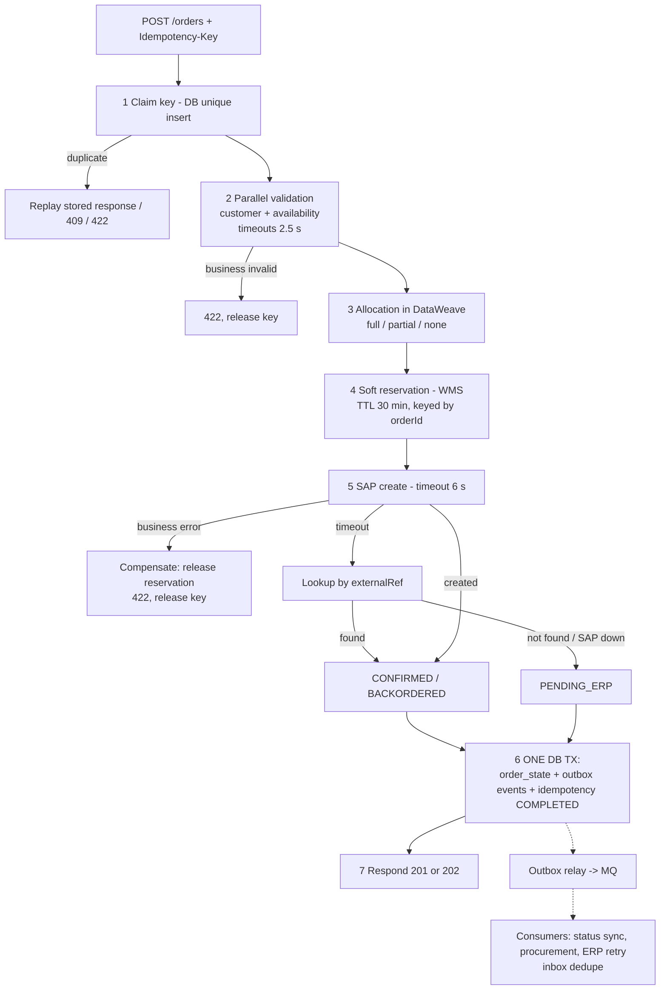

# 08.1 — Phase E: Reliable End-to-End Order Processing

`Essential` · Implemented in the mini project: [`prc-order-management.xml`](../mule-project/aim-order-integration/src/main/mule/prc-order-management.xml)

This page connects everything into **one reliable flow** and explains *why* each safeguard exists. Each safeguard is listed against the failure it prevents.

## 1. The flow with its reliability controls

## 2. Safeguard → failure it prevents

| # | Safeguard | Failure prevented | What would happen without it |
|---|-----------|-------------------|------------------------------|
| 1 | Idempotency key with request hash | Duplicate submissions | Two SAP orders, two shipments, an angry customer |
| 2 | Route-level timeouts in a scatter-gather | Slow dependency drags the API | Salesforce timeouts, so retries, so more load |
| 3 | Pure DataWeave allocation function | Logic bugs in allocation | Hard-to-test logic spread across flows |
| 4 | Reservation with TTL, keyed by orderId | Overselling. Orphaned reservations | Stock promised twice, or stock locked forever |
| 5a | Compensation only on *definitive* errors | Releasing stock for an order SAP actually created | Order exists in SAP with no stock |
| 5b | Lookup-by-reference on timeout | Duplicate SAP orders | Blind retry creates a second order |
| 6 | State + outbox in one local transaction | Lost events (dual write) | SAP order exists, Salesforce never updated |
| 7 | Persist-then-respond | Lost orders after a crash | Client got 201 but there's no trace |
| — | Inbox + business keys in consumers | Duplicate POs, status flip-flops | Redelivery creates duplicates |
| — | DLQ + alerts + replay API | Poison messages, silent failures | Messages lost or retried forever |
| — | Reconciliation jobs | Everything not anticipated | Drift discovered by customers |

## 3. The consistency gaps (and how each is closed)

**Gap A — SAP committed, Mule crashed before the DB commit.**
*State:* the SAP order exists. `idempotency_record` = IN_PROGRESS. No `order_state`.
*Closure:* (1) The client retries with the same key → `IN_PROGRESS` older than a threshold → takeover: **lookup in SAP by reference** → found → complete. (2) The nightly reconciliation finds SAP orders with the `REF_1` prefix and no Mule state.

**Gap B — DB committed, the event not yet published.**
*State:* `order_state` CONFIRMED, outbox row PENDING.
*Closure:* the relay publishes when MQ is available. That's the outbox's purpose. Alert if the oldest PENDING row is older than 5 minutes.

**Gap C — Event published twice** (relay crashed after publish, before the update).
*Closure:* the consumer inbox (`event_id`) and upserts by external ID in Salesforce.

**Gap D — Reservation made, then Mule crashed before SAP.**
*Closure:* the reservation TTL (30 min) auto-releases. The client retry re-reserves with the same orderId, and the WMS treats it as the same reservation (idempotent by reference).

## 4. Outbox vs compensating transaction: when to use which

| Situation | Use | Why |
|-----------|-----|-----|
| You need state change + notification to be atomic | **Outbox** | Turns a dual write into a single local transaction + reliable relay |
| A *business step in another system* succeeded and a later step **definitively** failed | **Compensation** | You can't roll back another system, so you semantically undo the step |
| Outcome unknown (timeout) | **Neither**. Use **lookup + forward recovery** | Compensating something that may not exist (or may) is wrong |
| Step physically irreversible (truck left) | **Forward recovery + human task** | No compensation exists |

## 5. Walk-through: one order, three outcomes (practise saying this)

1. **Happy path:** key claimed → customer ACTIVE, stock 5/5 and 40/40 → reserved → SAP `0000456789` → TX commit (CONFIRMED + `order.confirmed` outbox row) → **201** in ~1.4 s.
2. **SAP slow:** … → SAP times out at 6 s → lookup finds `0000456789` (SAP had committed) → CONFIRMED with `recoveredAfterTimeout=true` → **201** in ~7 s. An observability metric counts recovered timeouts.
3. **SAP down:** … → timeout → lookup fails (connection refused) → PENDING_ERP + `order.erp-pending` outbox → **202**. The retry consumer later does lookup-then-create → CONFIRMED → `order.confirmed` → Salesforce updated. The rep sees "Pending ERP" turn into "Confirmed" a few minutes later.

## 6. What the mini project implements vs. simplifies

| Capability | Mini project | Production design |
|------------|-------------|-------------------|
| Idempotency claim/replay/409/422 | ✔ (H2 DB) | PostgreSQL |
| Scatter-gather validation | ✔ | ✔ |
| Reservation + compensation | ✔ (mock WMS) | Real WMS |
| SAP timeout → lookup → PENDING_ERP | ✔ (mock SAP with a configurable delay) | SAP connector + OData lookup |
| Outbox + relay | ✔ (Scheduler → VM queue) | Anypoint MQ, `SKIP LOCKED` |
| Inbox dedupe in consumers | ✔ | ✔ |
| DLQ | ✔ (VM DLQ after redelivery exhausted) | Anypoint MQ native DLQ |
| Circuit breaker | ✘ (documented) | OS-based breaker |
| Reconciliation | ✘ (documented in [08.4](04-reconciliation-and-replay.md)) | Scheduled jobs |

Next: [08.2 Delivery guarantees & idempotency](02-delivery-guarantees-idempotency.md)
