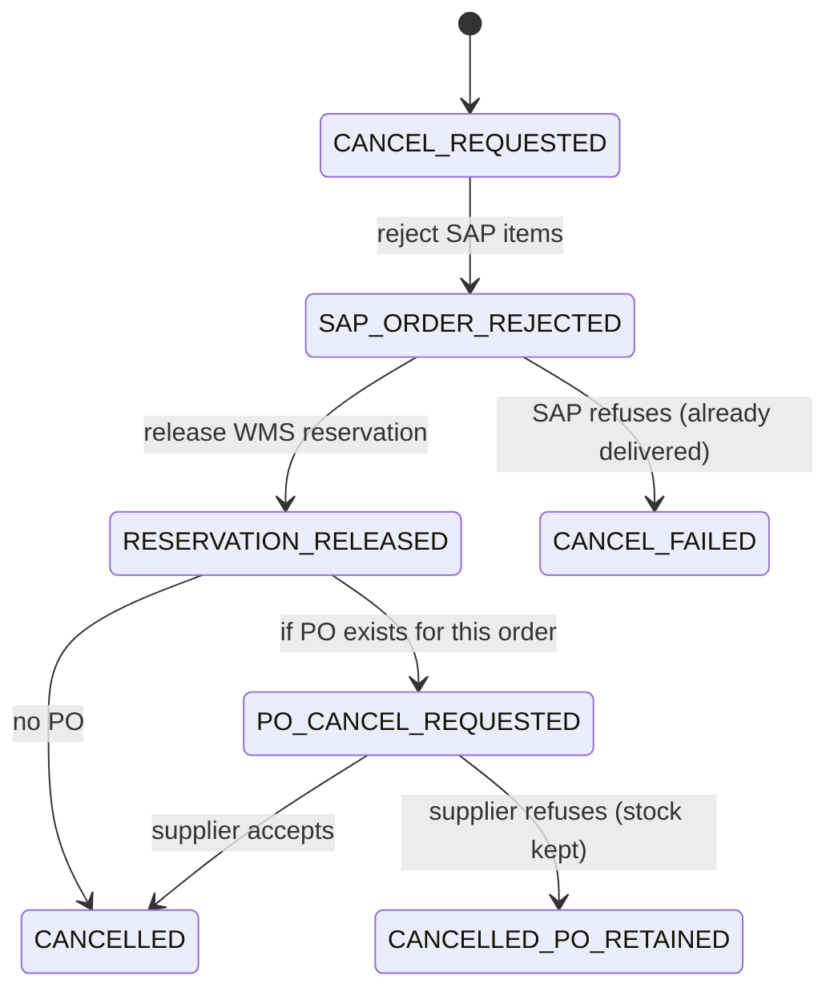

# 08.3 — Outbox, Inbox and Saga: Implementation Walkthrough

`Essential` · The pattern definitions are in [07.5](../07-integration-patterns/05-transaction-patterns.md). This page shows **how to build them in Mule**, step by step.

## 1. Demonstrating the consistency gap (try this in the mini project)

**Naive flow (wrong):**
```xml
<db:insert ...>order_state CONFIRMED</db:insert>      <!-- committed -->
<anypoint-mq:publish .../>                            <!-- MQ down -> error -->
```
Result: the DB says CONFIRMED and no event exists. Retrying the whole request can't fix it either, because the idempotency layer says "already done".

**Reverse order (also wrong):**
```xml
<anypoint-mq:publish .../>                            <!-- published -->
<db:insert ...>order_state CONFIRMED</db:insert>      <!-- DB fails -> rollback -->
```
Result: consumers act on an order that Mule has no record of.

**Outbox (right):** the event becomes *data* in the same transaction, and publication becomes a separate, retryable concern.

## 2. Outbox write (inside the order flow)

```xml
<try transactionalAction="ALWAYS_BEGIN" doc:name="TX: persist state + outbox">
    <db:insert config-ref="DB_Config" doc:name="Insert order state">
        <db:sql><![CDATA[INSERT INTO order_state (order_id, external_order_id, customer_id, status, sap_order_number, reservation_id, payload_json)
                         VALUES (:orderId, :extId, :customerId, :status, :sapNo, :rsvId, :json)]]></db:sql>
        <db:input-parameters><![CDATA[#[{
            orderId: vars.orderId, extId: vars.order.externalOrderId, customerId: vars.order.customerId,
            status: vars.orderStatus, sapNo: vars.sapOrderNumber, rsvId: vars.reservationId,
            json: write(vars.order, "application/json")
        }]]]></db:input-parameters>
    </db:insert>
    <foreach collection="#[vars.events]" doc:name="For each event to emit">
        <db:insert config-ref="DB_Config" doc:name="Insert outbox event">
            <db:sql><![CDATA[INSERT INTO outbox_event (event_id, aggregate_id, event_type, payload, status)
                             VALUES (:id, :agg, :type, :payload, 'PENDING')]]></db:sql>
            <db:input-parameters><![CDATA[#[{ id: payload.eventId, agg: vars.orderId,
                type: payload.eventType, payload: write(payload, "application/json") }]]]></db:input-parameters>
        </db:insert>
    </foreach>
    <db:update config-ref="DB_Config" doc:name="Complete idempotency record">
        <db:sql><![CDATA[UPDATE idempotency_record SET status='COMPLETED', http_status=:st, response_body=:body,
                         updated_at=CURRENT_TIMESTAMP WHERE idempotency_key=:key]]></db:sql>
        <db:input-parameters><![CDATA[#[{ key: vars.idempotencyKey, st: vars.httpStatus, body: write(vars.response, "application/json") }]]]></db:input-parameters>
    </db:update>
</try>
```

## 3. Outbox relay

```xml
<flow name="outbox-relay-flow" maxConcurrency="1">
    <scheduler doc:name="Every 3 s">
        <scheduling-strategy><fixed-frequency frequency="3" timeUnit="SECONDS"/></scheduling-strategy>
    </scheduler>
    <db:select config-ref="DB_Config" maxRows="100" doc:name="Fetch pending events">
        <db:sql><![CDATA[SELECT event_id, event_type, payload FROM outbox_event
                         WHERE status = 'PENDING' ORDER BY created_at
                         FETCH FIRST 100 ROWS ONLY]]></db:sql>
    </db:select>
    <foreach doc:name="Publish each event">
        <set-variable variableName="evt" value="#[payload]"/>
        <try doc:name="Publish one">
            <anypoint-mq:publish config-ref="MQ_Config" messageId="#[vars.evt.event_id]"
                                 destination="#[if (vars.evt.event_type startsWith 'inventory.') p('mq.q.procurement') else p('mq.x.orderEvents')]"/>
            <db:update config-ref="DB_Config" doc:name="Mark published">
                <db:sql><![CDATA[UPDATE outbox_event SET status='PUBLISHED', published_at=CURRENT_TIMESTAMP WHERE event_id=:id]]></db:sql>
                <db:input-parameters><![CDATA[#[{ id: vars.evt.event_id }]]]></db:input-parameters>
            </db:update>
            <error-handler>
                <on-error-continue type="ANY">
                    <db:update config-ref="DB_Config" doc:name="Increment attempts">
                        <db:sql><![CDATA[UPDATE outbox_event SET attempts = attempts + 1 WHERE event_id=:id]]></db:sql>
                        <db:input-parameters><![CDATA[#[{ id: vars.evt.event_id }]]]></db:input-parameters>
                    </db:update>
                </on-error-continue>
            </error-handler>
        </try>
    </foreach>
</flow>
```

**Production hardening**
- **Multiple replicas:** use `SELECT ... FOR UPDATE SKIP LOCKED` inside a transaction (PostgreSQL), or run the relay as a clustered/single-replica app.
- **Poison outbox rows** (e.g. payload too large for MQ): after N attempts, mark them `FAILED` and alert. Don't block the queue.
- **Ordering per aggregate:** if consumers need per-order ordering, publish to FIFO with message group = `aggregate_id`, or have consumers check versions.
- **Metrics:** count of PENDING rows, age of the oldest PENDING, publish errors per minute.

## 4. Inbox (consumer side)

```xml
<sub-flow name="inbox-dedupe-subflow">
    <set-variable variableName="duplicate" value="#[false]"/>
    <try doc:name="Register event in inbox">
        <db:insert config-ref="DB_Config" doc:name="Insert inbox row">
            <db:sql><![CDATA[INSERT INTO inbox_event (event_id, consumer) VALUES (:id, :consumer)]]></db:sql>
            <db:input-parameters><![CDATA[#[{ id: payload.eventId, consumer: 'status-sync' }]]]></db:input-parameters>
        </db:insert>
        <error-handler>
            <on-error-continue type="DB:QUERY_EXECUTION" logException="false">
                <set-variable variableName="duplicate" value="#[true]"/>
            </on-error-continue>
        </error-handler>
    </try>
</sub-flow>
```
**Subtlety:** if the inbox insert commits but the work then fails, the redelivery is treated as a duplicate and the work is lost. Fix it with one of these:
- Put the inbox insert **and the local work in one DB transaction** (works when the work is DB-only), or
- Insert the inbox row **after** the work succeeds, accepting a narrow duplicate window that is covered by natural idempotency (upserts), or
- Use a status column (`RECEIVED` → `PROCESSED`) and treat `RECEIVED` older than N minutes as retryable.

The mini project uses the **"after success"** variant for the Salesforce upsert, which is naturally idempotent.

## 5. Saga orchestration in code (order cancellation)



**Implementation outline**
- `cancellation_saga` table: `saga_id`, `order_id`, `step`, `status`, `attempts`, `updated_at`.
- Each step is a **private flow** that (1) performs the action idempotently, (2) updates the saga row, and (3) publishes the next step's command to a queue. That gives step-level retry and DLQ.
- A **timeout sweeper** finds sagas stuck in a step for more than N minutes and alerts.
- The **saga log** is an audit artefact. Finance and customer service can see exactly what happened.

## Interview angle
**Q: "Why not let the outbox relay publish directly inside the order flow after commit, to reduce latency?"**
> "You can do both: try to publish immediately after commit as a fast path, and keep the scheduled relay as the safety net for anything left PENDING. The latency drops to milliseconds in the normal case, and you keep the guarantee. What you can't do is skip the outbox row, because it's what makes the publication recoverable."

Next: [08.4 Reconciliation & replay](04-reconciliation-and-replay.md)
