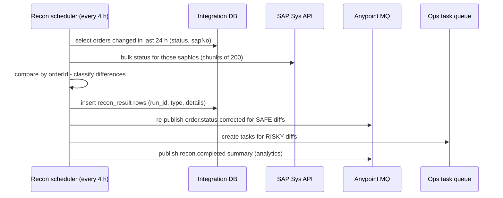

# 08.4 — Reconciliation and Controlled Replay

`Essential`

## 1. Order reconciliation job (Mule state vs SAP)



### Difference classification

| Type | Example | Safe to auto-fix? | Action |
|------|---------|-------------------|--------|
| D1 Status lag | Mule CONFIRMED, SAP has a delivery (RELEASED) | ✔ | Update Mule state, re-publish to Salesforce |
| D2 PENDING_ERP stale | No SAP number after 15 min | ✔ (lookup-then-create) | Trigger the ERP retry flow |
| D3 Orphan SAP order | SAP order with `REF_1=AIM-…`, no Mule row | ⚠ | Create the Mule state from SAP, alert ops |
| D4 Missing in SAP | Mule CONFIRMED with an SAP number that doesn't exist | ✘ | Ops task. Likely a manual deletion in SAP |
| D5 Quantity mismatch | Line qty differs (changed in SAP by CS) | ✘ | Notify. SAP wins as SoR, re-sync Salesforce |

## 2. Inventory reconciliation (WMS vs SAP)

```sql
-- After loading both snapshots into staging tables
SELECT COALESCE(w.material, s.material) AS material,
       COALESCE(w.plant, s.plant)       AS plant,
       COALESCE(w.qty, 0)               AS wms_qty,
       COALESCE(s.qty, 0)               AS sap_qty,
       COALESCE(w.qty, 0) - COALESCE(s.qty, 0) AS diff
FROM   stg_wms_inventory w
FULL OUTER JOIN stg_sap_inventory s
       ON s.material = w.material AND s.plant = w.plant AND s.sloc = w.sloc
WHERE  COALESCE(w.qty, 0) <> COALESCE(s.qty, 0);
```

**Explaining differences before "fixing" them (this matters in interviews):**
- **In-transit timing:** goods issued in the WMS but PGI not yet posted in SAP (or the reverse). Compare at a **cut-off time**, and exclude documents in flight.
- **Granularity:** the WMS counts at bin level and SAP at storage location level. Aggregate the WMS to the SAP level first.
- **Stock types:** SAP splits unrestricted, quality inspection and blocked stock. The WMS may use one number.
- **UoM:** BOX vs EA conversion errors.
- **Real errors:** missing goods receipts and failed integrations. These are what you're actually looking for.

**Auto-correction policy (agreed with finance/supply chain):** auto-post adjustments only for **allow-listed** material groups with |diff| below a threshold. Anything else becomes a task for an inventory controller. **Never auto-correct high-value items.**

## 3. Controlled replay API

```yaml
# ops-replay-api (internal, OAuth scope ops:replay)
POST /ops/v1/dlq/{queue}/replays
{
  "messageIds": ["6f1c2a5e-...", "a91b..."],     # or "filter": {"eventType": "order.confirmed", "from": "...", "to": "..."}
  "dryRun": true,
  "maxRatePerSecond": 5,
  "reason": "Salesforce outage INC-4471 resolved",
  "approvedBy": "ops-lead@aim-example.com"
}
```

**Replay flow**
1. **Dry run:** list what would be replayed and check each message against current state (already processed? superseded by a newer event?).
2. **Approval** for bulk or edited replays (four-eyes).
3. **Throttled re-publish** to the original queue with the header `replayed=true`, original `eventId` **unchanged** so inbox dedupe works, and `replayAttempt` incremented.
4. **Audit record:** who, when, why, which IDs, and the outcome.
5. **Verify:** DLQ depth back to 0, consumer error rate normal, recon clean.

**Why keep the same eventId?** If a replayed event was in fact processed before (it reached the DLQ due to a timeout *after* the work was done), inbox dedupe skips it. A new ID would bypass dedupe and could create duplicates (troubleshooting scenario #18).

**Payload correction:** sometimes the payload itself is wrong (bad UoM from the supplier). The corrected message gets a **new eventId linked to the original** (`correctsEventId`), which is a deliberate business action recorded in the audit.

## 4. Ops dashboard essentials
- DLQ depth per queue, oldest message age.
- PENDING_ERP count and oldest age.
- Last recon run: differences by type, trend over 30 days.
- Replays per week, a quality signal. Frequent replays point to an upstream fix that's needed.

## Interview angle
**Q: "How do you replay 3,000 failed messages after a Salesforce outage without causing new problems?"**
> "First I confirm Salesforce is healthy and the root cause is gone. I dry-run the replay to see how many are still relevant; some may be superseded by newer status events. Then I replay at a throttled rate, say 5 per second, keeping the original event IDs so consumer dedupe protects against anything already processed. I watch the error rate and Salesforce API usage while it runs, and I finish by checking that the DLQ is empty and running the status reconciliation to confirm everything converged. Every step is audited."

Next: [08.5 Manufacturing distributed-transaction examples](05-distributed-transaction-examples.md)
