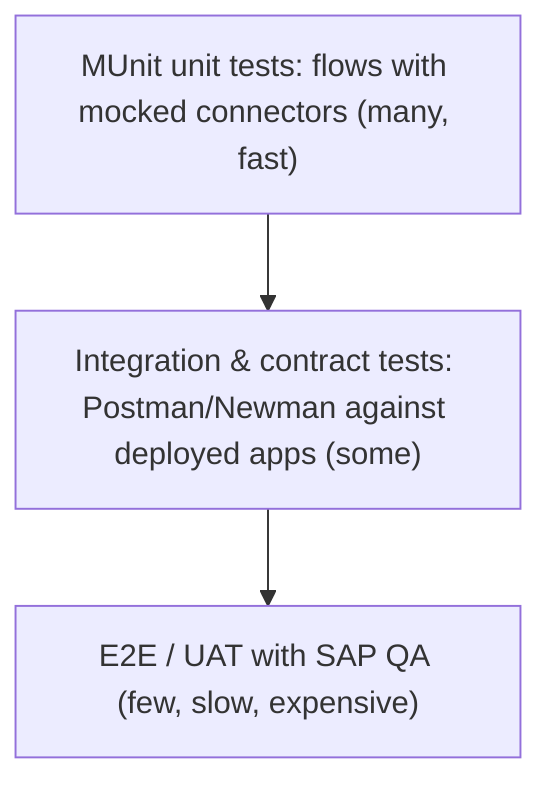

# 09.1 — MUnit Unit Testing, Connector Mocking, Negative Paths and Error Handlers

`Essential` · *Runnable suites: [`src/test/munit`](../mule-project/aim-order-integration/src/test/munit/)*

## 1. The test pyramid for a Mule estate



MUnit runs **inside a Mule runtime** during `mvn test`. It executes real flows and DataWeave, with **connectors mocked** so no SAP or network is needed.

## 2. Anatomy of an MUnit test

```xml
<munit:test name="create-order-happy-path-test" description="Stock available, SAP creates order -> 201 CONFIRMED">
    <munit:behavior>
        <!-- Mock the customer lookup -->
        <munit-tools:mock-when processor="http:request">
            <munit-tools:with-attributes>
                <munit-tools:with-attribute attributeName="doc:name" whereValue="Get customer from CRM System API"/>
            </munit-tools:with-attributes>
            <munit-tools:then-return>
                <munit-tools:payload value='#[{ customerId: "CUST-100234", status: "ACTIVE" }]' mediaType="application/json"/>
            </munit-tools:then-return>
        </munit-tools:mock-when>
        <!-- ...mocks for availability, reservation, SAP... -->
    </munit:behavior>
    <munit:execution>
        <munit:set-event>
            <munit:payload value="#[readUrl('classpath://test-data/order-instock.json', 'application/json')]" mediaType="application/json"/>
            <munit:attributes value="#[{ headers: { 'idempotency-key': 'TEST-KEY-0001' } }]"/>
        </munit:set-event>
        <flow-ref name="prc-create-order-flow"/>
    </munit:execution>
    <munit:validation>
        <munit-tools:assert-that expression="#[payload.status]" is="#[MunitTools::equalTo('CONFIRMED')]"/>
        <munit-tools:assert-that expression="#[vars.httpStatus]" is="#[MunitTools::equalTo(201)]"/>
        <munit-tools:verify-call processor="http:request" times="1">
            <munit-tools:with-attributes>
                <munit-tools:with-attribute attributeName="doc:name" whereValue="Create SAP sales order"/>
            </munit-tools:with-attributes>
        </munit-tools:verify-call>
    </munit:validation>
</munit:test>
```

| Section | Purpose |
|---------|---------|
| `behavior` | Arrange: mocks and spies |
| `execution` | Act: set the input event, call the flow |
| `validation` | Assert: payload, variables, number of calls, call arguments |

**Why unique `doc:name`s matter:** mocks target processors by attributes, and `doc:name` is the readable selector. Duplicated names make mocks hit the wrong processor. That's a code review item.

## 3. Mocking techniques

| Technique | Example | Use |
|-----------|---------|-----|
| Return a payload + attributes | `then-return` with `payload` and `attributes value="#[{statusCode: 201}]"` | Normal responses |
| Return an **error** | `<munit-tools:then-return><munit-tools:error typeId="HTTP:TIMEOUT"/></munit-tools:then-return>` | Negative paths |
| Return from a file | `value="#[readUrl('classpath://test-data/sap-response.xml','application/xml')]"` | Realistic backend payloads |
| Spy | `<munit-tools:spy processor="http:request">` with before/after assertions | Assert what was **sent** (e.g. the SAP XML) |
| Verify calls | `verify-call times="0"` | Prove compensation did *not* run on success |
| Mock a flow-ref | `mock-when processor="flow-ref"` with `name` attribute | Isolate sub-flows |

## 4. Test catalogue for the order process (what a senior expects)

| # | Test | Mocks | Assertions |
|---|------|-------|------------|
| T1 | Happy path, full stock | CRM ACTIVE, availability full, reservation 201, SAP 201 | status CONFIRMED, 201, SAP called once, outbox row exists |
| T2 | Partial stock | availability short | status BACKORDERED, `inventory.shortage-detected` in the outbox |
| T3 | Duplicate request, same body | First run as T1, second run with the same key | Second response identical, SAP called **once** in total |
| T4 | Same key, different body | — | Error `AIM:IDEMPOTENCY_KEY_REUSED` |
| T5 | Customer blocked | CRM BLOCKED | Error `AIM:CUSTOMER_INVALID`. SAP **never** called. Key released |
| T6 | SAP business error | SAP returns 422 | Reservation **released** (verify DELETE called once). Error propagated |
| T7 | SAP unknown outcome | SAP Sys returns 504 | status PENDING_ERP, 202, `order.erp-pending` in the outbox, reservation **not** released |
| T8 | SAP timeout, lookup finds order (Sys API test) | create → `HTTP:TIMEOUT`, lookup → found | 201 with `recoveredAfterTimeout=true` |
| T9 | WMS down | availability → `HTTP:CONNECTIVITY` | Error propagated (503 mapping). No reservation, no SAP |
| T10 | Mapping golden file | none | DW output equals `expected-sap-request.xml` |

## 5. Testing error handlers directly

```xml
<munit:test name="customer-blocked-returns-422-test" expectedErrorType="AIM:CUSTOMER_INVALID"
            description="Blocked customer must stop before SAP">
    ...
</munit:test>
```
- `expectedErrorType` asserts that the flow **raised** this error. Use it when the flow under test propagates.
- To test the *HTTP response body* that the global handler produces, call the listener flow through an HTTP request in the test (with the listener enabled via `<munit:enable-flow-sources>`), or test the error-builder sub-flow directly with a crafted `error`.

## 6. Testing DataWeave in isolation
- Keep mappings in `src/main/resources/dwl/*.dwl` and test them with **golden files**: input JSON → run the transform in a small flow → compare with an expected file using `MunitTools::equalTo(readUrl(...))`.
- Or use the **DataWeave testing framework** (DW unit tests in a separate DataWeave library project) for pure functions such as `sapAlpha` and allocation.

## 7. Coverage and quality gates

```xml
<!-- pom.xml munit-maven-plugin -->
<coverage>
    <runCoverage>true</runCoverage>
    <failBuild>true</failBuild>
    <requiredApplicationCoverage>80</requiredApplicationCoverage>
    <requiredFlowCoverage>70</requiredFlowCoverage>
    <formats><format>html</format><format>sonar</format></formats>
</coverage>
```
**Coverage is necessary, not sufficient.** 90% coverage with no assertions on outcomes proves nothing. Reviewers check **assertions and negative paths**.

## Common mistakes
- Only testing happy paths.
- Asserting `payload != null` instead of business values.
- Not mocking a connector, so the test tries to reach a real endpoint and becomes flaky.
- Sharing state between tests (DB rows from T1 affect T3). Use unique keys per test, or clean up in `after-test`.
- Mocking DataWeave-heavy sub-flows away, which means your mappings are never tested.

Next: [09.2 Integration, contract & regression testing](02-integration-contract-regression.md)
