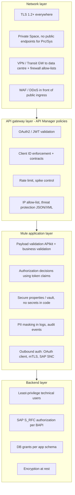

# 10.1 — Security Architecture: Which Control Belongs Where

`Essential` · Trust-boundary diagram: [03.6 Diagram 18](../03-uml-diagrams/06-security-and-cicd.md)

## 1. Layered security model

## 2. Control placement matrix

| Control | Network | Gateway (API Manager) | Mule app | Backend | Why there |
|---------|:------:|:---------------------:|:--------:|:-------:|-----------|
| TLS / mTLS termination | ✔ (ingress) | | ✔ (last mile / outbound) | ✔ | Encrypt every hop |
| Client authentication (who is calling) | | ✔ | | | Consistent, no code, changeable at runtime |
| Coarse authorisation (may this client call this API/method?) | | ✔ (scopes, contracts) | | | Same |
| **Fine-grained authorisation** (may supplier SUP-0042 see PO 4500012345?) | | | ✔ | | Needs business data. A gateway can't know PO ownership |
| Rate limiting / spike control | | ✔ | | | Protect before using app threads |
| IP allow-listing | ✔ (firewall) | ✔ (policy) | | | Defence in depth |
| Schema validation | | ✔ (threat protection: depth, size) | ✔ (APIkit) | | Reject malformed or malicious input early |
| Business validation | | | ✔ | ✔ | Rules live in Process APIs and SAP |
| Secrets management | | | ✔ (secure props/vault) | | |
| PII masking / secure logging | | | ✔ | | Only the app knows the payload semantics |
| Audit trail | | ✔ (API analytics) | ✔ (business audit) | ✔ (SAP change docs) | Different questions at each layer |
| Encryption at rest | | | | ✔ (DB, MQ, OS) | Platform/backend responsibility |

## 3. Real-world supplier example (end to end)

Supplier `SUP-0042` posts a PO confirmation:
1. **Network:** DNS `partners.aim-example.com` → WAF → Private Space ingress. **mTLS**: the supplier's client certificate is validated against AIM's partner CA truststore.
2. **Gateway:** Client ID enforcement (the supplier's client app in API Manager) + rate limit 5 req/s + JSON threat protection (max depth 10, max string length 1,000).
3. **Mule app:** APIkit validates the schema. The app checks that **the certificate subject / client ID maps to supplier SUP-0042** and that **PO 4500012345 belongs to SUP-0042**. Otherwise 403. This is *fine-grained authorisation*, the control most often missed.
4. **Audit:** `supplier_message_log` records supplierId, messageId, PO, correlationId and outcome (no payload PII).
5. **Backend:** the SAP technical user is allowed only `BAPI_PO_CHANGE` for confirmations.

**Common vulnerability:** a supplier modifies the PO number in the URL and confirms *another supplier's* PO. Gateway policies won't stop that (this is broken object-level authorisation, BOLA). Only the application check does.

## 4. Environment separation and network segmentation

| Rule | Implementation |
|------|----------------|
| Separate environments | Separate Anypoint environments, Private Spaces (or at least namespaces), MQ queues, DB schemas, credentials |
| No prod data in lower envs | Masked or synthetic data. Use SAP QA clients |
| Prod access | Least privilege via Anypoint teams/roles. Break-glass process for emergencies |
| Network | System APIs reachable only from inside the Private Space. Firewall: Private Space CIDR → SAP gateway ports only |
| Egress | Restrict outbound destinations from the Private Space where supported (allow-list partner hosts) |

## 5. Secure connectivity to SAP and partners

| Target | Transport security | Authentication |
|--------|-------------------|----------------|
| SAP (RFC) | **SNC** (SAP Secure Network Communication) over VPN | Technical user or X.509 via SNC. Pooled connections |
| SAP (OData) | HTTPS | OAuth 2.0 / Basic over TLS (technical user). Principal propagation where user context matters |
| WMS | HTTPS | API key in the header (rotated) or OAuth client credentials |
| Carriers | HTTPS out. Webhooks in with HMAC | OAuth / API keys. HMAC secret per carrier |
| Suppliers | mTLS in. OAuth/mTLS out | Certificates per partner (expiry tracked!) |
| Salesforce | HTTPS | OAuth JWT bearer (certificate-based), integration user |

Next: [10.2 OAuth 2.0, JWT, Client ID, TLS & mTLS](02-oauth-jwt-clientid-mtls.md)
