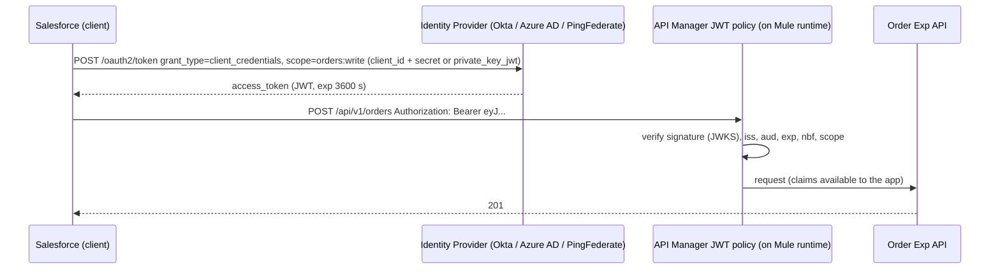
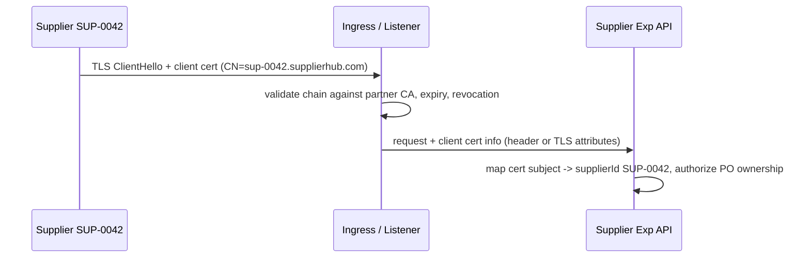

# 10.2 — OAuth 2.0, JWT Validation, Client ID Enforcement, TLS and mTLS

`Essential`

## 1. OAuth 2.0 client credentials (Salesforce → Order Exp API)



**Grant types and when to use them**
| Grant | Use |
|-------|-----|
| **Client credentials** | System-to-system (Salesforce → Mule, Mule → SupplierHub). AIM's default |
| Authorization code + PKCE | User-facing apps (B2B portal SPA) where the user's identity matters |
| JWT bearer | Salesforce connector to Salesforce. Certificate-based, no password |
| ~~Password~~ | Don't use (deprecated in OAuth 2.1 guidance) |

## 2. JWT validation: what must be checked

A JWT is `header.payload.signature`, Base64URL-encoded. Example claims:
```json
{
  "iss": "https://idp.aim-example.com/oauth2/default",
  "aud": "api://aim-order-exp",
  "sub": "0oa1salesforce",
  "client_id": "0oa1salesforce",
  "scp": ["orders:write", "orders:read"],
  "exp": 1792483200,
  "iat": 1792479600
}
```

| Check | Why |
|-------|-----|
| **Signature** against the IdP's JWKS (RS256/ES256) | Proves the token wasn't forged |
| **`iss`** equals the expected issuer | Rejects tokens from other IdPs or tenants |
| **`aud`** equals this API | Stops a token minted for another API being replayed here |
| **`exp` / `nbf`** with small clock skew | Expired tokens are rejected |
| **Scopes** | Method-level authorisation (`orders:read` can't POST) |
| **Algorithm allow-list** | Rejects `alg: none` and HS/RS confusion attacks |

**Where:** the API Manager **JWT Validation** policy (configured with the JWKS URL, issuer, audience and required claims). Mule apps can read validated claims for fine-grained checks. Don't re-implement signature checking in flows.

## 3. Client ID enforcement (internal APIs and partner contracts)

- Each consumer registers a **client application** in Exchange/API Manager and requests **access** to an API instance. Once approved, a **contract** exists.
- The policy checks `client_id`/`client_secret` (headers or Basic auth) against approved contracts.
- **Benefits:** API analytics per consumer, SLA tiers per client, instant revocation, and knowing who to notify about versioning.
- **Limitation:** client ID/secret is a shared secret, so it's weaker than OAuth tokens. On AIM it's used for **internal Process/System APIs inside the Private Space**, combined with network isolation. External callers use OAuth/JWT or mTLS.

## 4. TLS configuration in Mule

```xml
<!-- Inbound (listener) -->
<tls:context name="TLS_Inbound">
    <tls:trust-store path="certs/partner-ca-truststore.p12" type="pkcs12"
                     password="${secure::tls.trustPassword}"/>          <!-- for mTLS: CAs we accept -->
    <tls:key-store path="certs/aim-api-server.p12" type="pkcs12" alias="aim-api"
                   keyPassword="${secure::tls.keyPassword}" password="${secure::tls.storePassword}"/>
</tls:context>

<!-- Outbound (requester) with client cert (mTLS to supplier) -->
<tls:context name="TLS_SupplierHub_Client">
    <tls:trust-store path="certs/supplierhub-ca.p12" type="pkcs12" password="${secure::tls.supTrustPassword}"/>
    <tls:key-store path="certs/aim-client.p12" type="pkcs12" keyPassword="${secure::tls.clientKeyPassword}"
                   password="${secure::tls.clientStorePassword}"/>
</tls:context>
```

- **Never** use `insecure="true"` on a trust store outside local experiments. It disables certificate validation and makes MITM trivial.
- Pin **TLS 1.2+** (`enabledProtocols="TLSv1.2,TLSv1.3"`) and restrict cipher suites to the security team's standard.
- On **CloudHub 2.0**, public TLS is usually terminated at the Private Space **ingress** (custom domain certificate). Inbound **mTLS** for partners can be configured at ingress or in the app. Choose based on the platform features available and on where the certificate identity must be read.

## 5. mTLS for suppliers: identity from certificates



**Certificate lifecycle (the part that breaks production):**
- Keep an inventory: owner, expiry and partner contact for every cert (inbound CA, partner certs, our client certs, server certs).
- Alert at **60/30/14/7 days**.
- Rotate with overlap: add the new cert to the truststore *before* the partner switches, and remove the old one after.
- Troubleshooting scenario: [13 scenario 14](../13-production-troubleshooting/03-scenarios-11-15.md).

## 6. Outbound token management (Mule as an OAuth client)

```xml
<http:request-config name="HTTP_Request_SupplierHub_Config">
    <http:request-connection host="${supplierhub.host}" port="443" protocol="HTTPS">
        <http:authentication>
            <oauth:client-credentials-grant-type clientId="${secure::supplierhub.clientId}"
                clientSecret="${secure::supplierhub.clientSecret}" scopes="po.write"
                tokenUrl="${supplierhub.tokenUrl}" refreshTokenWhen="#[attributes.statusCode == 401]"/>
        </http:authentication>
    </http:request-connection>
</http:request-config>
```
- The OAuth module caches the token and refreshes it on expiry or 401 (`refreshTokenWhen`).
- **Token expiry mid-processing** (scenario 15): long batch runs must handle 401 → refresh → retry once. Never cache tokens beyond `expires_in`.

## Interview angle
**Q: "Client ID enforcement or OAuth for a supplier API?"**
> "For external suppliers I'd use OAuth 2.0 client credentials with JWT validation, or mTLS, because a client secret alone is a static shared secret that is easily leaked and hard to scope. Client ID enforcement is still valuable *together* with them for contracts, SLA tiers and analytics. For internal System APIs inside a private network, client ID enforcement plus network isolation is usually proportionate."

Next: [10.3 API Manager policies & governance](03-api-manager-policies-governance.md)
