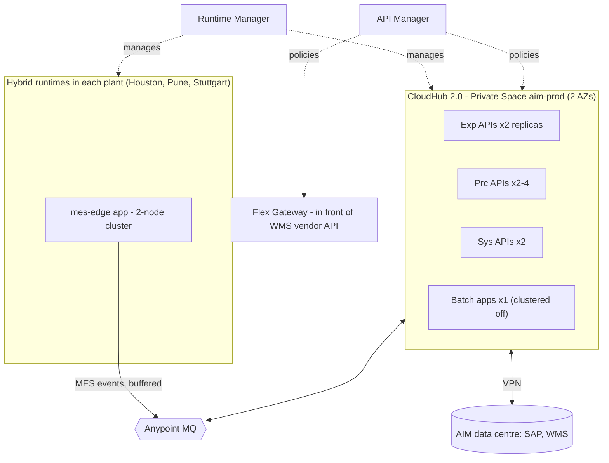

# 11.1 — Deployment Options and Anypoint Platform Components

`Essential` · *Verified against MuleSoft docs (Oct 2026) at a high level. Feature availability varies by subscription and control plane, so confirm details for your org.*

## 1. Anypoint Platform components you must be able to explain

| Component | What it does | AIM usage |
|-----------|--------------|-----------|
| **Design Center / API Designer** | Author RAML/OAS, mocking service | Design-first specs |
| **Exchange** | Catalogue of APIs, fragments, connectors, templates, and **Mule app artifacts** (for CloudHub 2.0 deployments) | Fragments, API specs, app artifacts |
| **API Manager** | API instances, policies, client contracts, SLA tiers, analytics, alerts | Security and traffic policies |
| **Runtime Manager** | Deploy, scale, configure properties, view logs/status, alerts | Deployments to CH2.0 / RTF / hybrid servers |
| **Anypoint Monitoring** | Dashboards, metrics, log search, distributed tracing (by subscription) | Ops dashboards and alerts |
| **Anypoint MQ** | Managed messaging | Event backbone |
| **Object Store v2** | Managed key-value store | Caches, watermarks |
| **Access Management** | Business groups, environments, teams, connected apps | RBAC, CI credentials |
| **Anypoint API Governance** | Rulesets for API specs | Design conformance |
| **Flex Gateway** | Envoy-based gateway for any API (Mule or not), managed by API Manager | WMS vendor API exposure |

## 2. Runtime deployment options compared

| | **CloudHub 2.0** | **CloudHub 1.0** | **Runtime Fabric (RTF)** | **Hybrid (customer-hosted runtime)** |
|-|------------------|------------------|--------------------------|---------------------------------------|
| Infrastructure | MuleSoft-managed containers (Kubernetes under the hood) | MuleSoft-managed VMs ("workers") on AWS | Customer-managed Kubernetes (EKS/AKS/GKE/OpenShift), MuleSoft-managed agent | Customer servers (VMs/bare metal) |
| Unit of scale | **Replicas** (fractional vCore sizes) | Workers (0.1–16 vCore) | Replicas on your cluster | Servers / clusters |
| Networking | **Private Spaces** (private network, ingress, VPN, Transit Gateway, firewall rules) | VPC, Dedicated Load Balancer (DLB), VPN | Your network, your ingress | Your network |
| HA | Multiple replicas across AZs | Multiple workers | Your K8s HA | Mule clustering (active-active) |
| Persistent VM queues | No (use Anypoint MQ or clustering) | Yes (CH1 persistent queues) | Via clustering/config | Via clustering |
| Ops burden | Lowest | Low | **High** (you run K8s) | **Highest** (patching, OS, JVM) |
| Choose when | Default for new cloud deployments | Existing estates (still supported; no EoL announced at time of writing) | Data residency, on-prem only, existing K8s platform | Plant-floor / edge, latency to on-prem systems, WAN-outage tolerance |

### CloudHub 2.0 key concepts
- **Shared Space vs Private Space:** shared is a regional multi-tenant network with public endpoints. A Private Space gives a dedicated network (CIDR), private ingress, VPN/TGW connectivity and custom TLS.
- **Replicas:** horizontal scaling. Use ≥ 2 for HA. *Clustering* can be enabled for features like the primary-node scheduler and shared VM queues.
- **Ingress:** the platform load balancer. Custom domains with your certificates. **Last-mile security** (TLS between ingress and replica) when required.
- **Deployment model:** apps are published to **Exchange** as artifacts, and Runtime Manager deploys them from there.
- **Rolling updates:** zero-downtime deployments for stateless apps.

### CloudHub 1.0 → 2.0 migration watch-outs (from partner migration guides and docs)
- **Persistent VM queues** and the **CloudHub connector** need rework (Anypoint MQ, alternative notifications).
- DLB mapping rules become **ingress** configuration.
- VPC/VPN networking is rebuilt as **Private Space** networking.
- Properties `${http.port}` handling, log forwarding and scheduler behaviour across replicas: retest them.

## 3. AIM deployment map

**Rationale:** CloudHub 2.0 for everything that can be cloud-hosted (lowest ops). Hybrid runtimes at plants because MES integration must survive WAN outages and needs low latency to shop-floor systems. Flex Gateway to govern a third-party API with the same policies.

## Interview angle
**Q: "When would you choose Runtime Fabric over CloudHub 2.0?"**
> "When there's a hard requirement CloudHub can't meet. Examples are data that must stay inside the company's own network or a specific jurisdiction, backends reachable only on-prem with no acceptable VPN path, or an existing enterprise Kubernetes platform with an operations team who want everything on it. The cost is that we take on running the cluster: upgrades, capacity, monitoring and ingress. Without such a requirement I default to CloudHub 2.0."

Next: [11.2 Maven build & Git workflow](02-maven-git-workflow.md)
