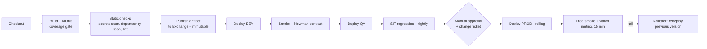

# 11.3 — CI/CD Pipelines (Jenkins and Azure DevOps) with Quality Gates

`Essential` · Sequence diagram: [03.6 Diagram 19](../03-uml-diagrams/06-security-and-cicd.md)

## 1. Pipeline stages (tool-agnostic)



**Quality gates**

| Gate | Threshold (AIM) | Blocks |
|------|-----------------|--------|
| MUnit tests | 100% pass | Merge and deploy |
| Coverage | App ≥ 80%, flow ≥ 70% | Merge |
| Secrets scan (gitleaks/trufflehog) | 0 findings | Merge |
| Dependency vulnerabilities | No critical/high without waiver | Release |
| API governance ruleset | 0 errors | Exchange publish of the spec |
| Contract tests (Newman) | 100% pass | Promotion to QA |
| Smoke tests | 100% pass | Promotion. PROD triggers auto-rollback |

## 2. Jenkinsfile (declarative)

```groovy
pipeline {
  agent { label 'maven-jdk17' }
  options { timestamps(); disableConcurrentBuilds() }
  environment {
    ANYPOINT = credentials('anypoint-connected-app')     // usr = client id, psw = secret
    MULE_NEXUS = credentials('mule-ee-nexus')
  }
  stages {
    stage('Build & MUnit') {
      steps {
        sh 'mvn -B -s settings.xml clean verify'
      }
      post { always { junit 'target/surefire-reports/*.xml'; publishHTML(target: [reportDir: 'target/site/munit/coverage', reportFiles: 'summary.html', reportName: 'MUnit Coverage']) } }
    }
    stage('Static checks') {
      steps { sh 'gitleaks detect --no-git -v' }
    }
    stage('Publish + Deploy DEV') {
      when { branch 'develop' }
      steps { deployTo('DEV', 'dev') }
    }
    stage('Deploy QA') {
      when { branch pattern: 'release/.*', comparator: 'REGEXP' }
      steps { deployTo('QA', 'qa') ; sh 'newman run postman/aim-order-integration.postman_collection.json -e postman/env-qa.json' }
    }
    stage('Deploy PROD') {
      when { branch 'main' }
      steps {
        input message: 'Approve PROD deployment?', submitter: 'release-managers'
        deployTo('PROD', 'prod')
        sh './scripts/smoke.sh prod'
      }
      post { failure { sh './scripts/rollback.sh prod' } }
    }
  }
}

def deployTo(String anypointEnv, String envKey) {
  withCredentials([string(credentialsId: "secure-key-${envKey}", variable: 'SECURE_KEY'),
                   string(credentialsId: "api-id-${envKey}", variable: 'API_ID')]) {
    sh """mvn -B -s settings.xml deploy -DmuleDeploy -DskipMunitTests \
          -Ddeploy.environment=${anypointEnv} -Ddeploy.env=${envKey} \
          -Ddeploy.target=aim-${envKey}-ps -Ddeploy.appName=${envKey}-order-mgmt-prc-api \
          -Ddeploy.replicas=2 -Ddeploy.vcores=1 -Ddeploy.apiId=\$API_ID \
          -Danypoint.clientId=\$ANYPOINT_USR -Danypoint.clientSecret=\$ANYPOINT_PSW \
          -Dsecure.key=\$SECURE_KEY"""
  }
}
```
*Note:* "build once, deploy many". In stricter setups the PROD stage **doesn't rebuild**. It deploys the already-published Exchange artifact version, e.g. through the Anypoint CLI / Platform APIs, or with the plugin configured to reference an existing artifact. The simplified script above rebuilds at the same commit/tag. Know the trade-off and say which one your team used.

## 3. Azure DevOps pipeline (YAML)

```yaml
trigger:
  branches: { include: [ develop, release/*, main ] }

variables:
  - group: aim-anypoint-common          # ANYPOINT_CLIENT_ID, ANYPOINT_CLIENT_SECRET (secret)
pool: { vmImage: ubuntu-latest }

stages:
- stage: Build
  jobs:
  - job: build
    steps:
    - task: JavaToolInstaller@0
      inputs: { versionSpec: '17', jdkArchitectureOption: x64, jdkSourceOption: PreInstalled }
    - task: Maven@4
      inputs:
        mavenPomFile: pom.xml
        goals: clean verify
        options: -s settings.xml
        publishJUnitResults: true
        testResultsFiles: '**/surefire-reports/TEST-*.xml'

- stage: DeployQA
  dependsOn: Build
  condition: and(succeeded(), startsWith(variables['Build.SourceBranch'], 'refs/heads/release/'))
  variables: [ { group: aim-qa-secrets } ]          # linked to Azure Key Vault
  jobs:
  - deployment: qa
    environment: aim-qa
    strategy:
      runOnce:
        deploy:
          steps:
          - checkout: self
          - task: Maven@4
            inputs:
              goals: deploy
              options: >-
                -s settings.xml -DmuleDeploy -DskipMunitTests
                -Ddeploy.environment=QA -Ddeploy.env=qa -Ddeploy.target=aim-qa-ps
                -Ddeploy.appName=qa-order-mgmt-prc-api -Ddeploy.replicas=2 -Ddeploy.vcores=1
                -Ddeploy.apiId=$(API_ID) -Dsecure.key=$(SECURE_KEY)
                -Danypoint.clientId=$(ANYPOINT_CLIENT_ID) -Danypoint.clientSecret=$(ANYPOINT_CLIENT_SECRET)
          - script: newman run postman/aim-order-integration.postman_collection.json -e postman/env-qa.json

- stage: DeployPROD
  dependsOn: DeployQA
  condition: and(succeeded(), eq(variables['Build.SourceBranch'], 'refs/heads/main'))
  variables: [ { group: aim-prod-secrets } ]
  jobs:
  - deployment: prod
    environment: aim-prod                      # environment with required approvers + checks
    strategy:
      runOnce:
        deploy:
          steps:
          - checkout: self
          - script: echo "same steps as QA with PROD variables"
```
**Azure-specific points:** variable groups linked to **Key Vault**, **environments with approvals and checks** (business hours, change ticket), and deployment history for audit.

## 4. Environment-specific configuration (summary)

| Item | Source | Example |
|------|--------|---------|
| Non-secret env config | `config-{env}.yaml` in the artifact | hosts, timeouts, pool sizes |
| Env selector | Deployment property `env` | `qa` |
| Secrets | Vault → protected property / secure props key | `secure.key`, client secrets |
| API autodiscovery ID | Deployment property `api.id` | per environment |
| Sizing | Pipeline parameters | replicas, vCores |

## 5. Rollback strategy
1. **App rollback:** redeploy the previous artifact version (`1.3.2`). It takes minutes and the pipeline job is pre-built (`rollback.sh`).
2. **Config rollback:** properties are versioned in Git, so revert and redeploy.
3. **DB changes:** use **expand/contract** only. A release never drops or renames a column that the previous version needs.
4. **API policy changes:** policy configuration is exported and versioned. Revert via API Manager or the automation scripts.
5. **Event schema changes:** additive only, so old consumers keep working during rollback.

**When rollback is not enough:** if the bad version already created bad data (e.g. wrong UoM in 200 POs), rollback stops the bleeding but you still need **data remediation**: identify the affected records via the audit/correlation logs, correct them via SAP, and communicate with suppliers.

Next: [11.4 Sizing, networking & monitoring](04-sizing-networking-monitoring.md)
