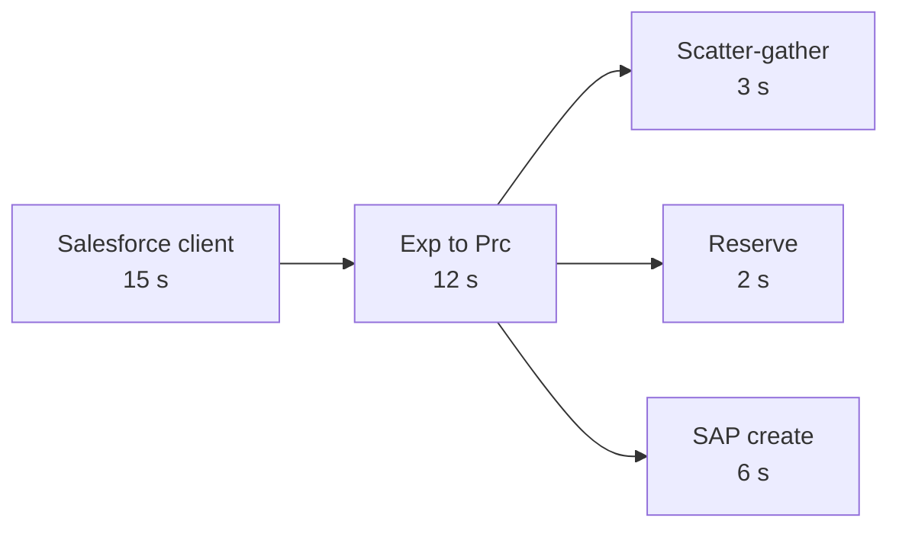

# 12.1 — Timeout Budgets, Retry Storms and Connection Pools

`Essential`

## 1. Timeout budgets

**Principle:** every inner timeout < its caller's timeout, and the sum of a call chain fits inside the outermost timeout with margin.

| Anti-pattern | Consequence |
|--------------|-------------|
| Inner timeout ≥ outer timeout | The caller gives up first. The inner work continues (wasted, and maybe a side effect). The caller retries, causing duplicates |
| No explicit timeout | Default behaviour (unknown to the team). Threads held for a long time |
| Same timeout everywhere ("30 s") | No budget. Cascading waits |
| Timeout shorter than the backend p99 | Constant false failures and unknown outcomes |

**Method for choosing a timeout:**
1. Measure the dependency's latency distribution (p50/p95/p99) under realistic load.
2. Timeout ≈ p99 + margin, **capped by the remaining budget**.
3. If p99 doesn't fit the budget, change the *design* (async, cache, pre-compute). Don't just raise timeouts.

**Deadline propagation (advanced):** pass the remaining budget downstream, e.g. a header `x-deadline-ms`. Then a System API that receives a request with 500 ms left doesn't start a 6 s SAP call.

## 2. Retry storms

**How a storm forms (real scenario):** SAP slows from 1.5 s to 7 s at month-end. The SAP timeout is 6 s, so most calls fail. Exp retries ×3, Prc retries ×3 and the Sys API retries ×3, which means 27 SAP calls per order. SAP load multiplies by 27, so SAP slows further. Meanwhile Salesforce users click Submit again. **The integration layer DDoSes SAP.**

**Prevention**

| Control | Detail |
|---------|--------|
| Retry at **one layer** | AIM: only System APIs retry, and only idempotent reads. Async consumers retry via MQ redelivery |
| **Exponential backoff + jitter** | Spreads retries in time. Avoids synchronised waves |
| **Retry budget** | Max ~10% extra traffic from retries. Stop retrying when the error rate is high |
| **Circuit breaker** | Stops calls entirely while the dependency is unhealthy ([07.7](../07-integration-patterns/07-resilience-and-data-patterns.md)) |
| **Honour `Retry-After`** | 429/503 |
| **Idempotency keys for client retries** | User retries become harmless replays |
| **Load levelling** | Switch to 202 + queue when the dependency degrades |

## 3. Connection pools

| Pool | Config | Sizing rule | Symptom when too small | Symptom when too big |
|------|--------|-------------|------------------------|----------------------|
| HTTP requester | `maxConnections` | ≥ peak concurrent calls to that host per replica | Requests queue inside Mule. Latency rises with no backend change | Backend overload. Ephemeral port exhaustion |
| DB | `maxPoolSize`, `maxWait` | Concurrent DB operations per replica. Total across replicas ≤ the DB limit | `maxWait` timeouts. Pool exhausted | DB `max_connections` hit. DB CPU contention |
| SAP JCo | pool `maxActive` | Agreed with SAP Basis | Waits for a connection | SAP RFC resource exhaustion affects other SAP users |

**Key insight:** a pool is a **bulkhead**. A deliberately small pool per backend means a slow WMS can't consume threads that order intake needs for SAP.

**Pool exhaustion signature:** latency rises sharply while backend latency (measured inside the backend) is flat, plus errors like "timeout waiting for connection" or `DB:CONNECTIVITY`. Fix the cause (leaked connections, long transactions, slow queries) before increasing the pool. See [13 scenario 9](../13-production-troubleshooting/02-scenarios-06-10.md).

**Long transactions hold connections:** an HTTP call inside a DB transaction holds a DB connection for the whole HTTP duration. This is one of the commonest causes of pool exhaustion in Mule apps.

## 4. Graceful degradation menu (AIM)

| Degradation | Trigger | User impact |
|-------------|---------|-------------|
| Async fallback (202 PENDING_ERP) | SAP timeout / breaker open | Rep sees "Pending ERP" for minutes |
| Cached material descriptions | SAP read slow | Possibly stale descriptions |
| Skip the optional tracking enrichment | TMS slow | Order view without tracking |
| Reduce consumer concurrency | SAP CPU high | Status updates slower |
| Reject non-critical traffic (429) | Overload | Portal browsing throttled; orders prioritised |

## Interview angle
**Q: "How do you set timeouts for an API chain Experience → Process → System → SAP?"**
> "I start from the consumer's timeout and allocate a budget top-down, so each layer's timeout is smaller than its caller's, with margin for processing. I check that the SAP timeout covers SAP's measured p99, and if it doesn't fit, I change the design rather than the number, for example async fallback. I make sure only one layer retries, with backoff. And because a timeout on a create is an unknown outcome, the layer that times out does a lookup by reference rather than a blind retry."

Next: [12.2 DataWeave & payload performance](02-dataweave-payload-performance.md)
