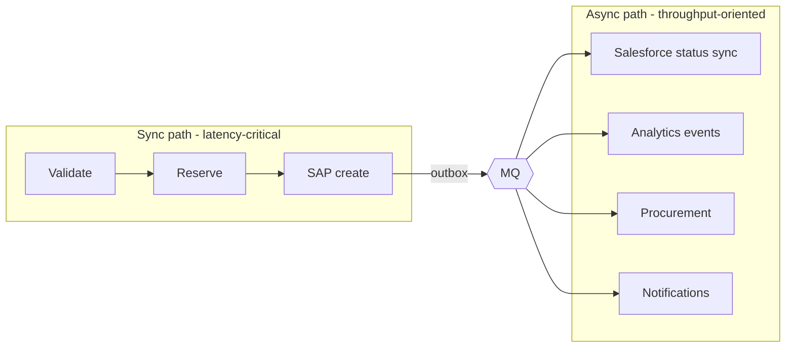

# 12.3 — Capacity Planning, Backpressure, Asynchronous Processing and Disaster Recovery

`Advanced`

## 1. Capacity planning (worked example — all numbers are assumptions)

**Inputs:** 45,000 orders on quarter-end day, 70% of them between 08:00 and 14:00 → 31,500 in 6 h ≈ **1.5 orders/s average, 10/s peak bursts**.

| Resource | Demand at peak | Capacity per unit | Units needed | Planned (with headroom) |
|----------|----------------|-------------------|--------------|--------------------------|
| Order Prc API | 10 req/s × ~1.5 s = 15 concurrent | ~20 concurrent per 1-vCore replica (measured in a perf test) | 0.75 | **2 replicas** (HA) → up to 4 |
| SAP RFC connections | 10/s × 1.5 s = 15 | SAP allows 20 for this user | — | 2 × 10 pool |
| DB connections | ~4 ops/order × 10/s × 20 ms = 0.8 concurrent (plus bursts) | — | — | 2 × 10 pool (plenty; fail fast) |
| MQ events | 10 orders/s × 3 events = 30 msg/s | Anypoint MQ handles this comfortably | — | Standard queues |
| Status-sync consumer | 30 msg/s × 300 ms Salesforce = 9 concurrent | Salesforce API limits/day | — | 2 replicas × concurrency 5 |

**Rules:** plan for **peak + 50% headroom**, verify it with a load test, and re-plan when the volume trend shifts (dashboards with monthly growth).

**Little's Law:** `concurrency = throughput × latency`. It's the simplest tool for sizing pools, threads and consumers, and interviewers like hearing it applied.

## 2. Asynchronous processing to protect sync paths

Everything that isn't required for the response moves out of the request path. The sync path then depends only on the systems the user truly needs.

## 3. Backpressure end to end (summary)

| Point | Mechanism | Signal to the producer |
|-------|-----------|------------------------|
| Gateway | Rate limit / spike control | 429 + Retry-After |
| App | `maxConcurrency`, bounded pools | 503 (fast fail) instead of slow timeouts |
| Queue | Absorbs bursts | Queue age metric. Producers unaffected |
| Consumer | Fixed concurrency, slows down when SAP slows | Nothing to the producer. The queue grows |
| Partner | Honour 429 | Our consumer backs off |

## 4. Disaster recovery (DR)

| Component | Failure | Strategy (AIM) | RPO / RTO (assumption) |
|-----------|---------|----------------|------------------------|
| Single replica | Crash | Other replicas serve traffic. The platform restarts the replica | 0 / seconds |
| Availability zone | AZ outage | Replicas spread across AZs | 0 / minutes |
| Region (CloudHub 2.0) | Regional outage | **Warm standby** Private Space in a second region. Apps deployed but scaled down. DNS failover. Anypoint MQ in the secondary region via **cross-region failover** (if the subscription supports it) or secondary queues | Orders: RPO ≈ 0 for persisted DB data (replicated DB), in-flight MQ messages may be delayed / RTO ≤ 1 h |
| Integration DB | DB outage | Managed multi-AZ + cross-region replica. Promote on regional failure | Minutes / ≤ 1 h |
| SAP | SAP outage | Not DR for Mule. Degrade to 202 + queue | — |
| Control plane | Anypoint control plane issue | Running apps keep running (data plane independent). Deployments paused | — |

**DR essentials**
- **Infrastructure and config as code:** Private Space settings, app deployments and policies are scripted, so a rebuild in another region is repeatable.
- **DR drills twice a year:** fail over to the secondary region with synthetic orders and measure the actual RTO.
- **Idempotency makes DR safe:** after failover, clients retry with the same keys, and outbox/inbox prevent duplicates when both regions overlap briefly.
- **Data residency:** check that the DR region is legally allowed for EU customer data.

## Interview angle
**Q: "How would you size the order API for quarter-end?"**
> "I start from business volume: peak orders per second, not daily totals. With Little's Law and the measured latency, I get the concurrency each resource must support: replicas, SAP connections, DB pool, consumer concurrency. I check every downstream limit, especially SAP RFC sessions and Salesforce API limits, because they're usually the real ceiling. Then I add headroom, validate with a load test that includes SAP latency variance, and keep load levelling as a safety valve if the peak is higher than forecast."

Next section: [13 — Production troubleshooting](../13-production-troubleshooting/00-troubleshooting-method.md)
