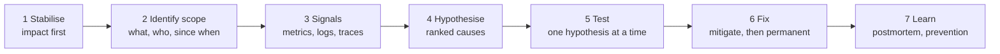

# 13.0 — A Systematic Production Troubleshooting Method

`Essential` — interviewers listen for *method*. Answers like "I'd check the logs and add retries" are not senior answers.

## The 7-step method (memorise: **S-I-S-H-T-F-L**)

| Step | Questions | Tools |
|------|-----------|-------|
| **1. Stabilise** | Is business impact ongoing? Can I stop the bleeding *now* (pause a consumer, roll back, open a circuit, switch to async mode) without destroying evidence? | Runtime Manager, feature flags, API Manager |
| **2. Scope** | Which APIs/flows? All requests or a subset (one customer, one plant, one supplier)? Since when? What changed (deploys, config, certs, backend releases, volume)? | Change log, deployment history, dashboards |
| **3. Signals** | Golden signals per hop: rate, errors, latency, saturation. Error types and codes. Queue depth/age. Logs by correlation ID | Anypoint Monitoring, log platform, MQ stats, DB stats |
| **4. Hypothesise** | List 2–4 plausible causes, ranked by likelihood × ease of checking | Team knowledge, runbooks |
| **5. Test** | Confirm or refute each with evidence (a query, a reproduction, a targeted log) | QA reproduction, diagnostic flows |
| **6. Fix** | Immediate mitigation (minutes), then the permanent corrective action (days), then data remediation | Pipeline, SAP/business teams |
| **7. Learn** | Blameless postmortem: timeline, root cause, contributing factors, actions with owners. Add the alert or test that would have caught it | Postmortem template ([16.5](../16-project-documents/05-incident-postmortem.md)) |

## Golden rules
1. **Correlate before you speculate.** Use one correlation ID to trace one failing transaction end to end.
2. **"What changed?"** is the most productive first question. Most incidents follow a change: a deploy, config, certificate, a backend release, or a data/volume shift.
3. **Distinguish symptom from cause.** A timeout in the Exp API is a symptom. The cause may be DB pool exhaustion three hops down.
4. **Mitigate without destroying evidence.** Take a heap dump or thread dump and export the logs *before* restarting where possible.
5. **Data remediation is part of the fix.** Duplicate POs, missing invoices and stale statuses need correcting, not just the code.
6. **Communicate on a cadence.** Every 30 minutes to stakeholders: impact, actions, next update.

## Standard evidence checklist
- [ ] Time window (start, peak, end), in UTC and plant-local time
- [ ] Affected APIs/flows/queues and the error types (`HTTP:TIMEOUT` vs `HTTP:CONNECTIVITY` matters)
- [ ] Example correlation IDs (3–5) for failing and succeeding requests
- [ ] Recent changes (deploys, properties, policies, certs, backend changes, partner notices)
- [ ] Metrics: throughput, p95/p99, error %, CPU/heap/GC, pool usage, queue depth/age, DLQ
- [ ] Business impact: orders affected, value, customers, SLA breach

## Severity guide (AIM)

| Sev | Definition | Example | Response |
|-----|-----------|---------|----------|
| P1 | Order intake or shipping blocked for many customers. Financial postings wrong | SAP integration down with no fallback. Duplicate invoices | Immediate, war room, 30-min updates |
| P2 | Degraded, with a workaround. A backlog building | Supplier POs delayed. Salesforce status lag | Within 30 min, hourly updates |
| P3 | Minor, single partner, non-urgent | One carrier's tracking failing | Next business day |

**How each scenario page is laid out (13.1–13.4):** Symptoms & impact · Reproduce · Diagnose · Signals · Root cause · Immediate mitigation · Permanent fix · Prevention & alerts · Alternatives · Interview answer.

Scenarios: [1–5](01-scenarios-01-05.md) · [6–10](02-scenarios-06-10.md) · [11–15](03-scenarios-11-15.md) · [16–20](04-scenarios-16-20.md)
