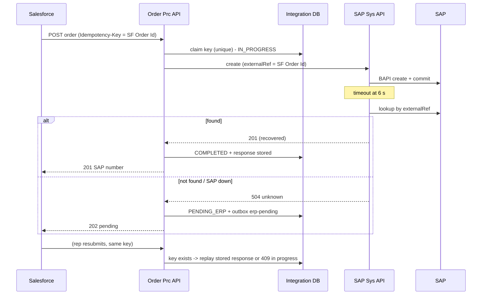

# 14.1 — Scenario 1: SAP Timeout After the Transaction Has Committed

**Label:** Representative senior-level scenario (not attributed to any company).

## The question (as an interviewer would ask it)
> "Your Mule API creates sales orders in SAP S/4HANA. Occasionally SAP takes longer than your timeout. Mule returns an error to Salesforce, but the order *was* created in SAP. The rep resubmits, and now there are two orders. How would you design this so it can't happen, and how would you handle the existing duplicates?"

## What the interviewer is evaluating
| Criterion | Weak signal | Strong signal |
|-----------|------------|---------------|
| Understands "unknown outcome" | "Increase the timeout" / "add retries" | "A timeout means the outcome is unknown, so never blind-retry a create" |
| Idempotency design | Vague "make it idempotent" | Concrete keys: client Idempotency-Key + business reference in SAP + DB constraint |
| SAP knowledge | Treats SAP like a REST API | BAPI commit/LUW, searchable reference fields, SAP-side duplicate checks |
| Recovery path | None | Lookup-then-create, PENDING state, retry consumer, reconciliation |
| Operations | Ignores existing duplicates | Remediation plan + monitoring + postmortem |

## Clarifying questions to ask first (shows seniority)
1. Is SAP called via BAPI/RFC (SAP connector) or OData? *(This affects the lookup options.)*
2. Does the request carry a unique external ID, such as the Salesforce Order Id?
3. Does the rep need the SAP order number synchronously, or is "accepted, pending confirmation" acceptable?
4. Is there a field in the SAP sales order where we can store our reference, and can it be searched efficiently?
5. What's the SAP p95/p99 latency, and what's Salesforce's callout timeout?

## Requirements (assumed after clarification)
- One SAP order per Salesforce order, always.
- The rep normally sees the SAP number in under 4 s. Degraded mode is acceptable during SAP slowness.
- SAP via BAPI. The reference goes in the PO-reference field `BSTKD` (or a custom Z-field) and is searchable via OData.

## Architecture



## Detailed solution (layer by layer)
1. **Client idempotency:** Salesforce sends `Idempotency-Key` = Salesforce Order Id. A resubmission reuses it automatically (it's derived from the record, not generated per click).
2. **Process API claim:** the DB unique insert gives three outcomes: new / completed (replay) / in progress (409).
3. **Business reference in SAP:** every create carries the reference. The SAP team confirms it's unique and indexed. Optionally, an SAP-side duplicate check (a user exit / BAdI) rejects a second order with the same reference. That's defence in depth.
4. **Timeout handling in the SAP System API:** catch `HTTP:TIMEOUT` (or JCo timeout) and do a **lookup by reference**, with a short delay. Found → success with `recoveredAfterTimeout=true`. Not found → 504 with code `AIM-SAP-5041` ("unknown, don't blind-retry").
5. **Degraded path:** the Process API marks `PENDING_ERP`, writes an outbox event and returns 202. The ERP retry consumer always runs **lookup-then-create**.
6. **Reconciliation:** every 15 minutes, PENDING_ERP older than the threshold → lookup → resolve. Nightly: SAP orders carrying our reference prefix but with no Mule state.

## Relevant Mule configuration (excerpt)
```xml
<try doc:name="Create with unknown-outcome handling">
  <http:request method="POST" config-ref="SAP_Sys" path="/sys/sap/v1/sales-orders" responseTimeout="6000"/>
  <error-handler>
    <on-error-continue type="HTTP:TIMEOUT">
      <flow-ref name="lookup-sales-order-by-external-ref-flow"/>
      <choice>
        <when expression="#[payload.found]"><set-variable variableName="erpOutcome" value="CONFIRMED"/></when>
        <otherwise><set-variable variableName="erpOutcome" value="UNKNOWN"/></otherwise>
      </choice>
    </on-error-continue>
  </error-handler>
</try>
```
Full runnable version: [`sys-sap-erp.xml`](../mule-project/aim-order-integration/src/main/mule/sys-sap-erp.xml).

## Failure handling matrix
| Situation | Outcome |
|-----------|---------|
| SAP fast, success | 201 |
| SAP slow, committed | Lookup finds it → 201 |
| SAP slow, not committed | Lookup misses → 202 → the retry creates once |
| SAP committed *after* the lookup | Retry consumer: lookup-first finds it → no duplicate |
| SAP down | 202. Breaker opens. Retry drains after recovery |
| Mule crashes mid-flow | Key IN_PROGRESS → sweeper/resubmission does a lookup → completes |

## Security & observability
- The lookup uses the same least-privilege SAP user (it needs read authorisation for sales orders).
- Metrics: `sap_timeouts_total`, `sap_timeout_recovered_total`, `pending_erp_count`, and the age of the oldest PENDING_ERP. Alert on PENDING_ERP age > 15 min.
- Logs: `SAP_TIMEOUT_RECOVERED` events with orderId and correlationId.

## Handling the existing duplicates
1. Query SAP for references with more than one order (by reference field and date range).
2. With sales operations: decide which order to keep (usually the first). Reject or cancel the other before delivery.
3. If a delivery was already created, coordinate with logistics. If an invoice exists, finance issues a credit memo.
4. Communicate with the affected customers. Write the postmortem.

## Alternatives
- **Always async (202)**: simplest, but no immediate SAP number.
- **IDoc-based order creation (ORDERS05)**: tRFC/TID semantics give SAP-side once-only processing *per TID*, but it's asynchronous and needs EDI setup.
- **Longer timeout**: reduces frequency but never eliminates the problem, and hurts UX.

## Common mistakes
- Adding `until-successful` around the create.
- Relying on Object Store dedupe with a TTL shorter than the retry window.
- Assuming SAP returns an error on duplicates (it won't, unless it's configured to).
- Compensating (cancelling) on timeout. You might cancel a perfectly good order, or one that doesn't exist.

## Difficult follow-up questions
1. *"The SAP team refuses a custom field. Now what?"* → Use an existing reference field (`BSTKD`, header text) with an agreed format. Or keep a mapping table on our side and use a time-window search (customer + date + amounts) as a fallback, with lower confidence, which flags it for manual review.
2. *"The lookup itself is slow or fails."* → Treat it as unknown and go to PENDING. Never create on a failed lookup.
3. *"What if Salesforce generates a new key on each click?"* → Fix the client (derive the key from the record ID). Meanwhile, add business-level duplicate detection on `externalOrderId` + customer.
4. *"How long do you keep idempotency records?"* → Longer than the maximum retry/replay window (7–30 days). Purge with a scheduled job.
5. *"Can you make it exactly-once?"* → Not across HTTP + SAP. We guarantee an exactly-once *effect* with idempotency + lookup + reconciliation.

## Two-minute model answer
> "A timeout means I don't know whether SAP committed, so the design must never blind-retry a create. I'd make creation idempotent at three levels. First, Salesforce sends an Idempotency-Key derived from its order ID, and the Process API claims it in a database table with a unique constraint, so a resubmission returns the stored response or a 409 if it's still in progress. Second, every SAP create carries that reference in a searchable SAP field, and on a timeout the SAP System API looks the order up by reference before doing anything else. If it's found, we return success. If not, or if SAP is down, we mark the order PENDING_ERP, return 202, and a retry consumer later does lookup-then-create. Third, a reconciliation job catches anything left over. For the existing duplicates, I'd find them by reference, work with sales ops to cancel the extras before delivery, and add monitoring on timeouts and pending orders."

## Five-minute model answer (structure)
1. **Reframe** (30 s): unknown outcome vs failure. Why retries and longer timeouts don't solve it.
2. **Clarify** (30 s): sync need, SAP interface, reference field.
3. **Design** (2 min): walk the sequence diagram, covering the key claim, reference, timeout → lookup, PENDING_ERP + outbox, and the retry consumer's lookup-then-create.
4. **Edge cases** (1 min): commit after lookup, Mule crash, SAP down/breaker, retention.
5. **Operations** (1 min): metrics, alerts, reconciliation, the remediation plan for existing duplicates, postmortem.

## Scoring rubric (0–3 per criterion, 15 max)
| Criterion | 0 | 1 | 2 | 3 |
|-----------|---|---|---|---|
| Unknown-outcome insight | Missing | Mentions it vaguely | Explains it | Explains it and rejects blind retries/compensation explicitly |
| Idempotency mechanics | Missing | Generic | Key + DB | Key + DB + SAP reference + request hash |
| Recovery flow | Missing | Retry only | Lookup | Lookup + pending + retry consumer + recon |
| SAP specifics | None | Mentions SAP | Reference field / BAPI commit | Plus SAP-side duplicate check, OData lookup, LUW timing |
| Operations & remediation | None | Monitoring | Monitoring + alerts | Plus duplicate cleanup and postmortem |
**12+ = strong senior. 8–11 = solid. Below 8 = practise again.**
