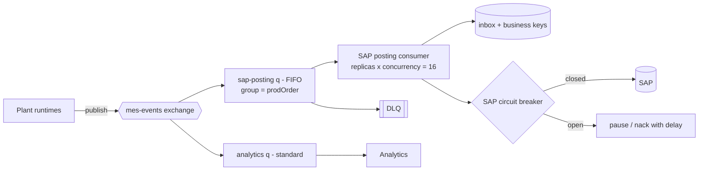

# 14.2 — Scenario 2: High-Volume Messaging, Duplicate Events and Backlog Recovery

**Label:** Representative senior-level scenario.

## The question
> "Your plants publish production and inventory events through Anypoint MQ, about 200 events per second at shift change. Consumers update SAP. Last week SAP was down for 2 hours. When it came back, the queue had 1.4 million messages, consumers caused duplicate goods receipts, and SAP got overloaded again during the catch-up. Redesign this."

## Evaluation criteria
| Criterion | What good looks like |
|-----------|---------------------|
| Duplicate root causes | Explains at-least-once delivery, redelivery after ack timeout, producer resends |
| Idempotency | Durable inbox + business keys + SAP-side checks |
| Backlog recovery | Controlled drain rate, prioritisation, coalescing |
| Protection of SAP | Concurrency limits, circuit breaker, rate shaping |
| Capacity reasoning | Numbers: arrival rate, drain rate, catch-up time |
| Ops | Metrics, alerts, runbook |

## Clarifying questions
1. Are all events equally important? (Production completion → GR is critical. Operation progress may be informational.)
2. Does SAP need every event, or only the latest state per production order/material?
3. What's SAP's safe sustained posting rate for goods movements? (Ask Basis, e.g. 40/s.)
4. Ordering requirements per production order?
5. How long may postings lag before the business is hurt (e.g. ATP accuracy)?

## Requirements (assumed)
- Peak 200 events/s, of which 30/s need SAP postings. The rest go to analytics.
- SAP safe rate: 40 postings/s sustained.
- Per-production-order ordering is required. Duplicates are unacceptable for GR/GI.

## Architecture



## Solution
1. **Split by purpose:** analytics events and SAP-posting events go to different queues (exchange fan-out). Analytics doesn't compete with SAP postings, and SAP consumers only see what SAP needs.
2. **Idempotency for postings:**
   - Inbox on `eventId` (durable DB, not in-memory).
   - Business key per posting: `(prodOrder, operation, confirmationCounter)` for confirmations, `(prodOrder, batch)` for GR.
   - Lookup in SAP before posting if the previous attempt's outcome is unknown.
3. **Ordering:** FIFO queue with **message group = production order**. Parallelism comes from many groups, while each production order's events stay in order.
4. **Protect SAP:** consumer concurrency sized to SAP's safe rate (16 concurrent × ~0.4 s per posting ≈ 40/s). A **circuit breaker** stops consumption when SAP errors spike (stop the subscriber / nack with delay), so messages wait in the queue rather than hammering SAP.
5. **Backlog recovery plan:**
   - Catch-up maths: backlog 1.4M (of which ~216k are SAP postings: 30/s × 7,200 s). Drain at 40/s with 30/s new arrivals, so the net drain is 10/s and catch-up takes **~6 hours**. Too slow? Then:
   - **Coalesce:** for progress events, only the latest per production order matters, so skip superseded ones (version check). That can shrink the backlog by more than 70%.
   - **Prioritise:** GR/GI first, informational confirmations later (separate queues or a priority attribute).
   - **Temporarily raise the SAP rate** with Basis approval during off-peak (e.g. 80/s at night).
6. **Producer side:** the plant runtimes buffer locally during outages, so the cloud queue isn't the only buffer, and they track published offsets to avoid resending on reconnect.
7. **Duplicates during catch-up came from:** consumer processing time > ack timeout under SAP slowness, causing redelivery. Fix: ack timeout > p99 processing time, plus claiming the business key before posting.

## Mule configuration highlights
```xml
<flow name="sap-posting-consumer-flow" maxConcurrency="8">
  <anypoint-mq:subscriber config-ref="MQ_Config" destination="${mq.q.sapPosting}" acknowledgementMode="MANUAL"
                          acknowledgementTimeout="120" acknowledgementTimeoutUnit="SECONDS"/>
  <flow-ref name="check-circuit-breaker-subflow"/>     <!-- raises AIM:CIRCUIT_OPEN -->
  <flow-ref name="inbox-and-business-key-claim-subflow"/>
  <flow-ref name="post-to-sap-flow"/>
  <anypoint-mq:ack ackToken="#[attributes.ackToken]"/>
  <error-handler>
    <on-error-continue type="AIM:DUPLICATE">
      <anypoint-mq:ack ackToken="#[attributes.ackToken]"/>
    </on-error-continue>
    <on-error-continue type="AIM:CIRCUIT_OPEN, AIM:SAP_UNAVAILABLE">
      <anypoint-mq:nack ackToken="#[attributes.ackToken]"/>
    </on-error-continue>
  </error-handler>
</flow>
```
*(Attribute names for the ack timeout vary by connector version.)*

## Observability
- Queue depth, **oldest message age**, publish vs consume rate, redelivery rate, DLQ depth.
- SAP posting latency and error rate. Breaker state changes.
- Business: "GR lag" = now − production completion time of the oldest unposted GR.
- Alerts: age > 15 min (P2), redelivery > 2%, any DLQ message for GR.

## Security
Per-plant MQ client credentials (a compromised plant can't publish to other plants' destinations). Event payloads contain no PII. The SAP technical user is limited to goods-movement BAPIs.

## Alternatives
- **Kafka** for the MES stream (high-volume, replayable, partitioned by production order). Anypoint MQ stays for business commands.
- **Batch posting**: aggregate GRs per minute into bulk SAP calls (fewer calls, more latency).

## Common mistakes
- Scaling consumers up after an outage ("drain faster"), which overloads SAP again.
- In-memory dedupe on restartable replicas.
- One queue for everything, so analytics noise delays critical postings.
- No catch-up time estimate. The business needs an ETA.

## Follow-up questions
1. *"How do you choose the ack timeout?"* → Above p99 processing time under degraded conditions, plus margin. Measure it.
2. *"A poison message blocks a FIFO group. What then?"* → Max deliveries, then the DLQ. Decide whether to park the group. Alert immediately.
3. *"How do you know you lost no events?"* → Producer-side sequence numbers per plant, gap detection, and reconciliation of production confirmations vs GR quantities.
4. *"Exactly-once with Kafka?"* → Kafka transactions give exactly-once within Kafka. SAP postings still need idempotency.

## Two-minute model answer
> "Three problems: duplicates, uncontrolled catch-up, and noisy mixing of event types. I'd split the stream with an exchange, so analytics events go to their own queue and SAP only sees postings. For duplicates, every posting gets a durable inbox check plus a business key such as production order and batch, and the ack timeout is set above the worst-case processing time so slow SAP calls don't trigger redelivery. Ordering per production order comes from a FIFO queue with message groups. To protect SAP, consumer concurrency is sized to SAP's safe rate, and a circuit breaker pauses consumption during outages so messages wait in the queue. For recovery, I estimate the catch-up time, coalesce superseded progress events, prioritise goods movements, and with Basis approval raise the rate off-peak. Monitoring is on queue age, redeliveries and GR lag."

## Five-minute structure
1. Diagnose last week's failure modes (1 min). 2. Split streams + ordering (1 min). 3. Idempotency layers (1 min). 4. Capacity maths + drain strategy (1 min). 5. Observability, security, alternatives (1 min).

## Rubric (0–3 each, 15 max)
| Criterion | 3-point answer includes |
|-----------|-------------------------|
| Duplicate causes | Ack timeout redelivery + producer resends + replay |
| Idempotency | Durable inbox + business key + SAP lookup |
| Recovery | Drain-rate maths + coalescing + prioritisation |
| SAP protection | Bounded concurrency + breaker + Basis coordination |
| Operability | Age-based alerts, GR lag, DLQ policy |
