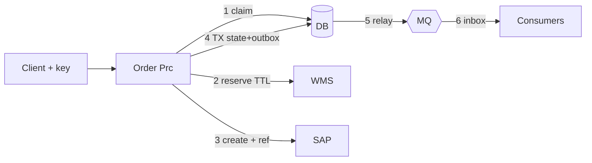

# 14.3 — Scenario 3: Reliable Order Processing Across SAP, a Database, a Message Broker and a Warehouse

**Label:** Representative senior-level scenario.

## The question
> "Design a Mule integration that takes a customer order, reserves stock in the WMS, creates the order in SAP, stores integration state in a database and publishes an event for downstream systems. Explain how you guarantee no lost orders, no duplicates, and consistent state, given that none of these systems share a transaction."

## Evaluation criteria
| Criterion | Strong answer |
|-----------|---------------|
| States the problem precisely | Dual writes, no 2PC across HTTP/SAP/MQ, partial failures |
| Ordering of steps | Justified order: claim → validate → reserve → SAP → TX(state + outbox) → respond |
| Atomicity where possible | A local DB transaction for state + outbox + idempotency |
| Saga thinking | Compensation for definitive failures, forward recovery for unknown outcomes |
| Delivery guarantees | At-least-once + idempotent consumers. Honest about exactly-once |
| Recovery tooling | Reconciliation, DLQ, replay |

## Clarifying questions
1. Must the caller receive the SAP number synchronously?
2. Is partial fulfilment allowed? What if stock is short?
3. Who is the source of truth for reservations: WMS or SAP?
4. What downstream systems consume the event, and what latency do they need?
5. Volume and peak? (This affects load levelling.)

## Architecture
See the full flow in [08.1](../08-reliability-transactions/01-end-to-end-order-flow.md) and the sequence in [02.6](../02-architecture/06-order-to-fulfilment-sequence.md).

## Solution walkthrough
1. **Persist intent before side effects:** the idempotency claim row (`IN_PROGRESS`) gives a durable trace from the first millisecond.
2. **Reserve with a TTL:** prevents overselling, and self-heals if the saga dies.
3. **SAP create with a business reference:** a timeout → lookup. Success → continue. Definitive error → **compensate** the reservation. Unknown → PENDING_ERP (keep the reservation).
4. **One local transaction:** `order_state` + `outbox_event`(s) + idempotency COMPLETED. This is the **commit point** of the saga from Mule's perspective.
5. **Respond after the commit** (persist-then-respond).
6. **Relay** publishes at-least-once. **Consumers** use an inbox + business keys.
7. **Safety nets:** reservation TTL, the PENDING_ERP retry consumer, a stale IN_PROGRESS sweeper, reconciliation (Mule vs SAP vs WMS), DLQ + replay.

### Failure-by-failure table
| Crash/failure point | State left | Recovery |
|--------------------|------------|----------|
| After claim, before reserve | Key IN_PROGRESS | Client retry → stale key takeover → continue |
| After reserve, before SAP | Reservation | TTL expiry, or the retry re-reserves idempotently (same orderId) |
| SAP definitive error | Reservation | Compensation (queued if it fails) |
| SAP timeout | Reservation + maybe an SAP order | Lookup → continue or PENDING_ERP |
| After SAP, before the DB TX | SAP order, key IN_PROGRESS | Retry → lookup finds the SAP order → complete. Nightly recon finds orphans |
| After the DB TX, before the response | All committed | Client retry → stored response replayed |
| Relay crash after publish | Duplicate publish | Consumer inbox |
| Consumer failure | Message redelivered | Idempotent consumer. DLQ after N |

## Mule configuration highlights
- `try transactionalAction="ALWAYS_BEGIN"` around three DB operations on the same config.
- `scatter-gather` for the validations.
- A `try` with `on-error-continue type="HTTP:TIMEOUT"` around the SAP call.
- A scheduler-based relay with `maxConcurrency="1"` (or `SKIP LOCKED`).
- Implemented in the mini project: [`prc-order-management.xml`](../mule-project/aim-order-integration/src/main/mule/prc-order-management.xml), [`outbox-publisher.xml`](../mule-project/aim-order-integration/src/main/mule/outbox-publisher.xml), [`event-consumers.xml`](../mule-project/aim-order-integration/src/main/mule/event-consumers.xml).

## Security & observability
- Client auth at the gateway. Internal client IDs between layers.
- An order timeline view from `audit_log` + correlation ID. Metrics: outbox age, PENDING_ERP, compensation failures, recon diffs.

## Alternatives
| Alternative | When |
|-------------|------|
| SAP as the reservation owner (no WMS reservation in the sync path) | If the WMS reservation isn't required before SAP confirms |
| Fully async intake | Very high volume. SAP often unavailable |
| CDC-based relay (Debezium) | Lower latency, more infrastructure |
| XA (DB + JMS) | Only for XA-capable resources on-prem. Doesn't cover SAP/HTTP |

## Common mistakes
- Publishing to MQ inside the flow without an outbox ("it rarely fails").
- Wrapping HTTP calls in a DB transaction and believing they roll back.
- Compensating on timeouts.
- Claiming "exactly-once delivery".
- No reconciliation ("our design is reliable").

## Follow-up questions
1. *"Why reserve before SAP rather than after?"* → It prevents a race in which SAP confirms stock that another order takes. The trade-off is orphaned reservations (mitigated by the TTL).
2. *"The DB is down: do you still create SAP orders?"* → No. Fail closed (503). Without durable state we can't guarantee idempotency.
3. *"How do you test this?"* → MUnit per branch, chaos tests killing replicas at each step, recon in SIT.
4. *"How would this look with Kafka?"* → The outbox relays to a Kafka topic (key = orderId). Consumers commit offsets after processing. Idempotency is still required.

## Two-minute model answer
> "Since SAP, the WMS, the database and the broker can't share a transaction, I treat this as a saga with one local transaction as its commit point. I first claim the idempotency key in the database, so every request is durable and duplicates are detectable. Then I reserve stock with a TTL and create the SAP order carrying our reference. A definitive SAP error triggers compensation to release the reservation. A timeout triggers a lookup by reference, and if it's still unknown the order goes PENDING_ERP for a retry consumer. Then, in one local DB transaction, I write the order state, the outbox events and the idempotency completion, and only then respond. A relay publishes the outbox at-least-once, and consumers dedupe with an inbox and business keys. TTLs, sweepers and reconciliation catch anything left in between. That gives no lost orders and no duplicates, with eventual consistency across systems."

## Five-minute structure
1. Problem framing: dual writes, no 2PC (45 s). 2. Step order and why (1 min). 3. Failure table walkthrough (1.5 min). 4. Delivery guarantees and consumers (1 min). 5. Recon, monitoring, alternatives (45 s).

## Rubric (0–3 each, 18 max)
| Criterion | 3-point answer |
|-----------|----------------|
| Framing | Names dual-write and no-2PC explicitly |
| Step order | Justifies reserve-before-SAP and persist-then-respond |
| Local TX + outbox | Correctly scoped |
| Saga | Distinguishes compensate vs forward recovery |
| Consumers | Inbox + business key. Honest guarantees |
| Safety nets | TTL + sweeper + recon + DLQ/replay |
**14+ strong. 10–13 solid.**
