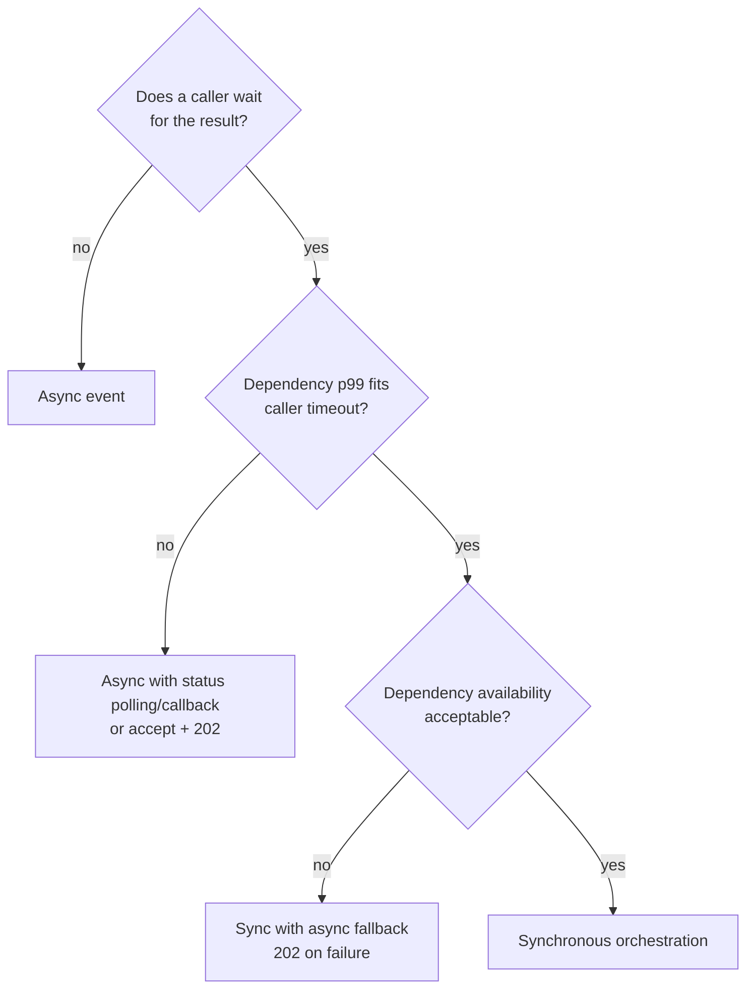

# 14.4 — Scenario 4: Synchronous Orchestration vs Asynchronous Event-Driven Processing

**Label:** Representative senior-level scenario.

## The question
> "For the manufacturing order-to-delivery process, which parts would you implement as synchronous API orchestration and which as asynchronous, event-driven processing? Defend your choices, and tell me what would make you change them."

## Evaluation criteria
- Uses **explicit decision criteria**, not preference.
- Maps criteria to **concrete process steps**.
- Explains the **costs** of async: eventual consistency, observability, idempotency.
- Recognises **hybrids** (sync with async fallback).
- States the **triggers for changing** the decision.

## Clarifying questions
1. Who waits for the response: a human, a system, or nobody?
2. What are the dependency latencies and availability (SAP, WMS, carriers)?
3. Volume shape: steady or bursty (quarter-end)?
4. Must several systems react to the same business fact?
5. What consistency does the business tolerate (seconds, minutes, hours)?

## Decision framework

| Criterion | Favours sync | Favours async |
|-----------|-------------|---------------|
| Caller needs the answer to proceed | ✔ | |
| Dependency latency fits the caller's timeout at p99 | ✔ | |
| Dependency availability is high | ✔ | |
| Long-running (minutes or days), human or physical steps | | ✔ |
| Several consumers of the same fact | | ✔ |
| Bursty load vs limited downstream capacity | | ✔ (load levelling) |
| Partner callbacks / webhooks | | ✔ |
| Strong read-your-writes expectation | ✔ | |
| Strict ordering across many entities | Simpler sync | Async needs partitioning |

## Applying it to AIM

| Step | Choice | Reasoning |
|------|--------|-----------|
| Order submission + validation + availability + reservation + SAP order | **Sync, with async fallback** | The rep waits. SAP p99 (3 s) fits the 15 s budget. Fallback to 202 when SAP is slow or down |
| Order status → Salesforce, analytics, notifications | **Async (pub/sub)** | Several consumers. Nobody waits |
| Shortage → procurement | **Async** | Business-day timescale. Supplier rate limits |
| MTO → production | **Async** | Long-running. Plant-local resilience |
| Supplier confirmations, ASNs | **Async (webhook → queue)** | Partner-initiated. Order handled by version |
| Dispatch → carrier booking | **Async consumer with a sync call inside** | Triggered by an event. The booking needs an immediate tracking number |
| Tracking / POD | **Async (webhooks)** | Carrier-driven |
| Invoice | **Async** | Downstream of POD |
| Availability for portal browsing | **Sync with cache** | Users wait. Approximate data is fine |

## Costs of async (say these, because they show maturity)
- **Eventual consistency:** UIs must show intermediate states ("Pending ERP", "Awaiting supply").
- **Idempotency everywhere:** at-least-once delivery.
- **Observability:** you need correlation IDs across queues, queue-age metrics and DLQs.
- **Debugging:** a flow spans time and components, so you need tracing and an order timeline.
- **Ordering:** needs FIFO/partitioning or version checks.

## Costs of sync
- **Temporal coupling:** availability is the product of the chain's availabilities (0.999 × 0.995 × 0.99 ≈ 98.4%).
- **Latency adds up** across hops. Retry storms under stress.
- **Capacity coupling:** bursts propagate directly to SAP.

## What would make me change the decision
| Trigger | Change |
|---------|--------|
| Order volume ×5 or SAP capacity limits | Async intake (always 202) with a status API/callback |
| Sales accepts "pending" orders | Simplify to async. Removes the SAP dependency from the UX |
| SAP S/4HANA Cloud with event APIs | Consume SAP business events instead of polling or callbacks |
| Partner offers sync confirmation APIs | Still async for resilience, but with faster SLAs |

## Mule implementation notes
- Sync: HTTP listener → APIkit → flows, with strict `responseTimeout`s and scatter-gather.
- Async: outbox → Anypoint MQ exchange → subscriber flows with MANUAL ack, inbox, DLQ.
- Hybrid: a `try` around the SAP call. Fallback writes PENDING_ERP + outbox and returns 202.

## Common mistakes
- "Async is always better": ignoring the UX need and the complexity cost.
- Async in name only: a consumer that synchronously calls five systems in sequence with no idempotency.
- Sync chains with 5+ hops and default timeouts.
- No status API for async requests, so the caller polls blindly or never learns the result.

## Follow-up questions
1. *"How does the client learn the outcome of a 202?"* → Status endpoint (`GET /orders/{id}`), a callback/webhook to Salesforce, or Salesforce reading a Platform Event we publish.
2. *"Isn't the hybrid complex?"* → Yes. It's justified only because both modes are needed: an immediate SAP number normally, resilience during outages. It's documented in an ADR.
3. *"How do you test async flows end to end?"* → Await-style assertions (poll the status until the expected state or a timeout), correlation-based log assertions, and queue inspection in SIT.

## Two-minute model answer
> "I decide with explicit criteria: does someone wait for the result, does the dependency's p99 fit the caller's timeout, is it available enough, and are there multiple consumers or long-running steps? For AIM, order submission through SAP order creation is synchronous, because the sales rep needs the SAP number and SAP normally answers within the budget. I add an async fallback, a 202 with a pending status, for when SAP is slow or down. Everything after confirmation is event-driven: status sync, procurement, production, carrier booking, invoicing. Those steps have multiple consumers, long durations or partner callbacks. Async costs us eventual consistency, idempotency work and more observability, which I plan for explicitly. I'd move intake to fully async if volumes outgrow SAP capacity or the business accepts pending orders."

## Rubric (0–3 each, 15 max)
| Criterion | 3-point answer |
|-----------|----------------|
| Criteria explicit | 4+ criteria, applied consistently |
| Step mapping | Correct classification, including the hybrid and "sync call inside an async consumer" |
| Async costs | Consistency, idempotency, observability, ordering |
| Sync costs | Availability product, latency, capacity coupling |
| Change triggers | Concrete triggers tied to business or tech changes |
