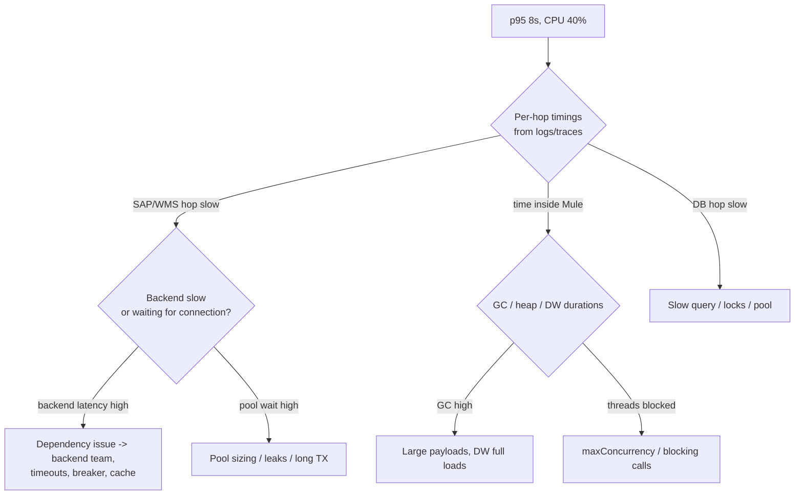

# 14.5 — Scenario 5: Production Performance Degradation (DataWeave, Connection Pools, Concurrency, Scaling)

**Label:** Representative senior-level scenario.

## The question
> "Since Monday, the order Process API's p95 has gone from 1.5 s to 8 s during business hours, with occasional 503s. Nothing was deployed this week. CPU is around 40%. The team wants to add two more replicas. What do you do?"

## Evaluation criteria
- Doesn't jump to scaling. Asks **what changed** (volume, data, dependencies, config).
- Uses **per-hop latency** and **saturation** metrics, not just CPU.
- Knows Mule-specific bottlenecks: requester pools, DB pools, `maxConcurrency`, DataWeave on large payloads, GC.
- Proposes measured, reversible mitigations, then a root-cause fix.
- Explains why replicas could make it **worse** (more DB connections, more pressure on SAP).

## Clarifying questions
1. Did the volume or payload size change? (A new big customer with 150-line orders?)
2. Did any dependency change: an SAP patch, a WMS release, a Salesforce release?
3. Is the degradation uniform, or specific to some customers or materials?
4. Are the 503s ours (fail-fast pools) or forwarded from downstream?
5. What do heap/GC and thread metrics show?

## Diagnostic plan

## A worked root cause (one plausible story)
1. **Signals:** per-hop logging shows the SAP Sys call itself unchanged (~1.1 s), but **time to acquire a connection** rose to ~5 s. The HTTP requester `maxConnections=20` is saturated. GC time is high every few minutes (heap saw-tooth with long pauses).
2. **What changed:** since Monday, a large distributor sends orders with 150–200 lines (previously 8 on average). For these orders:
   - The availability payload is large. A DataWeave allocation step uses a nested `filter` lookup (O(n²)) and is called twice per request. That adds CPU spikes and GC pressure (overall CPU still looks moderate, averaged across replicas and time).
   - The SAP call for a 200-line order takes 4–5 s, and it holds a requester connection 4× longer. **Pool saturation** follows (Little's Law: the same throughput × 4× latency = 4× concurrency).
3. **Why more replicas could hurt:** each replica opens more SAP connections. The SAP RFC limit is already close, and DB connections increase. It might mask the issue briefly but risks SAP-side exhaustion.

## Mitigation (same day)
- Separate requester configs (bulkhead) for large orders, or route orders with more than 50 lines to an **async path** (202 + queue), so they can't starve normal orders.
- Increase the SAP connection pool **only** within the agreed SAP limits.
- Hot-fix the DataWeave lookup (indexed `groupBy`).

## Permanent fix
- DataWeave: index once, single pass. Golden tests with 200-line orders.
- SAP: split very large orders into chunked item additions, or create them asynchronously.
- Capacity model updated with a **line-count distribution**, not just orders per second.
- Performance test suite gets the large-order profile.

## Monitoring to add
- Latency by **payload size bucket** (lines 1–10, 11–50, 51+).
- Connection-acquisition time for HTTP/DB pools.
- GC pause time alerts. DataWeave step durations for heavy transforms.

## Relevant Mule configuration knobs
| Knob | Where |
|------|-------|
| `maxConnections` | `http:request-connection` |
| `responseTimeout` | `http:request` |
| `maxConcurrency` | Flow (bulkhead for the large-order flow) |
| `maxPoolSize`, `maxWait` | DB pooling profile |
| Streaming strategy | Connector operation / source |
| Replica size / count | Runtime Manager |

## Common mistakes
- "CPU is 40%, so it's not us." Pools and GC saturate long before CPU does.
- Scaling first without a hypothesis.
- Increasing timeouts, which hides the problem and worsens thread holding.
- Ignoring the payload-size distribution.

## Follow-up questions
1. *"How do you get per-hop timings without tracing?"* → Log start/end around each outbound call with `durationMs`, plus correlation ID, in a structured format, and aggregate in the log platform.
2. *"How do you detect connection-pool waits in Mule?"* → Timeouts like "waiting for idle object" (DB), latency rising while backend-side latency stays flat, runtime/JMX metrics where available.
3. *"When is vertical scaling the right answer?"* → When heap/CPU per request is the constraint (heavy DW, batch) and the code is already efficient.

## Two-minute model answer
> "I wouldn't add replicas before understanding the bottleneck, because with SAP connection limits more replicas can make it worse. I'd first ask what changed. Nothing was deployed, so I'd look at volume, payload shapes and dependencies. Then I'd break the latency down per hop and check saturation, not CPU: requester and DB pool waits, GC pauses and thread usage. In a case like this the SAP call itself might be normal, but much larger orders hold connections longer and a DataWeave lookup goes quadratic on 200-line orders. That causes pool saturation and GC pressure. Same-day mitigation: a bulkhead or async path for very large orders and an indexed DataWeave lookup. Then the permanent fix: chunking for large SAP orders, a capacity model by line count, perf tests with the new profile, and monitoring by payload size."

## Rubric (0–3 each, 15 max)
| Criterion | 3-point answer |
|-----------|----------------|
| Doesn't jump to scaling | Explains why scaling can hurt |
| What-changed analysis | Volume/data/dependency/config |
| Mule-specific bottlenecks | Pools, maxConcurrency, DW, GC, streaming |
| Mitigation vs fix | Reversible same-day steps + permanent design fix |
| Monitoring | Size-bucketed latency, pool waits, GC |
