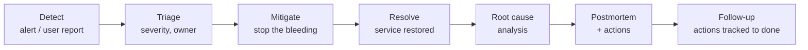

# 15.4 — Production Incident Management, Root-Cause Analysis and Release Readiness

`Essential`

## 1. Incident roles (even in small teams)

| Role | Responsibility |
|------|----------------|
| **Incident commander** (often the senior dev on call or the integration lead) | Coordinates, decides, keeps focus. Doesn't debug alone |
| **Technical lead(s)** | Investigate and mitigate |
| **Communications** | Stakeholder updates on a cadence |
| **Scribe** | Timeline of actions and findings (feeds the postmortem) |

## 2. Incident lifecycle

## 3. Root-cause analysis techniques

**5 Whys (example: duplicate POs)**
1. Why were duplicate POs created? The consumer retried the PO creation after a timeout.
2. Why did a retry create a new PO? There was no lookup of existing POs by business key.
3. Why was there no lookup? The design assumed timeouts meant failure.
4. Why wasn't that caught? There was no test or chaos case for "SAP commits but responds late".
5. Why no such test? The test strategy covered only error responses, not latency-induced unknown outcomes.

**Root cause:** the design and test strategy lacked unknown-outcome handling. **Contributing factors:** SAP slowness at month-end, ack timeout < processing time.

**Fishbone categories for integrations:** Code · Configuration · Data · Dependencies (backends/partners) · Infrastructure/network · Process (release, change, monitoring).

## 4. Release readiness (go/no-go)

| Area | Ready when |
|------|-----------|
| Functionality | UAT signed off. Known defects accepted by the PO |
| Quality | MUnit/SIT/regression green. Performance results within NFRs |
| Security | Checklist complete. Pen-test findings resolved or accepted |
| Operations | Runbooks, dashboards and alerts in place. Support trained |
| Deployment | Pipeline tested. Rollback tested in QA. Config/secrets in PROD verified |
| Dependencies | Partners ready (certs exchanged, endpoints whitelisted). SAP transports in PROD |
| Business | Cut-over plan agreed. Communication sent. Hypercare roster set |

Go/no-go meeting: each owner states ✅/❌. Any ❌ needs an explicit risk acceptance from the accountable person, or the release is delayed.

## 5. Production support model

| Tier | Who | Scope |
|------|-----|-------|
| L1 | Service desk | Ticket intake, known-error workarounds |
| L2 | Integration support | Runbooks, replays, restarts, first diagnosis |
| L3 | Integration developers (senior on-call rotation) | Code/config fixes, complex RCA |
| Vendor | MuleSoft support, WMS/SAP vendors | Platform/product defects |

**MuleSoft support tickets:** include the runtime version, deployment target, app name, timestamps (UTC), correlation IDs, logs, and steps already taken. Good tickets get faster answers.

Templates: incident report & postmortem → [16.5](../16-project-documents/05-incident-postmortem.md). Cut-over plan → [16.4](../16-project-documents/04-operations-documents.md).

Next section: [16 — Project documents](../16-project-documents/01-requirements-and-design-docs.md)
