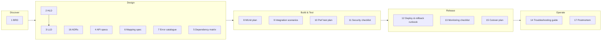

# 16.1 — Requirements and Design Documents: BRD, HLD, LLD, ADRs

`Essential` · Covers documents **1 (BRD), 2 (HLD), 3 (LLD) and 16 (ADRs)** of the 17 required.

## Where each document fits in the delivery lifecycle



| # | Document | Owner | Approvers | When it's used |
|---|----------|-------|-----------|----------------|
| 1 | BRD | Business analyst | Business owner | Scope baseline. Acceptance criteria |
| 2 | HLD | Integration architect / senior dev | Architecture board | Design review, estimates, security review |
| 3 | LLD | Senior dev | Tech lead | Build reference. Code review baseline |
| 16 | ADR | Whoever makes the decision | Deciders | Whenever a significant decision is made |

---

## 1. Business Requirements Document (BRD) — condensed example

```markdown
# BRD: Automated Order-to-Fulfilment Integration (AIM)   v1.2   2026-08-10
## 1. Business objective
Eliminate manual order re-keying from Salesforce into SAP; provide real-time order status;
automate shortage procurement. KPIs: order entry lead time < 5 min (from 4–6 h);
oversell incidents -80%; duplicate POs = 0.
## 2. Scope
In: Salesforce + B2B portal orders, SAP SD/MM/PP, WMS, SupplierHub (REST/SFTP), FreightLink.
Out (phase 2): EDI suppliers, returns (RMA), intercompany orders.
## 3. Stakeholders
Sales Ops (owner), Procurement, Warehouse Ops, Finance, Customer Service, IT Integration.
## 4. Business process (as-is / to-be)
To-be flow: see process diagram (O2C + P2P). Manual steps eliminated: 3; new exception queue: 1.
## 5. Business requirements
BR-01 Orders submitted in Salesforce create SAP orders automatically.        Priority: Must
BR-02 Sales reps see SAP order number or a 'pending' status within 1 minute.  Must
BR-03 Shortages raise purchase requisitions without manual intervention.     Must
BR-04 No duplicate orders/POs/invoices under any retry or failure.            Must
...
## 6. Business rules
- Partial deliveries allowed only if customer master flag = Y (SAP).
- Credit-blocked customers: order rejected with reason; credit team notified.
## 7. Assumptions & constraints
SAP remains system of record for orders, prices, inventory valuation.
## 8. Acceptance criteria
UAT scenarios UAT-01..UAT-25 signed by Sales Ops, Procurement, Warehouse.
```
**How to use it:** every functional requirement in [01.3](../01-business-domain/03-requirements.md) traces back to a BR. Design and test scenarios reference BR IDs. That's **traceability**.

---

## 2. High-Level Design (HLD) — table of contents + key content

```markdown
# HLD: AIM Integration Platform – Order to Fulfilment   v1.0
1. Context & scope (system context diagram)                         → 02.1
2. Architecture overview (API-led layers, event backbone)           → 02.2, 02.3
3. Integration inventory (each interface: source, target, pattern,
   sync/async, volume, SLA)                                          → table below
4. Data & consistency (SoR per entity, transaction boundaries, saga) → 01.1 §4, 01.2
5. Non-functional design (performance, availability, DR)            → 01.3, 12.x
6. Security architecture                                            → 10.1
7. Deployment architecture & environments                           → 02.5, 11.1
8. Operations (monitoring, alerting, support model)                 → 11.4, 15.4
9. Risks, assumptions, open decisions (links to ADRs)
```

**Integration inventory (excerpt)**
| ID | Interface | Source → Target | Pattern | Mode | Volume/day | SLA |
|----|-----------|-----------------|---------|------|-----------|-----|
| INT-001 | Order submission | Salesforce → SAP (+WMS) | API-led orchestration + saga | Sync + async fallback | 15k (45k peak) | p95 ≤ 4 s |
| INT-002 | Order status sync | Mule → Salesforce | Pub/sub | Async | 60k events | ≤ 60 s |
| INT-003 | Shortage → PO | Mule → SAP → SupplierHub | Event-driven + idempotent receiver | Async | 2k | ≤ 15 min |
| INT-004 | Inventory snapshot | WMS → SAP | SFTP + Batch | Scheduled | 2M rows | by 03:00 |
| INT-005 | Carrier tracking | Carrier → Mule → SAP/SF | Webhook → queue | Async | 30k | ≤ 5 min |

---

## 3. Low-Level Design (LLD) — per API/app

```markdown
# LLD: order-mgmt-prc-api   v1.0
## 1. Responsibilities & non-responsibilities
## 2. Interfaces
   - Inbound: POST /orders, GET /orders/{id} (RAML link, Exchange asset v1.2.0)
   - Outbound: salesforce-sys-api, inventory-prc-api, sap-erp-sys-api (paths, timeouts)
   - Events published: order.confirmed, order.backordered, order.erp-pending, inventory.shortage-detected
## 3. Flow design
   - create-order-flow: steps 1–7 with sequence diagram (02.6)
   - Each sub-flow: purpose, inputs (vars), outputs, errors raised
## 4. Data design
   - Tables: idempotency_record, order_state, outbox_event, audit_log (DDL + indexes + retention)
## 5. Mappings: reference to mapping spec MAP-ORD-001..004
## 6. Error handling: error types → codes (catalogue ERR-ORD-*), retry policy table
## 7. Configuration: property keys per env, secure properties list
## 8. Security: inbound policy, outbound credentials, PII fields & masking
## 9. Logging & monitoring: log events, metrics, alerts
## 10. Testing: MUnit test list (T1–T10), SIT scenarios
## 11. Deployment: replicas, vCores, Private Space, dependencies
```

---

## 16. Architecture Decision Records — index example

| ADR | Title | Status |
|-----|-------|--------|
| ADR-001 | API-led layering with an explicit skip rule for pass-through Process APIs | Accepted |
| ADR-002 | Anypoint MQ (not Kafka) for business events. Revisit for MES telemetry | Accepted |
| ADR-003 | PostgreSQL for idempotency/state instead of Object Store | Accepted |
| ADR-004 | Sync order creation with async fallback (202 PENDING_ERP) | Accepted |
| ADR-005 | SAP BAPI via connector for create; OData for lookups | Accepted |
| ADR-006 | Hybrid runtime in plants for MES | Accepted |
| ADR-007 | Transactional outbox for order events | Accepted ([full text](../15-senior-responsibilities/01-role-and-delivery.md#4-architecture-decision-records-adrs)) |
| ADR-008 | WMS reservation with 30-min TTL before SAP creation | Accepted |
| ADR-009 | Version-based ordering for supplier confirmations | Proposed |

Next: [16.2 API & data specifications](02-api-and-data-specs.md)
