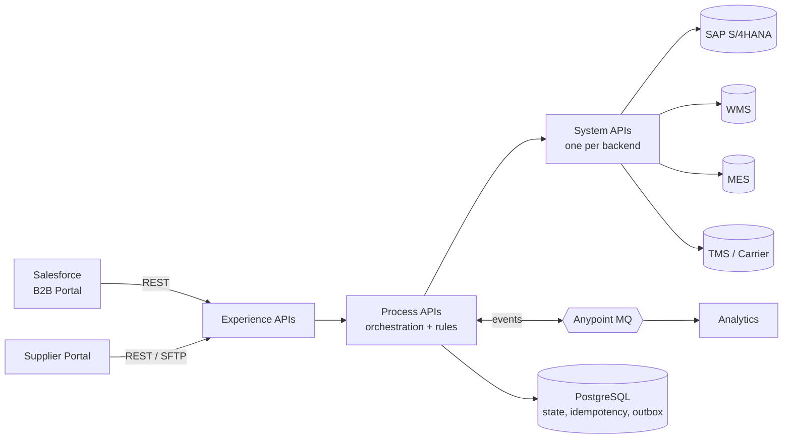

# Enterprise Manufacturing & Supply Chain Integration Platform Using MuleSoft

> **Senior MuleSoft Developer interview preparation kit.** It is built around one realistic, end-to-end *simulated* project for a fictional manufacturer, **Apex Industrial Manufacturing (AIM)**.

> **Honesty label.** This is a *simulated training project*. Every company name, volume, SLA and incident below is illustrative. In an interview, present it as "a reference architecture I designed and built to practise", or map the patterns to your own real projects. Never claim these numbers as production results.

---

## How to use this kit

1. Read **01 → 04** first. They cover the business, the architecture and the APIs, and they are the foundation for every interview answer.
2. Run the **mini project** in [`mule-project/aim-order-integration`](mule-project/aim-order-integration/README.md) while reading **05 → 08**. Every concept there exists in real code.
3. Use **13 → 17** to rehearse. Say the answers out loud and time them.
4. Track your progress with the **12-milestone roadmap** in [18-learning-roadmap](18-learning-roadmap/01-milestones-1-6.md).

Topic tags used throughout:
- `Essential`: expected of every senior MuleSoft developer.
- `Advanced`: architect-level depth that sets you apart.

---

## Folder index

| # | Folder | What you learn | Key files |
|---|--------|----------------|-----------|
| 01 | [business-domain](01-business-domain/) | AIM's business, order-to-cash and procure-to-pay flows, requirements | [scenario](01-business-domain/01-business-scenario.md), [process](01-business-domain/02-end-to-end-process.md), [requirements](01-business-domain/03-requirements.md) |
| 02 | [architecture](02-architecture/) | System context, API-led layers, components, deployment, primary sequence | [api-led](02-architecture/03-api-led-architecture.md), [order sequence](02-architecture/06-order-to-fulfilment-sequence.md) |
| 03 | [uml-diagrams](03-uml-diagrams/) | Diagrams 7–19: failure sequences, state machine, domain model, DLQ, CI/CD | [failure sequences](03-uml-diagrams/02-failure-recovery-sequences.md) |
| 04 | [api-design](04-api-design/) | API catalogue, RAML, error contract, versioning, dependency matrix | [catalogue](04-api-design/01-api-catalogue.md), [RAML](04-api-design/02-raml-specifications.md) |
| 05 | [dataweave](05-dataweave/) | DataWeave 2.0 with manufacturing payloads (SAP, supplier, UoM, currency) | [SAP mapping](05-dataweave/02-json-xml-and-sap-mapping.md) |
| 06 | [mule-implementation](06-mule-implementation/) | Dev setup, flows, error handling, DB, SAP/Salesforce, MQ, Batch | [error handling](06-mule-implementation/03-error-handling.md) |
| 07 | [integration-patterns](07-integration-patterns/) | All 35 patterns, each with a use case, config, trade-offs and an interview question | [reliability patterns](07-integration-patterns/04-reliability-patterns.md) |
| 08 | [reliability-transactions](08-reliability-transactions/) | End-to-end reliable order flow, outbox/inbox, saga, delivery guarantees | [order flow](08-reliability-transactions/01-end-to-end-order-flow.md) |
| 09 | [testing](09-testing/) | MUnit, mocking, contract, integration, load and smoke tests | [MUnit](09-testing/01-munit-unit-testing.md) |
| 10 | [security-governance](10-security-governance/) | OAuth2, JWT, mTLS, policies, secrets, PII, versioning | [security architecture](10-security-governance/01-security-architecture.md) |
| 11 | [deployment-cicd](11-deployment-cicd/) | CloudHub 2.0/1.0, RTF, hybrid, Maven, pipelines, release checklist | [pipelines](11-deployment-cicd/03-cicd-pipelines.md) |
| 12 | [performance](12-performance/) | Timeout budgets, retry storms, pools, DataWeave tuning, capacity, DR | [timeouts](12-performance/01-timeouts-retries-pools.md) |
| 13 | [production-troubleshooting](13-production-troubleshooting/) | A troubleshooting method plus 20 detailed incident scenarios | [method](13-production-troubleshooting/00-troubleshooting-method.md) |
| 14 | [interview-scenarios](14-interview-scenarios/) | 5 deep senior scenarios with 2-min/5-min answers and rubrics | [SAP timeout](14-interview-scenarios/01-sap-timeout-after-commit.md) |
| 15 | [senior-responsibilities](15-senior-responsibilities/) | Design reviews, ADRs, estimation, mentoring, difficult situations | [difficult situations](15-senior-responsibilities/03-difficult-situations.md) |
| 16 | [project-documents](16-project-documents/) | 17 enterprise delivery document templates | [design docs](16-project-documents/01-requirements-and-design-docs.md) |
| 17 | [mock-interviews](17-mock-interviews/) | 5-minute pitch, 15 core Q&As, 30 extra questions | [pitch](17-mock-interviews/01-five-minute-project-pitch.md) |
| 18 | [learning-roadmap](18-learning-roadmap/) | 12 milestones with exercises, assessments and readiness scores | [milestones 1–6](18-learning-roadmap/01-milestones-1-6.md) |
| — | [mule-project](mule-project/aim-order-integration/) | **Runnable Mule 4 project**: order intake → WMS → SAP → outbox → events | [project README](mule-project/aim-order-integration/README.md) |

---

## The project in one picture

Customers order **industrial pumps and valves**. MuleSoft handles the following:
- It validates each order and checks stock across warehouses.
- It creates the sales order in SAP and reserves stock in the WMS.
- When stock is short, it starts production (MES) or procurement (suppliers).
- It books shipments with carriers, confirms delivery and triggers invoicing.
- It keeps Salesforce updated throughout.

Each step is reliable, idempotent, auditable and observable.

---

## Version assumptions (verified October 2026)

| Item | Assumption used in this kit | Source |
|------|------------------------------|--------|
| Mule runtime | **4.9 LTS** (Java 17). The Edge channel is at 4.13 (Oct 2026). 4.6 LTS standard support ended Aug 2026 | [MuleSoft LTS/Edge cadence](https://docs.mulesoft.com/release-notes/mule-runtime/lts-edge-release-cadence) |
| Java | 17 (required for Mule 4.9+) | [Java support](https://docs.mulesoft.com/general/java-support) |
| Anypoint Studio | 7.2x | [Studio release notes](https://docs.mulesoft.com/release-notes/studio/anypoint-studio-7.26.0-release-notes) |
| Deployment | CloudHub 2.0 as the primary target. CloudHub 1.0 is still supported, with no end-of-life date announced | MuleSoft docs and partner migration guides |
| Anypoint MQ | Standard and FIFO queues, 10 MB max message, DLQ support, 10 in-flight messages per FIFO message group | [Anypoint MQ queues](https://docs.mulesoft.com/mq/mq-queues) |

Connector versions change frequently. Before you rely on any version-specific behaviour, check it in Anypoint Exchange.
