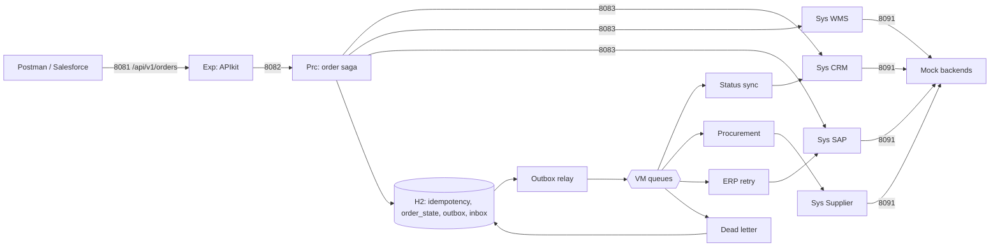

# aim-order-integration — Runnable Mule 4 Mini Project

A small but **realistic** slice of the AIM platform: customer order → validation → WMS reservation → SAP sales order → transactional outbox → asynchronous consumers (Salesforce status, procurement, ERP retry) → dead-letter + replay.

> **Training project.** SAP, WMS, Salesforce and SupplierHub are **simulated** by mock flows on port 8091, so the project runs on a laptop without licences. VM queues stand in for Anypoint MQ, and embedded H2 (PostgreSQL mode) stands in for PostgreSQL. Where a real connector differs, the XML comments say so.

## 1. What it demonstrates

| Concept | Where |
|---------|-------|
| API-led layers (Exp → Prc → Sys) with separate listeners/ports | `exp-customer-order-api.xml`, `prc-order-management.xml`, `sys-*.xml` |
| Contract-first API with APIkit (RAML, examples, traits) | `src/main/resources/api/` |
| Idempotency key: replay / 409 / 422 (DB unique constraint) | `prc-claim-idempotency-subflow` |
| Scatter-gather with per-route fallback (404 = business outcome) | `prc-process-new-order-flow` |
| DataWeave: allocation, BAPI mapping (ALPHA, UoM, EXTENSIONIN), RETURN table | `src/main/resources/dwl/` |
| Saga: compensation on **definitive** failure only | `prc-compensate-release-reservation-flow` |
| SAP timeout = **unknown outcome** → lookup by reference → 201 or 202 | `sys-sap-erp.xml` |
| Local transaction: order state + outbox + idempotency | `TX: order state + outbox + idempotency` |
| Outbox relay with content-based routing | `outbox-publisher.xml` |
| Idempotent receivers (inbox + business keys), retry with backoff, dead-letter | `event-consumers.xml` |
| Forward recovery (lookup-then-create) for PENDING_ERP | `erp-retry-consumer-flow` |
| Controlled replay keeping the original eventId | `ops-api.xml` |
| Global error handler → standard AIM error contract | `common-error-handler.xml`, `dwl/modules/aim/errors.dwl` |
| Bulkheads (one requester config per backend), explicit timeout budget | `global-config.xml`, `config-local.yaml` |
| MUnit: mocks by doc:name, error mocks, verify-call, real H2 | `src/test/munit/` |



## 2. Prerequisites

| Item | Version |
|------|---------|
| Anypoint Studio | 7.2x (with a Mule 4.9+ runtime; a newer Edge runtime also works) |
| JDK | 17 |
| Maven (optional, CLI builds) | 3.9.x |
| Postman (optional) | any recent |

Free ports needed: **8081, 8082, 8083, 8091**.

## 3. Import and run (Anypoint Studio)

1. **File → Import → Anypoint Studio → Anypoint Studio project from File System** and select this folder. Or use **Maven-based Mule project from pom.xml**.
2. If Studio offers newer connector versions or a different runtime, accept them. The versions in `pom.xml` were checked against MuleSoft's repository in October 2026.
3. Right-click the project → **Run As → Mule Application**.
4. Wait for `DEPLOYED` and the log line `Integration schema ready`.

CLI alternative: `mvn clean package -DskipTests`, then deploy the JAR from `target/` to a standalone Mule runtime.

## 4. Try the scenarios

Import `postman/aim-order-integration.postman_collection.json` and run the requests in order. Or use curl (PowerShell users: use `curl.exe`):

```bash
curl -i -X POST http://localhost:8081/api/v1/orders \
  -H "Content-Type: application/json" -H "Idempotency-Key: DEMO-0001" \
  -d '{"externalOrderId":"SF-1","sourceSystem":"SALESFORCE","customerId":"CUST-100234","customerPoNumber":"WU-PO-1","currency":"USD","requestedDeliveryDate":"2026-11-20","shipTo":{"name":"Riverside Water Utility","line1":"100 River Rd","city":"Austin","postalCode":"73301","country":"US"},"lines":[{"lineNumber":10,"materialNumber":"PMP-CF-200","quantity":5,"unitOfMeasure":"EA"}]}'
```

| # | Scenario | How to trigger | Expected |
|---|----------|----------------|----------|
| 1 | Happy path | Any active customer, `PMP-CF-200` ≤ 8 | `201 CONFIRMED` + SAP number. A few seconds later the log shows `STATUS_SYNCED` |
| 2 | Shortage | `VLV-BL-050` qty 40 (only 5 available) | `201 BACKORDERED`. Log shows `REQUISITION_CREATED` (procurement consumer) |
| 3 | Duplicate submit | Send the same request + same `Idempotency-Key` twice | Identical body, header `idempotent-replayed: true`, **one** SAP document |
| 4 | Key reuse | Same key, different body | `422 AIM-ORD-4221` |
| 5 | Blocked customer | `customerId: CUST-BLOCKED` | `422 AIM-ORD-4223`. No reservation, no SAP call |
| 6 | Unknown customer / material | `CUST-999` / `XYZ-UNKNOWN` | `422` with AIM code |
| 7 | **SAP commits, response times out** | `customerPoNumber` starts with `TIMEOUT-` | ~3 s timeout → lookup → `201` with `recoveredAfterSapTimeout: true`. `GET /mock/sap/sales-orders?externalRef={orderId}` shows `documentCount: 1` |
| 8 | **SAP down** | `customerPoNumber` starts with `SAPDOWN-` | `202 PENDING_ERP`. About 10 s later `GET /api/v1/orders/{id}` shows CONFIRMED (ERP retry did lookup-then-create) |
| 9 | SAP business rejection | `customerPoNumber` starts with `REJECT-` | `422 AIM-SAP-4225` with the SAP message, log shows `COMPENSATED reservation=...` |
| 10 | Schema violation | Remove `lines` or the `Idempotency-Key` header | `400` from APIkit, AIM error body |
| 11 | **DLQ + replay** | Order `MTR-7.5KW` (no stock → shortage → supplier 503) | After 3 attempts: `DEAD_LETTER` in the log. `GET :8082/prc/ops/v1/dead-letters`, then `POST :8091/mock/admin/supplier-outage/resolve`, then `POST :8082/prc/ops/v1/dead-letters/{id}/replay` → `REQUISITION_CREATED` |

Useful endpoints: `GET :8082/prc/ops/v1/outbox` (outbox status), `GET :8091/mock/sap/sales-orders?externalRef=...` (SAP documents per order).

## 5. Run the tests

- **Studio:** right-click `src/test/munit` → **Run MUnit suite**. Suites: `prc-order-management-test-suite.xml` (7 tests) and `sys-sap-erp-test-suite.xml` (4 tests).
- **Maven:** `mvn clean test`. Note that MUnit from the command line downloads a Mule runtime and may need **MuleSoft Enterprise repository credentials** in `~/.m2/settings.xml`. If you lack them, run the tests in Studio.

| Test | Proves |
|------|--------|
| T1 | Happy path, one SAP call, outbox event written |
| T2 | Allocation maths (35 backordered), shortage event |
| T3 | Duplicate request replays the stored response, SAP called once |
| T4 | Same key + different body is rejected |
| T5 | Blocked customer stops early, claim released for retry |
| T6 | SAP business error → compensation exactly once |
| T7 | SAP unknown → 202 PENDING_ERP, no compensation |
| S1 | BAPI mapping: ALPHA, UoM ST/KAR, item padding, reference |
| S2 | Timeout → lookup finds the order → 201 recovered, no blind retry |
| S3 | Timeout + failed lookup → 504 unknown |
| S4 | RETURN TYPE E → 422 with the SAP message |

## 6. From training project to production (what changes)

| Here | Production |
|------|------------|
| One app, four ports | One Mule app per API (Exp/Prc/Sys), deployed separately (CloudHub 2.0 Private Space) |
| Mock SAP over HTTP | SAP Connector (BAPI + `BAPI_TRANSACTION_COMMIT` on the same session), OData lookup on a custom reference field |
| VM queues + re-publish retries | Anypoint MQ exchanges/queues, MANUAL ack, native DLQ (max deliveries), delivery delay |
| H2 in memory | PostgreSQL: change `db.url`/`db.driver`, add the `org.postgresql:postgresql` dependency + sharedLibrary, run `schema.sql` through Flyway/Liquibase. Use `FOR UPDATE SKIP LOCKED` in the relay |
| Plain properties | Secure properties / vault for secrets, `-Denv=...` per environment |
| No gateway | API Manager: autodiscovery + JWT validation + rate limiting on the Exp API, client ID enforcement on Prc/Sys |
| Logs only | Structured JSON logs to the log platform, dashboards and alerts on DLQ, outbox age, PENDING_ERP |
| Ops API unprotected | Ops-only OAuth scope, audit of every replay, dry-run |

## 7. Known simplifications (be honest about these in interviews)
- Process→Process calls (Order → Inventory) are collapsed: Order Prc calls WMS Sys directly.
- Inbox rows are written *after* processing, which leaves a narrow duplicate window covered by natural idempotency (upsert, partner idempotency key). See study kit 08.3.
- No circuit breaker or rate limiting is implemented. The design for both is in study kit 07.7 and 10.3.
- The reservation TTL lives in the mock only. Nothing actually expires.
- Studio's console shows everything. Search for `ORDER_PROCESSED`, `SAP_TIMEOUT`, `OUTBOX_PUBLISHED`, `DEAD_LETTER`.

Study material: [../../README.md](../../README.md)
